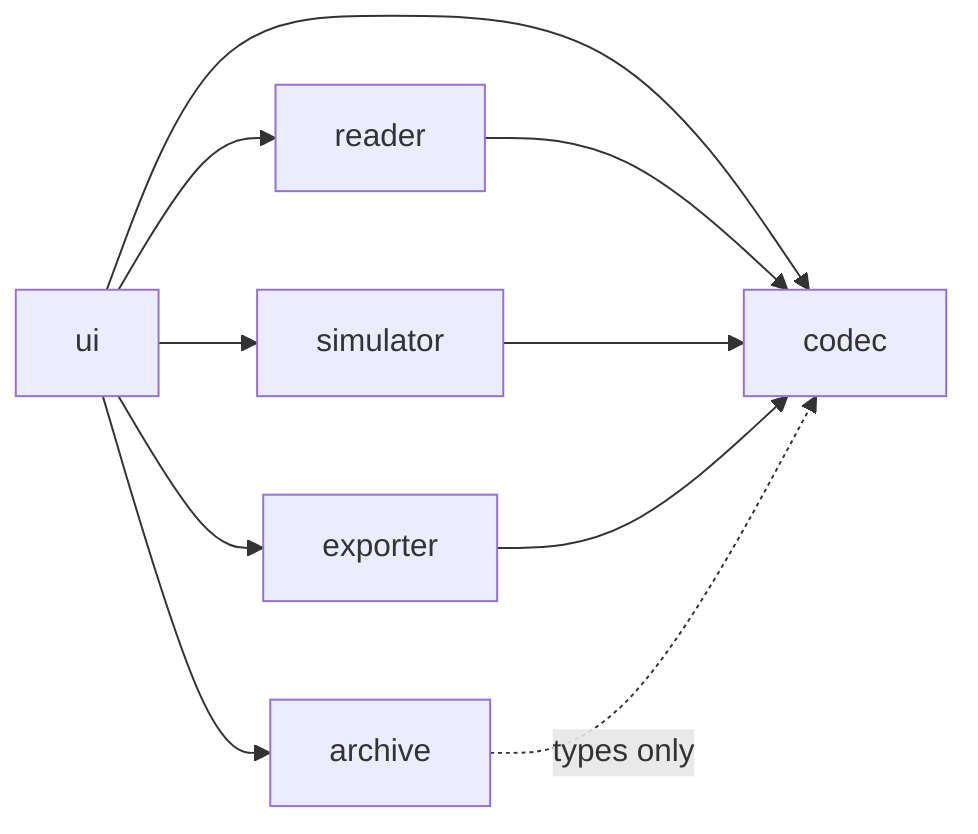
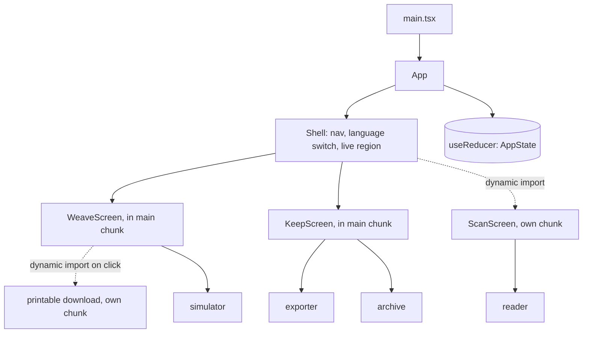

# Design Document

## Overview

The app composes the finished modules `src/codec`, `src/reader`, `src/simulator` and `src/exporter` into three screens (Weave, Keep, Scan) in `src/ui`, and adds the missing `src/archive` implementation that Keep depends on. It also adds a printable sample card, so a first-time visitor can print a card, photograph it and scan it.

Design decisions and their reasons:

| Decision | Reason |
|---|---|
| All state transitions are pure reducers and pure functions in `src/ui`. React components only render state and dispatch actions. | The steering rules require properties on pure functions. Component tests are limited to a few render-to-string examples. |
| No router. The Screen is a field of the app state. | The built site must work from a root or a sub-path (R23.3). With no URL routing there is nothing to rewrite on a static host. |
| `src/ui` keeps its new pure code in sub-folders (`samples/`, `printable/`, `i18n/`, `state/`, `profile/`), with one `src/ui/types.ts`. | `tech.md` allows one `types.ts` per module. A new top-level module would change the dependency rules in `structure.md`. |
| The Scan screen and the printable download are loaded with dynamic `import()`. | The initial load must stay under 200 KB gzipped (R16.1, R16.10). |
| Dependencies stay `react` and `react-dom`. No router, no i18n library, no PNG library, no test DOM library. | R16.2. A PNG library is not needed: the browser encodes the PNG and a pure function inserts the `pHYs` chunk. |
| The Scan_Batch lives in the app state, not in the Scan screen. | The Scan screen is lazy and unmounts on navigation. R1.4 asks for state to survive navigation, and a lost batch is lost work. |
| The Card_Profile is read once at start and passed down as a value. No component holds a card dimension. | `card-geometry.md` and R4.3, R21.3. |

Terms follow the weaving glossary: one card is one pick, a hole position is an end, a punched hole lifts the hook, and a pattern is a list of cards. The words "row" and "bitmap" are not used for a pick or a card in identifiers.

Research notes (summaries, not copied text):

- A PNG file stores its pixel density in an optional `pHYs` chunk, in pixels per metre, that must come before the first `IDAT` chunk. Its CRC covers the chunk type and data. A pure function can insert it into bytes that the browser produced. Source: [PNG specification, pHYs chunk](https://www.w3.org/TR/png-3/#11pHYs).
- Vite builds with an absolute `/` base by default. Setting `base: './'` makes asset URLs in the built `index.html` relative, so the site works from any sub-path. Source: [Vite, building for production, public base path](https://vite.dev/guide/build.html#public-base-path).
- Vercel detects a Vite project and uses `npm run build` and `dist`. A `vercel.json` states them explicitly. Source: [Vercel, Vite on Vercel](https://vercel.com/docs/frameworks/frontend/vite).
- Contrast ratio follows WCAG 2.x: relative luminance of each colour, then `(L1 + 0.05) / (L2 + 0.05)`. Source: [WCAG 2.2, contrast minimum](https://www.w3.org/TR/WCAG22/#contrast-minimum).

Content was rephrased for compliance with licensing restrictions.

## Architecture

### Module dependencies



Rules, checked by a source-scan test (R16.3, R16.4, R16.6, R6.9):

- `src/ui` imports other modules only from their `index.ts` (`'../codec/index.ts'` and so on) and never from `scripts/`.
- `src/archive` imports only types from `src/codec/index.ts`, and no `localStorage`.
- No module imports `src/ui`.
- `package.json` `dependencies` hold exactly `react` and `react-dom`. Adding another needs a recorded bundle-size evaluation in `docs/BUILD_LOG.md` first.
- Name clash: `src/reader` and `src/exporter` both export a type `ReadFailure`. `src/ui` imports them with aliases (`ReadFailure as CardReadFailure`, `ReadFailure as BmpReadFailure`).

### Runtime structure



### Source layout

```
src/archive/
  index.ts          saveDesign, getDesign, listDesigns, deleteDesign + types
  types.ts          Metadata, SavedDesign, DesignSummary, ArchiveFailure, ArchiveResult, ArchiveStore, ArchiveDeps
  designs.ts        the four functions over an injected ArchiveStore (pure of browser APIs)
  idbStore.ts       the only file that touches indexedDB
src/ui/
  main entry        ../main.tsx (exists)
  types.ts          every ui type (state, actions, view data)
  index.ts          App, ScannerPage, SimulatorPage, ArchivePage (names kept from structure.md; see Components)
  App.tsx           shell: useReducer, profile load, language, screens, live region
  state/
    appState.ts     initialAppState, appReducer
    batch.ts        Scan_Batch operations and commitBatch
    corrections.ts  toggleHook, undoCorrection, hookMarkers, hitSizePx, minimumZoom
    playback.ts     stepForward, stepBack, scrubTo, pickLabel, canvasAltText
    cloth.ts        clothChoices to RenderSettings, weftPlan, viewportFor, gapPickNumbers
    keep.ts         canExport, canSave, savedLabel, summaryRow, exportRequest
  profile/
    loadProfile.ts  loadProfile(fetchText) -> ProfileState
    notice.ts       profileNotice(profile) -> ProfileNotice | null
  samples/
    sampleDesigns.ts   generateSample(profile, design) -> Pattern
  printable/
    layout.ts       hookCentreMm, printableLayout(profile, grid)
    svg.ts          printableSvg(layout) -> string
    raster.ts       printableRaster(profile, grid, pixelsPerMm) -> PixelData
    png.ts          withPixelDensity(png, pixelsPerMetre) -> Uint8Array, crc32
    download.ts     the only file here with browser calls: canvas.toBlob, anchor click
  i18n/
    messages.ts     lookup(language, key), failure-to-key maps
    en.json, hi.json   dictionaries
    reviewList.ts   reviewList(hi, en) -> ReviewEntry[]
  theme/
    tokens.css      Day loom and Night loom custom properties
    contrast.ts     contrastRatio, token pairs
  screens/
    weave/WeaveScreen.tsx + .module.css, ClothCanvas.tsx, TryIt.tsx
    keep/KeepScreen.tsx + .module.css
    scan/ScanScreen.tsx + .module.css, CardOverlay.tsx   (lazy chunk)
  platform/
    browser.ts      language storage, matchMedia, speechSynthesis, camera, secure-page check (injected into components)
```

The `src/ui/index.ts` exports in `structure.md` (`ScannerPage`, `SimulatorPage`, `ArchivePage`) predate the screen names in the requirements. The implementation exports `App` only, plus the pure functions that tests need. A task updates `structure.md`.

`vite.config.ts` gains `base: './'` and `include: ['tests/**/*.test.ts', 'tests/**/*.test.tsx']`. Render-to-string examples use `react-dom/server`, which needs no DOM.

### Lazy loading and the 200 KB budget

- `ScanScreen` is loaded with `React.lazy(() => import('./screens/scan/ScanScreen.tsx'))` inside `Suspense`. `src/reader` is imported only by `ScanScreen` and the printable test, so Rollup places it in the Scan chunk (R16.10).
- `printable/download.ts`, `png.ts` and `raster.ts` are loaded by `import()` when the user activates a print download. `layout.ts` and `svg.ts` are small and ship with the Try it entry only if the SVG option is chosen; both are behind the same dynamic import.
- `hi.json` and `en.json` are both in the main chunk (a few KB gzipped). The default is Hindi when `navigator.language` starts with "hi" and English otherwise; either may be shown first, so splitting would only delay the first paint.
- A script `scripts/check_bundle.ts` (task) gzips the entry chunk after `npm run build` and fails over 200 KB. It also asserts that the entry chunk text does not contain a Scan-only marker string, and that `dist/index.html` has no URL starting with `/` or `http`.
- Fonts: the design brief names Google Fonts, but R13.6 forbids a third-party host. The first build uses the fallback stacks only (Georgia, system-ui, ui-monospace). Self-hosted `woff2` subsets in `public/fonts/` are a CUT-LAST addition and are referenced by relative `@font-face` URLs.

## Components and Interfaces

### State model (`src/ui/types.ts`)

```ts
export type Screen = 'weave' | 'keep' | 'scan';
export type Language = 'hi' | 'en';

export type ProfileFailure =
  | { reason: 'fetch-failed'; detail: string }
  | { reason: 'not-json' }
  | { reason: 'invalid-profile'; violations: Violation[] };

export type ProfileState =
  | { status: 'loading' }
  | { status: 'ready'; profile: CardProfile }
  | { status: 'failed'; failure: ProfileFailure };

export type SampleDesign = 'diamond' | 'border' | 'floral';

/** Where the Current_Pattern came from. Decides whether replacing it needs a confirmation (R4.7). */
export type PatternOrigin =
  | { kind: 'none' }
  | { kind: 'sample'; design: SampleDesign }
  | { kind: 'scanned'; saved: boolean }
  | { kind: 'archive'; id: string };

export type CurrentPattern = { pattern: Pattern; origin: PatternOrigin };

export type Confirm =
  | { kind: 'replace-with-sample'; design: SampleDesign }
  | { kind: 'delete-design'; id: string }
  | { kind: 'remove-batch-card'; index: number }
  | { kind: 'commit-batch' }; // replace or append question (R11.8)

export type Announcement = { kind: 'error' | 'confirmation'; messageKey: string; id: number };

export type ScanBatch = ReadonlyArray<CardGrid>;

export type AppState = {
  screen: Screen;
  language: Language;
  profile: ProfileState;
  current: CurrentPattern;
  batch: ScanBatch;
  confirm: Confirm | null;
  announcement: Announcement | null;
  prefersReducedMotion: boolean;
};
```

Per-screen state is local to the screen component and also a discriminated union:

```ts
export type ClothChoices = {
  warpColour: string; weftColour: string;
  zari: { on: false } | { on: true; tone: 'gold' | 'silver' };
  repeat: number; // integer 1..8
};
export type ReadyCloth = { cloth: PreparedCloth; settings: RenderSettings };
export type ClothView =
  | { status: 'empty' }
  | { status: 'ready'; ready: ReadyCloth }
  | { status: 'failed'; failure: SimFailure; previous: ReadyCloth | null }; // R2.12
export type PlaybackState =
  | { status: 'idle'; pick: number }
  | { status: 'playing'; pick: number }
  | { status: 'paused'; pick: number }
  | { status: 'finished'; pick: number };

export type ScanState =
  | { status: 'idle' }
  | { status: 'reading'; fileName: string }
  | { status: 'read'; image: PixelData; pose: Pose; grid: CardGrid; readGrid: CardGrid;
      corrected: ReadonlyArray<HookPosition>; zoom: number; replacing: number | null }
  | { status: 'failed'; failure: CardReadFailure };
export type HookPosition = { hookRow: number; hookColumn: number };
```

`corrected` doubles as the undo stack: each entry is one toggle, in order. Undo pops the last entry and toggles that position again, so undo is the same involution as a correction (R10.5, R10.7). A position toggled twice appears twice and shows as uncorrected: the marker shows "corrected" when the position occurs an odd number of times.

### Actions (`appReducer`)

```ts
export type AppAction =
  | { type: 'navigate'; screen: Screen }
  | { type: 'profile-loaded'; state: ProfileState }
  | { type: 'set-language'; language: Language }
  | { type: 'request-sample'; design: SampleDesign; pattern: Pattern }
  | { type: 'confirm-accepted' } | { type: 'confirm-dismissed' }
  | { type: 'open-saved'; id: string; pattern: Pattern }
  | { type: 'mark-saved'; id: string }
  | { type: 'batch-accept'; grid: CardGrid } | { type: 'batch-remove'; index: number }
  | { type: 'batch-move'; index: number; by: -1 | 1 } | { type: 'batch-replace'; index: number; grid: CardGrid }
  | { type: 'batch-commit'; mode: 'replace' | 'append' }
  | { type: 'read-failed'; failure: CardReadFailure } // no change to batch (R9.1)
  | { type: 'announce'; kind: Announcement['kind']; messageKey: string };
```

`request-sample` sets `confirm` and keeps the pattern when `origin` is `{ kind: 'scanned', saved: false }` and the batch result exists; otherwise it replaces the pattern at once (R4.7). The sample pattern arrives in the action because generating it needs the profile, which the reducer treats as data.

### Pure function interfaces

| File | Function | Contract |
|---|---|---|
| `profile/loadProfile.ts` | `loadProfile(fetchText: () => Promise<string>): Promise<ProfileState>` | Never throws. A rejected fetch gives `fetch-failed`; text that is not JSON gives `not-json`; JSON rejected by `parseCardProfile` gives `invalid-profile` with the violations (R1.6, R1.7). |
| `profile/notice.ts` | `profileNotice(profile: CardProfile): ProfileNotice \| null`, `ProfileNotice = { name: string; statusText: string }` | Returns a notice iff `profile.status` contains `UNVERIFIED`; `statusText` is the status unchanged (R22.3, R22.5, R22.8, R22.13). The `name` is always shown by the screen, so the function returns `null` for a profile with no status. |
| `samples/sampleDesigns.ts` | `generateSample(profile: CardProfile, design: SampleDesign): Pattern` | Pure. See "Sample designs". |
| `state/playback.ts` | `stepForward(pick, pickCount)`, `stepBack(pick, pickCount)`, `scrubTo(value, pickCount)`, `pickLabel(pick, pickCount): { current: number; total: number }`, `canvasAltText(...)` | Results are integers in `0..pickCount`. Text comes from translation keys with the numbers as placeholders. |
| `state/cloth.ts` | `weftPlan(choices): Weft[]`, `settingsFromChoices(choices, availableWidth, availableHeight): unknown` (passed to `parseRenderSettings`), `viewportFor(w, h)`, `gapPickNumbers(gaps): number[]` | `weftPlan` gives `[plain]` when zari is off and `[plain, zari]` when on, so zari lands on every second pick. `viewportFor` clamps to integers 1..4096. `gapPickNumbers` returns `pick + 1`. |
| `state/batch.ts` | `appendCard`, `removeCard`, `moveCard`, `replaceCard`, `commitBatch(batch, current, mode)` | Out-of-range indices return the batch unchanged. `commitBatch` with `replace` returns `batch`; with `append` returns `[...current, ...batch]`. |
| `state/corrections.ts` | `toggleHook(grid, position)`, `hookMarkers(profile, pose, grid, corrected)`, `hitSizePx(spacingPx, zoom)`, `minimumZoom(spacingPx)` | `toggleHook` returns a new grid of the same dimensions with one cell flipped; a position outside the grid returns the grid unchanged. `hookMarkers` returns one marker per hook position with image coordinates from `cardToImage(pose, point)`, and `shape` of `'filled'` (punched) or `'ring'` (unpunched) and a `corrected` flag. |
| `state/keep.ts` | `canExport(pattern)`, `canSave(pattern)`, `savedLabel(metadata, untitled)`, `summaryRow(summary, currentProfileName)`, `runExport(profile, pattern, options, deps)` | `runExport` calls `exportPatternBmp` and, only on success, `downloadBmp(bytes, bmpFileName(name, options.bitDepth), deps)`. It returns `{ ok: true } \| { ok: false; failure: ExportFailure }`. |
| `i18n/messages.ts` | `lookup(dictionaries, language, key)`, `simFailureKey`, `exportFailureKey`, `readFailureKey`, `bmpReadFailureKey`, `archiveFailureKey`, `profileFailureKey`, `printFailureKey` | Each failure-to-key function is a `switch` over `reason` that ends in a `never` check, so a new kind without a message fails to compile (R9.8). |
| `i18n/reviewList.ts` | `reviewList(hi: HiDictionary, en: Dictionary): ReviewEntry[]` | One entry per key whose `reviewed` flag is not `true` (R12.9, R12.10). |
| `theme/contrast.ts` | `contrastRatio(a: string, b: string): number`, `TOKEN_PAIRS` | WCAG 2.x formula. |
| `platform/browser.ts` | `cameraControl(env: { isSecureContext: boolean; hasGetUserMedia: boolean }): 'shown' \| 'hidden-with-note' \| 'hidden'`, `autoplay(reducedMotion: boolean): boolean` | Pure decisions; the browser calls are in other functions of the same file and are passed in as dependencies. |

### Weave screen

1. `CurrentPattern.pattern` goes to `prepareCloth(profile, pattern)`, because a `CardGrid[]` is a valid `SlotList`.
2. `settingsFromChoices` builds the settings; `parseRenderSettings` checks them. Both results are `SimResult`. On `ok: false` the screen keeps `previous` and shows `simFailureKey(failure)` (R2.12).
3. `createPlayer` is built with `paintToCanvas` as `paint` and `browserScheduler` as `scheduler`. The play button calls `player.play(0, pickCount, picksPerSecond)` from the first pick, or `resume()` when paused. Step buttons and the scrubber call `player.seek(...)` with the result of `stepForward`, `stepBack` or `scrubTo`. Speeds are three values in a constant list (for example 1, 4 and 12 picks per second).
4. Changing a colour, zari or repeat rebuilds the cloth and then calls `player.seek(pick)` with the same pick (R3.6).
5. Gaps: `gapPickNumbers(cloth.gaps)` is listed in text. The hatch is drawn by the simulator.
6. `Try it` shows three buttons (diamond, border, floral). Each dispatches `request-sample` with `generateSample(profile, design)`, then starts playback unless `autoplay(prefersReducedMotion)` is false, in which case the finished cloth is shown by `seek(pickCount)` (R14.9).
7. Beside each button is a print download (R21.1): a pick chooser (default 1) and a download button. The Print_Scale sentence and the "not a cut card" sentence sit next to it (R21.6, R21.9).

The Scan-only chunk is never needed for Weave, so the first screen needs no extra request.

### Keep screen

- Export: four option groups bound to an `ExportOptions` value that starts as `DEFAULT_EXPORT_OPTIONS`. The button label is the loom-purpose text. `runExport` is the click handler. The "no loom controller has been tested" sentence is always visible (R5.9).
- Save: six text inputs (all optional) and a save button. `saveDesign({ pattern, profileName: profile.name, metadata })` returns an `ArchiveResult`. On success the screen dispatches `mark-saved` and an `announce` with `savedLabel`; on failure the form value stays and `archiveFailureKey` is announced (R7.4).
- List: `listDesigns()` on mount and after each save or delete. Each row is `summaryRow(summary, profile.name)`. Row text is always a React text child, never `dangerouslySetInnerHTML` (R7.10).
- The Unverified_Profile notice sits next to the export button and next to the save button and never disables either (R22.6, R22.7).

### Scan screen (lazy chunk)

1. A file input (`accept="image/*"`) gives a `File`. `loadPixelData(file)` then `readCard(profile, pixels)` run in an async handler. The state goes `idle` to `reading` to `read` or `failed`. The handler ignores a late result when a newer file was chosen (a request counter), so the state cannot go back from a newer read to an older one.
2. `CardOverlay` draws the image on a canvas and overlays one `<button>` per marker from `hookMarkers`. Each button has an enlarged hit area from `hitSizePx` (at least 48 CSS px), an accessible name with the hook row and hook column, and a shape (filled disc for punched, ring for unpunched, plus a "corrected" diamond badge). A legend in text explains the shapes (R8.4, R10.4). When `hitSizePx(spacing, zoom) < 48` the zoom control raises the zoom to `minimumZoom(spacing)` (R10.3).
3. Accept dispatches `batch-accept` with the corrected grid. The batch list shows one `CardThumb` per pick (an SVG of the grid), numbered from 1, with remove (confirmed), earlier, later and scan-again controls. "Done" dispatches `batch-commit`, or `confirm` first when the Current_Pattern is non-empty (R11.8).
4. A read failure dispatches `read-failed` and shows `readFailureKey(failure)`. For `invalid-profile` the violation locations are listed in a details area (R9.7).
5. Live camera, voice prompts and animation extras (R18 to R20) are separate components added after the photo flow, each behind its own pure decision (`cameraControl`, a voice-available check, `autoplay`).

### Sample designs

Each design is a function of the ends axis. With `E = endsPerPick(profile)` ends and a motif period `P = max(2, profile.hookRows)` picks:

- Pick count is `3 * P`, so the motif repeats three times along the picks (R4.5). Pick `t` equals pick `t mod P` by construction, because the generator only reads `t mod P`.
- Let `u = (2 * e + 1 - E) / E` for end `e` (range -1..1) and `v = (2 * s + 1 - P) / P` for pick `s = t mod P`.
- Diamond: end `e` is lifted when `|u| + |v| <= 0.5` or `(|u| + |v|)` lies in a thin band at `0.8` (outline).
- Border: end `e` is lifted when `|u| >= 0.8`, or when `|v| >= 0.8`.
- Floral: end `e` is lifted when a four-petal shape `|u| * |v| <= 0.08` and `|u| + |v| <= 0.7`, or the centre `|u| + |v| <= 0.15`.
- The resulting `Ends` list is turned into a card with `decodeEnds(profile, ends)`, which applies `endOrder`. The generator never computes an end index from a formula, so the designs are valid for any `endOrder` (card-geometry.md rule 5).
- No hard-coded dimension appears: only `E`, `P`, and the unit-interval formulas above. The exact shapes may be tuned while keeping the contract of Properties 10 and 11. A degenerate profile (a single end) still gives valid grids.

### Printable card

Layout (`printable/layout.ts`) is the one source of geometry for the SVG and the raster (R21.12):

```ts
export type Disc = { centreMm: PointMm; diameterMm: number };
export type HookMark = Disc & { hookRow: number; hookColumn: number; punched: boolean };
export type PrintableLayout = {
  widthMm: number; heightMm: number;
  hookMarks: HookMark[];       // hookRows * hookColumns
  pegHoles: [Disc, Disc];
  lacingHoles: Disc[];
};
export function hookCentreMm(profile: CardProfile, hookRow: number, hookColumn: number): PointMm;
export function printableLayout(profile: CardProfile, grid: CardGrid): Result<PrintableLayout>;
```

`hookCentreMm` uses the same formula as `src/reader/sampling.ts` (`firstHoleCentreMm` plus column times horizontal pitch and row times vertical pitch). The reader does not export that formula, so the formula is repeated once here and Property 37 detects any disagreement. `printableLayout` runs `validateCardGrid` and returns the violations on failure (R21.17).

Drawing:

- Stock: manila fill (the `--card` token value for Day loom) on the whole card. Square corners.
- Punched hook mark: filled disc in the hole ink (`--hole`), diameter `holeDiameterMm`.
- Unpunched hook mark: a thin ring in a mid-grey. It has the same outer diameter but is lighter than the dark threshold, and its inside is stock, so the reader's sampling disc (60% of the hole radius) sees no dark pixel. Shape and tone differ from a punched mark (R21.4). If Property 37 shows the reader treating the ring as dark, the mark changes to a small cross; the property is not weakened.
- Peg holes and lacing holes: filled discs at the profile positions and diameters.
- No text, no metadata, no lift list in the file other than the drawing (R21.18).

SVG (`printable/svg.ts`): `<svg xmlns width="{w}mm" height="{h}mm" viewBox="0 0 {w} {h}">` with all coordinates in millimetres. Numbers are written with fixed precision.

Raster (`printable/raster.ts`): `printableRaster(profile, grid, pixelsPerMm): Result<PixelData>` returns RGBA bytes of size `round(widthMm * ppmm)` by `round(heightMm * ppmm)`. Each pixel centre is tested against the discs and rings of the layout. No supersampling: the reader thresholds anyway, and the test shows the result reads back. The default for downloads is 12 pixels per millimetre (about 305 dpi). With the demo profile, a 2 mm hole is 24 px, above `MIN_HOLE_DIAMETER_PX` (11). A caller passing too small a value gets a `resolution-too-low` read failure, which is the reader's own rule. The 12 px/mm is a rendering resolution, not a card dimension.

PNG (`printable/png.ts`, `download.ts`): `download.ts` draws the raster to a canvas with `putImageData` and calls `canvas.toBlob('image/png')`. `withPixelDensity(png, pixelsPerMetre)` is pure: it checks the 8-byte signature, copies the bytes, removes any existing `pHYs` chunk, and inserts a new one right after `IHDR`. The chunk holds `x` and `y` density as 4-byte big-endian values, unit byte `1` (metre), and a CRC-32 over type and data. Density is `round(pixelsPerMm * 1000)`. A printer or viewer that honours `pHYs` prints the card at `cardWidthMm` by `cardHeightMm` at Print_Scale 100% (R21.5, R21.8). The SVG route needs no such step. `download.ts` reuses the exporter's download pattern: an object URL, an anchor click, and a deferred revoke, with the browser calls injected as `DownloadDeps`-like parameters for tests.

### Internationalisation

- `en.json` is a flat map `key -> text`. `hi.json` is a flat map `key -> { text: string; reviewed: boolean }`. Placeholders use `{name}` and are the same set in both files.
- `lookup` returns the Hindi text, else the `en` text, else the key (R12.7). `useT()` gives components a `t(key, params)`.
- A new `hi` entry starts with `reviewed: false`. A native speaker flips it to `true` in the JSON file (R12.11).
- `scripts/review_list.ts` writes `docs/HINDI_REVIEW.md`, a table of key, Hindi text and English text for each `reviewed: false` entry, using `reviewList` (R12.9, R12.12). The test checks that the checked-in file equals the generated output.
- The Hindi text uses card ("कार्ड"), design ("डिज़ाइन") and loom ("करघा"). A test scans `hi.json` for "bitmap", "matrix", "decode" and their usual Devanagari transliterations (R12.8). The first Hindi draft is machine-written and every entry starts unreviewed.
- `document.documentElement.lang` is set in an effect on language change. The stored choice is under the key `naqsha.language` in `localStorage` (a preference only; archive data stays in IndexedDB, R6.11).
- The message keys for failures are in a fixed set so each failure kind has one key (R9.8).

### Theme and accessibility

- `theme/tokens.css` holds the Day loom and Night loom tokens of `docs/DESIGN_BRIEF.md` as custom properties, Day loom as `:root` and Night loom under `[data-theme='night']`.
- `contrast.ts` lists the text and background token pairs. A test asserts each pair is at least 4.5:1. A pair that fails is recorded in `docs/BUILD_LOG.md` with a proposed value, and the token is changed there. Two pairs the brief names need checking first: `--ink` on `--zari` (button text) and `--zari` on `--ground` (focus indicator, needs 3:1).
- Every interactive control has `min-width` and `min-height` of 48px in `Shell` styles. Focus uses `outline: 3px solid var(--zari)` with an offset.
- A single `<div role="status" aria-live="polite">` shows `announcement`. The notice for an Unverified_Profile is not an announcement (R22.10).
- `@media (prefers-reduced-motion: reduce)` sets transitions and animations to none. The app also reads the media query once into `prefersReducedMotion` for `autoplay`.

## Data Models

### Archive (`src/archive/types.ts`)

```ts
export type Metadata = {
  name: string; naqshband: string; weaver: string; place: string; date: string; notes: string;
}; // every field may be an empty string

export type SavedDesign = {
  id: string;
  profileName: string;
  metadata: Metadata;
  createdAt: number;        // ms since epoch, from the injected clock
  pattern: Pattern;
};

export type DesignSummary = {
  id: string; profileName: string; metadata: Metadata; createdAt: number; pickCount: number;
};

export type ArchiveFailure =
  | { reason: 'not-found'; id: string }
  | { reason: 'storage-unavailable'; detail: string }
  | { reason: 'write-failed'; detail: string };

export type ArchiveResult<T> = { ok: true; value: T } | { ok: false; failure: ArchiveFailure };

/** The one small seam over IndexedDB. A fake in tests, idbStore.ts in the browser. */
export type ArchiveStore = {
  /** Writes the record and its summary in one transaction: both or neither. */
  put(record: SavedDesign, summary: DesignSummary): Promise<void>;
  get(id: string): Promise<SavedDesign | undefined>;
  listSummaries(): Promise<DesignSummary[]>;
  /** Removes the record and its summary in one transaction. Returns false when the id was not stored. */
  remove(id: string): Promise<boolean>;
};

export type ArchiveDeps = { store: ArchiveStore; now: () => number; newId: () => string };
```

Functions (`designs.ts`, re-exported from `index.ts`). Each takes a final optional `deps` argument that defaults to the IndexedDB store, `Date.now` and `crypto.randomUUID`:

```ts
saveDesign(input: { pattern: Pattern; profileName: string; metadata: Metadata }, deps?): Promise<ArchiveResult<string>>;
getDesign(id: string, deps?): Promise<ArchiveResult<SavedDesign>>;
listDesigns(deps?): Promise<ArchiveResult<DesignSummary[]>>;
deleteDesign(id: string, deps?): Promise<ArchiveResult<null>>;
```

- A store that throws is mapped to `storage-unavailable` when it throws while opening, and to `write-failed` when `put` or `remove` throws. Reads that throw map to `storage-unavailable`. No function throws (R6.1, R6.8).
- `listDesigns` sorts by `createdAt` descending, then by `id` ascending, so equal timestamps give a stable order (R6.5).
- `getDesign` and `deleteDesign` return `not-found` for an id the store does not hold (R6.7).

IndexedDB schema (`idbStore.ts`): database `naqsha-archive`, version 1.

| Object store | Key path | Content | Indexes |
|---|---|---|---|
| `designs` | `id` | the full `SavedDesign` (the Pattern is a nested boolean array, kept by structured clone) | none |
| `summaries` | `id` | the `DesignSummary` | `createdAt` |

`put` opens one `readwrite` transaction over both stores, so a failure aborts both writes (no partial record, R6.8). `listSummaries` reads only `summaries`, so a list never loads patterns (R6.5). `idbStore.ts` is the only file that references `indexedDB`. Schema upgrades add a new version number and an `onupgradeneeded` branch; version 1 creates both stores.

### Profile status and notice

`CardProfile.status` is optional text. `ProfileNotice = { name: string; statusText: string }`. The translated sentence comes from the `notice.unverifiedProfile` key and the status text is shown beside it unchanged (R22.5, R22.11).

### Playback speeds, colours

`SPEEDS = [1, 4, 12]` picks per second. `COLOURS` is a list of at least six `{ key: string; hex: string }` entries (for example madder, indigo, leaf, ivory, charcoal, ochre) whose names are translation keys. Every hex is a six-digit `#rrggbb` accepted by `parseColour`.

### Deployment (`vite.config.ts`, `vercel.json`)

- `vite.config.ts`: `base: './'`.
- The profile is fetched from `${import.meta.env.BASE_URL}profiles/demo-12x16.json`, which resolves to `./profiles/demo-12x16.json` and works from a root or a sub-path (R23.3, R13.4).
- `vercel.json`: `{ "framework": "vite", "buildCommand": "npm run build", "outputDirectory": "dist" }`. There is no rewrite rule, since there is no client router.
- The site makes no request except the page assets and the profile file. No analytics, no third-party font host.
- `README.md` gets the banner at the top, the Vercel steps, the local `npm run build` and `npm run preview` check, the public URL once known, a line that no login is needed, and the unverified-profile and untested-loom statements (R23.4 to R23.6, R23.10, R23.14). The banner and GIFs are captured by hand from the running Built_Site, each at most 5 MB, stored in `media/`, with alternative text in the README (R23.9, R23.11, R23.12). They are not imported by the app (R23.13).

### Service worker and installability (`public/sw.js`, `src/ui/platform/serviceWorker.ts`)

*Added in task 8.1 (Requirement 24).*

`public/sw.js` is hand-written plain JavaScript, a classic worker script with no build step and no dependency. It holds two generated constants between the markers `/* naqsha:precache-start */` and `/* naqsha:precache-end */`: `CACHE_NAME` and `PRECACHE`. `scripts/build_precache.ts` runs after `vite build` as the last step of `npm run build`, reads `dist/`, and writes those two constants into `dist/sw.js`, so no hashed name is ever typed by hand (R24.6). The repository copy keeps placeholders. The pure parts live in `scripts/checks/precache.ts`: `precacheEntries`, `precacheCacheName` (the format version plus a SHA-256 of every precached file's path and bytes, so changed content gives a new cache and new worker bytes), `renderPrecacheBlock`, `readPrecacheBlock`, `injectPrecacheBlock` and `precacheProblems`. `scripts/check_bundle.ts` checks the generated block, the Web_Manifest and the icons of `dist/` (R24.2, R24.7).

The worker's three rules: on `install` it fetches every entry once, resolved against `self.registration.scope`, and puts it in `CACHE_NAME`, rejecting if any entry is not ok (R24.2, R24.8); on `activate` it deletes every cache whose name is not `CACHE_NAME` and then claims the open pages (R24.3); on `fetch` it answers a GET from the cache when it is there and otherwise goes to the network exactly once (R24.4). The lookup passes `{ ignoreVary: true }`, because the precache is keyed by address and a host may answer with `Vary: Origin` while the page asks for its own scripts with `crossorigin`. A page navigation whose network request fails falls back to the cached start page, so an address with a query string still opens the app. The logic is put on `self.naqshaServiceWorker` so tests can call it with a fake `CacheStorage` and a fake `fetch`.

The update path (R24.5): a new worker waits; the app shows a notice with a control, and only when the visitor presses it does the page post `naqsha:skip-waiting` to the waiting worker and reload once, on `controllerchange`. Nothing reloads by itself, and the first worker of a visit taking control reloads nothing.

```ts
type ServiceWorkerState =
  | { status: 'not-registered' }
  | { status: 'registered' }
  | { status: 'update-ready' }
  | { status: 'loading-update' };

type ServiceWorkerEvent =
  | { type: 'registered'; waiting: boolean }
  | { type: 'new-worker-waiting' }
  | { type: 'update-requested' }
  | { type: 'controller-changed' };

type ServiceWorkerStep = { state: ServiceWorkerState; tellUser: boolean; reload: boolean };

stepServiceWorker(state: ServiceWorkerState, event: ServiceWorkerEvent): ServiceWorkerStep;
shouldRegister(env: { builtSite: boolean; supported: boolean }): boolean;
serviceWorkerUrl(baseUrl: string): string;
registerServiceWorker(deps: ServiceWorkerDeps): { state(): ServiceWorkerState; loadUpdate(): void };
```

Registration happens only in the Built_Site: `vite.config.ts` carries a small plugin that defines `__BUILT_SITE__` as true for `vite build` and false for the dev server and the test run, and `shouldRegister` needs it (R24.1). The address is `${import.meta.env.BASE_URL}sw.js`, relative like the profile.

`public/manifest.webmanifest` holds the name, short name, `start_url: './'`, `scope: './'`, `display: 'standalone'`, `theme_color` from `--surface` and `background_color` from `--ground` (the Day loom tokens), and the two icons. `scripts/make_icons.ts` reads the rectangles of `public/favicon.svg` and fills them into an RGBA buffer, written with the existing `scripts/png_rgba.ts` encoder, so the icons need no dependency; the generated files are checked in and a test compares them with a fresh run of the generator (R24.7).

## Correctness Properties

*A property is a characteristic or behavior that should hold true across all valid executions of a system-essentially, a formal statement about what the system should do. Properties serve as the bridge between human-readable specifications and machine-verifiable correctness guarantees.*

Reflection on merged criteria: criteria on message mapping (2.12, 5.7, 7.4, 9.2 to 9.9, 21.17) merge into one totality property (Property 6). Toggle involution and dimension validity (10.1, 10.6, 10.7) merge into one. Sample design validity and determinism stay apart because they fail for different reasons. Pick label and canvas alternative text (2.10, 14.5) merge. Raster round trip for generated grids (21.13, 21.14, 21.16) and for sample picks (21.15) stay apart since the second uses a fixed set of grids from the real generator.

Properties 13, 14, 15, 18, 24, 37 and 38 are round-trip or failure-path properties and are not optional. The others are required too, except where `tasks.md` marks one as CUT-LAST.

### Property 1: Navigation keeps the Current_Pattern

For any app state and any `navigate` action, the resulting state has the same `current` and `batch` as before, and the chosen `screen`.

**Validates: Requirements 1.4, 1.5**

### Property 2: Profile loading maps every outcome to a state

For any fetch outcome (text, rejected fetch) and any JSON value as profile text, `loadProfile` never throws and returns `ready` exactly when the text parses as JSON and `parseCardProfile` accepts it; otherwise it returns `failed` with a failure whose kind matches the cause.

**Validates: Requirements 1.6, 1.7**

### Property 3: Playback positions stay in range and step back undoes step forward

For any pick count `n >= 0` and any number `x` (including NaN, negative, fractional and larger than `n`), `scrubTo(x, n)`, `stepForward` and `stepBack` return integers in `0..n`, and for any pick `p` with `0 <= p < n`, `stepBack(stepForward(p, n), n) = p`.

**Validates: Requirements 2.5, 2.6, 2.7**

### Property 4: Position text contains the pick and the total

For any pick `p` and total `n`, `pickLabel` and the canvas alternative text contain the decimal text of `p + 1` (or `n` when finished) and of `n`, in both languages.

**Validates: Requirements 2.10, 14.5**

### Property 5: Gap list names the affected picks

For any slot list where some slots are `null` or damaged, `gapPickNumbers(prepareCloth(...).gaps)` equals the one-based pick numbers of exactly those slots, in increasing order.

**Validates: Requirements 2.11**

### Property 6: Every failure has a message in both languages

For any `SimFailure`, `ExportFailure`, `CardReadFailure`, `BmpReadFailure`, `ArchiveFailure`, `ProfileFailure` and printable-card failure, the failure-to-key function returns a key that exists in `en.json` and `hi.json`, and that is not the raw `reason` string.

**Validates: Requirements 2.12, 5.7, 7.4, 8.6, 9.2, 9.3, 9.4, 9.5, 9.6, 9.7, 9.9, 21.17**

### Property 7: A failed cloth update keeps the previous cloth

For any `ClothView` in status `ready` and any `SimFailure`, the cloth reducer returns status `failed` with `previous` equal to the earlier ready cloth.

**Validates: Requirements 2.12**

### Property 8: Weft plan puts zari on every second pick

For any plain colour, zari on or off and tone, `weftPlan` has length 1 when zari is off, and when on has length 2 with a plain weft at index 0 and `{ kind: 'zari', tone }` at index 1; every plain colour is accepted by `parseColour`.

**Validates: Requirements 3.3, 3.4**

### Property 9: Chosen settings are always accepted by the simulator

For any colour pair from the colour list, zari choice, repeat in 1..8 and available size (including 0, fractions and values above 4096), `parseRenderSettings(settingsFromChoices(...))` returns `ok: true`, the viewport is integers in 1..4096, and changing a choice does not change the current pick.

**Validates: Requirements 3.5, 3.6, 3.7**

### Property 10: Sample designs are valid patterns for any profile

For any valid Card_Profile and each Sample_Design, every card of `generateSample(profile, design)` has no `validateCardGrid` violation, and the pattern has at least one pick.

**Validates: Requirements 4.3, 4.4**

### Property 11: Sample designs repeat and are deterministic

For any valid Card_Profile and each Sample_Design, the pattern has at least twice as many picks as its period `P` (with `P` at least 2), pick `t` equals pick `t + P` wherever both exist, and two calls with the same profile return deeply equal patterns.

**Validates: Requirements 4.5, 4.6**

### Property 12: Replacing a scanned unsaved pattern asks first

For any app state and any sample request, the state gets a `confirm` and keeps its pattern exactly when the origin is `{ kind: 'scanned', saved: false }` and the pattern is non-empty; otherwise the pattern becomes the sample at once.

**Validates: Requirements 4.2, 4.7**

### Property 13: Exported BMP reads back to the same pattern

For any valid Card_Profile, any Pattern of valid cards and any `ExportOptions`, and for each Sample_Design, `readPatternBmp(exportPatternBmp(profile, pattern, options).bytes, profile, options)` returns the same Pattern.

**Validates: Requirements 5.8, 17.7**

### Property 14: A failed export or print never starts a download

For any invalid profile, empty pattern, damaged card, invalid options or invalid grid, `runExport` and the print action return a failure and the fake download dependency is called zero times.

**Validates: Requirements 5.7, 21.17**

### Property 15: Saving then getting returns the same design

For any Pattern, profile name and Metadata, with a fake store, `getDesign(saveDesign(...).value)` returns a design with an equal Pattern, equal Metadata and the same profile name and creation time.

**Validates: Requirements 6.2, 6.3, 6.4, 6.10**

### Property 16: Lists are newest first and carry no Pattern

For any set of saved designs with any creation times (including equal ones), `listDesigns` returns every design once, ordered by `createdAt` descending then `id` ascending, and each summary has `pickCount` equal to the stored Pattern length and no `pattern` field.

**Validates: Requirements 6.5**

### Property 17: Delete removes exactly one design, unknown ids are not found

For any set of saved designs and any id, `deleteDesign` of a stored id makes `getDesign` of it return `not-found` and leaves every other design equal; `getDesign` and `deleteDesign` of an id not stored return `not-found`.

**Validates: Requirements 6.6, 6.7**

### Property 18: A failed write leaves no partial record

For any design and any failure injected into the fake store (when opening, during `put`, or during `remove`), the function returns `storage-unavailable` or `write-failed`, does not throw, and the store's designs and summaries are the same as before the call.

**Validates: Requirements 6.8**

### Property 19: The saved label shows the name or "untitled"

For any Metadata, `savedLabel` contains the trimmed name when it is non-empty and the untitled text of the language otherwise.

**Validates: Requirements 7.3**

### Property 20: A failed save keeps the entered Metadata

For any form value and any `ArchiveFailure`, the Keep form state after the failure equals the form state before it, and an error announcement is set.

**Validates: Requirements 7.4**

### Property 21: List rows show the required fields and a differing profile name

For any `DesignSummary` and current profile name, `summaryRow` contains the name (or untitled), place, date and pick count, and contains the design's profile name exactly when it differs from the current profile name.

**Validates: Requirements 7.6, 22.12**

### Property 22: Markers sit on the hook positions with a shape for each state

For any valid Card_Profile, pose and grid, `hookMarkers` returns `hookRows * hookColumns` markers, marker `(r, c)` is at `cardToImage(pose, hookCentreMm(profile, r, c))`, its shape is `filled` when `grid[r][c]` is true and `ring` otherwise.

**Validates: Requirements 8.3, 8.4**

### Property 23: A failed or unaccepted read leaves the Scan_Batch unchanged

For any app state and any `read-failed` action, `batch` is unchanged and the failure is announced.

**Validates: Requirements 9.1, 11.10**

### Property 24: Toggling a hook twice restores the grid and keeps it valid

For any valid Card_Profile, valid grid and hook position, `toggleHook(toggleHook(g, p), p)` equals `g`, a single toggle changes exactly one cell, and the result has no `validateCardGrid` violation; undoing every entry of `corrected` returns the read grid.

**Validates: Requirements 10.1, 10.5, 10.6, 10.7**

### Property 25: Hit areas reach 48 CSS pixels

For any marker spacing in pixels greater than 0 and any zoom of at least `minimumZoom(spacing)`, `hitSizePx(spacing, zoom)` is at least 48, and `minimumZoom` never returns a value below 1.

**Validates: Requirements 10.2, 10.3**

### Property 26: Batch operations keep their invariants

For any Scan_Batch and valid index: `appendCard` adds one card at the end and keeps the earlier cards; `removeCard` removes exactly that card; `moveCard` keeps the same cards in the same count and swaps two neighbours (or returns the batch unchanged at an edge); `replaceCard` keeps the length and changes one card. Any out-of-range index returns the batch unchanged.

**Validates: Requirements 11.1, 11.3, 11.4, 11.5**

### Property 27: Done keeps the order of the Scan_Batch

For any Scan_Batch and Current_Pattern, `commitBatch(..., 'replace')` returns a pattern whose pick `i` is card `i` of the batch, and `commitBatch(..., 'append')` returns the current pattern followed by the batch in order.

**Validates: Requirements 11.6, 11.8, 11.9**

### Property 28: Both languages have the same keys and placeholders

For the `hi` and `en` dictionaries, the key sets are equal and, for each key, the set of `{placeholder}` names is equal.

**Validates: Requirements 12.1, 12.6**

### Property 29: Missing text falls back to English, then to the key

For any language, key and pair of (possibly partial) dictionaries, `lookup` returns the language text when present, else the `en` text, else the key itself.

**Validates: Requirements 12.7**

### Property 30: The review list is exactly the unreviewed Hindi entries

For any `hi` dictionary with any `reviewed` flags and any matching `en` dictionary, `reviewList` contains one entry for each key with `reviewed !== true`, each with its key, Hindi text and English text, and no other entry.

**Validates: Requirements 12.9, 12.10, 12.11**

### Property 31: Contrast ratio follows the WCAG formula

For any two colours, `contrastRatio(a, b)` equals `contrastRatio(b, a)`, is between 1 and 21, and equals 1 when `a = b`. Every token pair in `TOKEN_PAIRS` has a ratio of at least 4.5 (3 for the focus pair).

**Validates: Requirements 14.7**

### Property 32: Autoplay follows the motion preference

For any reduced-motion flag and either start trigger (sample selected or play requested at load), `autoplay(flag)` is true exactly when the flag is false.

**Validates: Requirements 14.8, 14.9, 20.4**

### Property 33: The live camera control follows the secure-page rule

For any `isSecureContext` and `hasGetUserMedia` values, `cameraControl` returns `shown` exactly when both are true, `hidden-with-note` when the page is not secure, and `hidden` otherwise.

**Validates: Requirements 18.1, 18.6**

### Property 34: The printable layout is complete and inside the card

For any valid Card_Profile and valid grid, `printableLayout` has one hook mark per hook position with `punched` equal to the grid value, exactly two peg holes and all lacing holes with the profile diameters, and every disc lies within `0..cardWidthMm` by `0..cardHeightMm`; for an invalid profile or grid it returns violations and no layout.

**Validates: Requirements 21.3, 21.4, 21.11, 21.12, 21.17**

### Property 35: The SVG has the physical size in millimetres

For any valid Card_Profile and valid grid, `printableSvg` has `width` equal to `cardWidthMm` followed by `mm`, `height` equal to `cardHeightMm` followed by `mm`, and `viewBox` equal to `0 0 cardWidthMm cardHeightMm`.

**Validates: Requirements 21.5, 21.7**

### Property 36: Inserting the pixel density keeps the PNG intact

For any valid PNG bytes and any density in 1..1,000,000 pixels per metre, `withPixelDensity` returns bytes whose chunks are the original chunks plus one `pHYs` chunk placed after `IHDR` and before the first `IDAT`, with the density in both axes, unit 1 and a correct CRC-32; applying it twice gives the same bytes as applying it once.

**Validates: Requirements 21.5, 21.8**

### Property 37: Drawing a card then reading it returns the same grid

For any valid Card_Profile (generated or supplied, with a fixed seed) and any valid grid, `readCard(profile, printableRaster(profile, grid, pixelsPerMm).value)` returns `ok: true` with the same grid, at a pixels-per-millimetre value that gives hole diameters above the reader's minimum.

**Validates: Requirements 21.13, 21.14, 21.16**

### Property 38: Every pick of every Sample_Design reads back from its printed card

For the demo profile and any profile from the generator, each Sample_Design and each pick `t` of it, `readCard` of the raster of pick `t` returns the grid of pick `t`.

**Validates: Requirements 21.15, 21.16**

### Property 39: The notice shows exactly for an unverified profile

For any optional status text, `profileNotice` returns a notice exactly when the status contains `UNVERIFIED`, and then `statusText` equals the status text unchanged.

**Validates: Requirements 22.3, 22.4, 22.5, 22.8, 22.9, 22.13**

### Property 40: Install requests every precache entry once and caches it

For any precache list and any worker scope, `precacheAll` asks the network for each entry exactly once, at the address the entry resolves to against that scope, and the cache of the current version ends with one response per entry and no other cache exists.

**Validates: Requirements 24.2, 24.8**

### Property 41: Activate deletes every cache but the current version

For any set of existing cache names, with or without the current version among them, `deleteOldCaches` deletes exactly the names that are not the current version and leaves the current one in place.

**Validates: Requirements 24.3**

### Property 42: Cache first, network once for anything not cached

For any request whose address is in the cache, `respond` returns the cached response and does not call the network. For any request whose address is not in the cache, `respond` calls the network exactly once and returns its response.

**Validates: Requirements 24.4**

### Property 43: The precache list equals the asset list of `dist/`

For any listing of a built site, the list `scripts/build_precache.ts` writes is the start page followed by every file of that listing except `sw.js`, each as a path relative to the worker's scope, with no absolute path and no built file missing, under a cache name of the form `naqsha-v<n>-<hash>`; the worker written to the built site reads back exactly that list and name.

**Validates: Requirements 24.2, 24.6, 24.8**

## Error Handling

Every failure is a value, not an exception. Each has one message key in `en.json` and `hi.json`, says what went wrong and what to do (R15.7), and is announced through the live region.

| Source | Failure | UI response | Requirement |
|---|---|---|---|
| Profile fetch and parse | `fetch-failed`, `not-json`, `invalid-profile` | Banner on every screen with the message and violation locations in a details area. Navigation stays usable. Weave, Keep and Scan controls that need the profile are disabled. | 1.7 |
| `prepareCloth`, `parseRenderSettings`, player | `SimFailure` | Message by kind. Previous cloth stays. | 2.12 |
| `exportPatternBmp` | `ExportFailure` | Message by kind, no download. | 5.7 |
| `archive` | `not-found`, `storage-unavailable`, `write-failed` | Message by kind. Form kept on a failed save. List refreshed after a failed delete. | 6.7, 6.8, 7.4 |
| `loadPixelData` rejects | treated as `invalid-image` | Same message as `readCard`'s `invalid-image`. | 8.6 |
| `readCard` | `CardReadFailure` (6 kinds) | Message by kind, batch unchanged. | 9.1 to 9.9 |
| Printable card | profile or grid violations | Message, no download. | 21.17 |
| PNG encoding or canvas unavailable | encoding failure | Message offering the SVG file. | 21.17 |
| Camera permission refused or no camera | `camera-refused`, `camera-missing` | Message; photo upload stays usable. | 18.4 |
| Unexpected exception in a handler | caught at the screen boundary | Generic "something went wrong, try again" message; state unchanged. | 15.7 |

A React error boundary wraps each screen so one broken screen does not remove the navigation.

## Testing Strategy

Property-based testing applies. The design is mostly pure functions (reducers, codecs, layout, parsers, round trips) and a thin set of React components. Components are tested with a few example-based render-to-string tests. IndexedDB, the camera, the file picker, the download and `fetch` are tested with fakes, not mocks (`tech.md`).

Dual approach:

- Property tests (fast-check) cover Properties 1 to 43 (40 to 43 were added in task 8.1 with Requirement 24). Each is one `fc.assert` with at least 100 runs and a fixed seed recorded in the test. Each test title starts with the requirement ID and states the requirement in plain words, for example `it('R6.10 saving then getting a design returns an equal pattern and metadata', ...)`. Each test also carries the comment `Feature: app, Property 15: Saving then getting returns the same design`.
- Example tests cover initial state, wiring with fake scheduler and fake paint, confirmation dialogs, translation examples, and render-to-string checks (R7.10 escaped markup, R3.8 hidden controls, R1.3 navigation controls, R10.8 buttons for keyboard use).
- Smoke and source-scan tests cover import boundaries, the dependency list, no `localStorage` in `src/archive`, no `any`, `vercel.json` content, `base: './'`, relative asset paths in the built `index.html`, the 200 KB budget, the Scan chunk split, and the generated precache list, Web_Manifest and icons of the built site (`scripts/check_bundle.ts` after `npm run build`).
- The service worker is tested through its real file: `tests/support/serviceWorkerFakes.ts` evaluates `public/sw.js` with a fake `CacheStorage`, a fake `fetch` and a fake `self`, since a classic worker script cannot be imported. The page's side uses a fake `navigator.serviceWorker`. What no fake reaches: the browser's own install, activate and update lifecycle, `skipWaiting` and `clients.claim` semantics, and whether a given host's headers let a cached response match. Step 13 of `npm run check:browser` covers those in a real Chrome, with the preview server stopped.
- Performance checks (R4.8, R8.8, R16.5, R21.19) are timing examples in Node plus a manual device check recorded in `docs/BUILD_LOG.md`. They are not properties.

Generators (`tests/support/`):

- `cardProfileArbitrary` produces valid profiles of varied size, pitch and `endOrder` permutation, with peg holes whose diameters differ from each other and from the hole diameter by at least 20% (the test profiles of `card-geometry.md`), and takes no fixed dimension. The tests take the profile as a parameter and never hard-code a size.
- `gridArbitrary(profile)`, `patternArbitrary(profile)` and `exportOptionsArbitrary` reuse `tests/support/patterns.ts` where it exists.
- `metadataArbitrary` includes empty strings, whitespace, Devanagari and markup characters.
- `failureArbitrary` per failure type, covering every `reason`.

Raster and image tests (Properties 37, 38):

- Use fixed seeds and record them in the test. Compare the reader's grid with the grid that was drawn.
- Photo-reading example tests use `tests/fixtures/` with the ground-truth JSON for the four conditions: clean, noisy, tilted, noisy and tilted (R17.5, R17.6).
- If Property 37 fails, report the shrunk counterexample, the seed and the path from fast-check, and say whether the drawing or the reader is at fault. Do not narrow the arbitrary, add a filter, lower `numRuns` or loosen the comparison without telling the user (`testing.md`). A failing counterexample is kept in `examples`.

Fakes (`tests/support/fakes.ts`): `FakeArchiveStore` (in-memory, with injectable failure points and transaction semantics: `put` stages both writes and commits together), `FakeScheduler`, `FakeDownloadDeps`, `FakeStorage`, `FakeCamera` (counts stopped tracks), `FakeSpeech`.

Test files mirror `src`: `tests/archive/designs.test.ts`, `tests/ui/state/*.test.ts`, `tests/ui/samples/sampleDesigns.test.ts`, `tests/ui/printable/{layout,svg,raster,png}.test.ts`, `tests/ui/i18n/*.test.ts`, `tests/ui/profile/*.test.ts`, `tests/ui/theme/contrast.test.ts`, `tests/ui/screens/*.test.tsx`, `tests/integration/app.test.ts`.

Known risks:

- The unpunched ring mark may be read as dark by the reader on some profiles (see "Printable card"). Property 37 decides.
- `hookCentreMm` repeats a formula from the reader. Property 22 and Property 37 detect drift.
- All card dimensions in the demo profile are illustrative and unverified. Nothing here validates a real card or a real loom controller.
