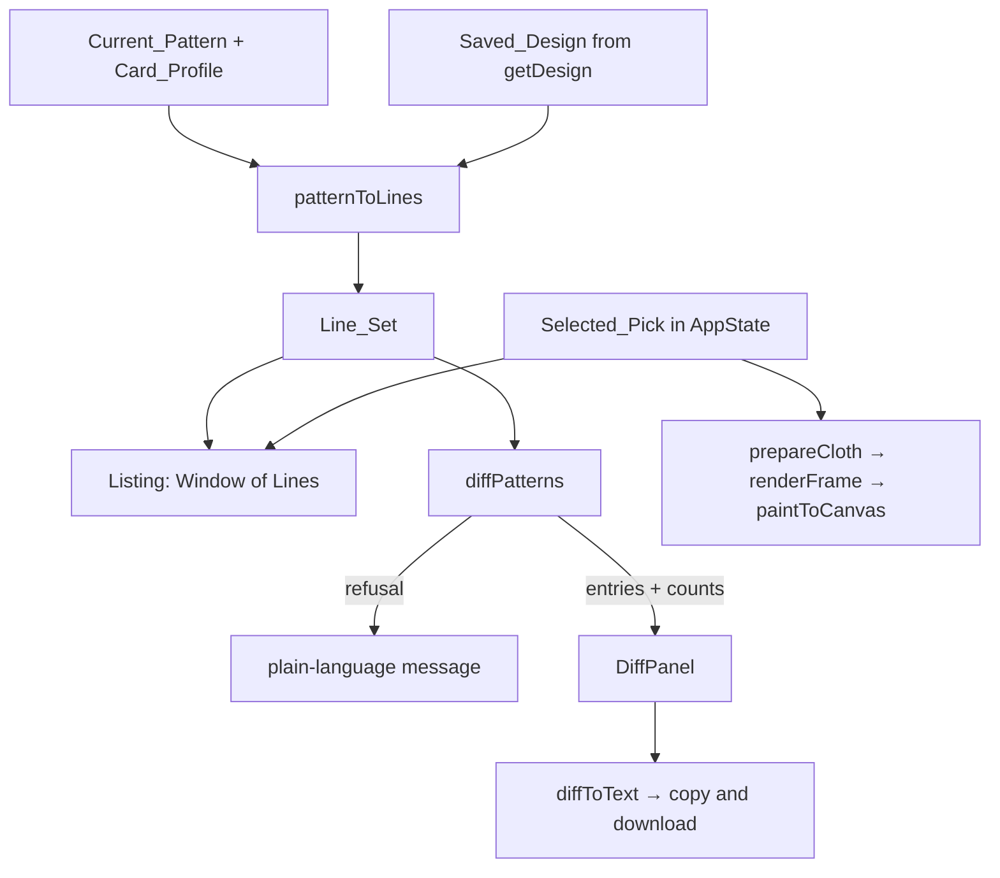

# Design Document

## Overview

Code view shows a naksha as text: one card (one pick) per line, each punched hole a `1` and each unpunched hook position a `0`, in end order. It adds the three things a developer expects of a listing — reading it, stepping through it with breakpoints, and diffing it — and nothing else.

The work is in two places:

- **`src/codec-view`**, a pure module that imports only `src/codec`. It turns cards into Bit_Lines, aligns two Line_Sets, builds the Diff, applies it back, and prints the Diff_Text. No React, no DOM, no archive. Every rule about lines and diffs is a property of a pure function here.
- **`src/ui/screens/code`**, the Code_View_Screen, lazy-loaded in its own chunk the way the Scan_Screen is. It reads the Archive, renders the Lines, paints the cloth through the Weave_Screen's own simulator calls, and holds the comparison as view state.

Nothing new is mapped, rendered or stored. The hook-position-to-end mapping comes from `encodeCardGrid`; the cloth comes from `prepareCloth`, `renderFrame` and `paintToCanvas`; the designs come from `listDesigns` and `getDesign`.

### Key decisions

| Decision | Choice | Reason |
|---|---|---|
| End order | Only the ends list from `encodeCardGrid`; `endOrder` is never read in this module | R1.3, R8.5; a permuted `endOrder` still agrees |
| Bit_Line | A `string` of `0` and `1`, no Group_Separator | Whole-line comparison is one string compare; `diffToText` needs no conversion |
| Group_Separator | Inserted by `groupBits(bits, hookColumns)`, exported from the module | R2.2, R6.4, R10.6: the same characters in both languages, from the module and not a Translation_File |
| Damaged card | `Line` is a discriminated union: `bits` or `damaged` | R1.9, R2.9; no partial Bit_Line can exist |
| Alignment | Canonicalise the pair, then a two-key DP: longest common subsequence, least index displacement | R5.2, R5.9, R6.2; makes P7 hold (see "The tie-breaking rule") |
| Diff_Pick_Limit | 2,000 picks per side | The DP is quadratic; 2,000 × 2,000 is 23 MB and about 20 ms (measured) |
| Window_Size | 80 Lines | Twice the rows that fit at the tallest supported viewport, inside R2.5's 40 to 200 |
| Virtualisation | A fixed row height from one CSS custom property, a spacer of `pickCount × rowHeight`, the Window offset by `transform` | Stepping and run-to-breakpoint must cross the whole chain, so no pagination (requirements decision 1) |
| Selected_Pick | One field in `AppState`; the Weave_Screen's playback keeps only its status | R4.2; see "Where the Selected_Pick lives" |
| Cloth choices | Lifted from Weave_Screen local state into `AppState` | R4.1: Code view must use the same choices, not its own defaults |
| Code_View_Marker | `naqsha-code-view-listing`, the `id` of the listing element | R9.9: a string literal survives minification, and the browser check can look for the element |

## Architecture

```
src/codec-view/            pure, imports only src/codec
  types.ts                 BitLine, Line, LineSet, Diff, DiffEntry, refusals, result values
  bits.ts                  cardToBits, patternToLines, groupBits, GROUP_SEPARATOR
  align.ts                 alignLines (canonicalise + DP), lineKey
  diff.ts                  diffPatterns, applyDiff, DIFF_PICK_LIMIT
  diffText.ts              diffToText, DIFF_MARKERS
  index.ts                 re-exports

src/ui/screens/code/       lazy chunk
  CodeViewScreen.tsx       default export for lazy(), CODE_VIEW_MARKER, the Archive calls
  CodeViewScreen.module.css
  Listing.tsx              the scroller, the spacer, the Window
  Listing.module.css
  LineRow.tsx              one Line: breakpoint control, pick number, markers, Bit_Line region
  LineRow.module.css
  DiffPanel.tsx            design choosers, counts, entries, the Diff_Text
  DiffPanel.module.css

src/ui/state/codeView.ts   pure view logic: WINDOW_SIZE, windowFor, breakpoints, parseJump,
                           pickNumberWidth, accessible-name builders, focusTargetAfterWindowMove
src/ui/state/cloth.ts      gains buildReadyCloth, moved out of WeaveScreen.tsx

tests/codec-view/          bits.test.ts, align.test.ts, diff.test.ts, diffText.test.ts, boundaries.test.ts
tests/ui/state/codeView.test.ts
tests/ui/screens/code.test.tsx
```

Dependency directions, added to the chain in `structure.md`:

```
codec-view → codec
ui → codec-view
```

Data flow:



## Components and Interfaces

### `src/codec-view/types.ts`

```ts
import type { CardProfile, Violation } from '../codec/index.ts';

/** The text of one card: Ends_Per_Pick characters of '0' or '1', character e being end e. No Group_Separator. */
export type BitLine = string;

/** One card as a line of bits, with its pick index. */
export type BitsLine = { kind: 'bits'; pick: number; bits: BitLine };
/** One card that failed validateCardGrid: its pick index and the violations, in place of a Bit_Line. */
export type DamagedLine = { kind: 'damaged'; pick: number; violations: ReadonlyArray<Violation> };
export type Line = BitsLine | DamagedLine;

/** The card geometry a Line_Set was built with. Two Line_Sets compare only when their headers agree. */
export type LineSetHeader = {
  profileName: string;
  hookRows: number;
  hookColumns: number;
  endsPerPick: number;
};

export type LineSet = LineSetHeader & { lines: ReadonlyArray<Line> };

export type BitsResult =
  | { ok: true; bits: BitLine }
  | { ok: false; violations: ReadonlyArray<Violation> };

export type LinesFailure = { reason: 'not-a-pattern'; location: string; message: string };
export type LinesResult = { ok: true; lineSet: LineSet } | { ok: false; failure: LinesFailure };

export type DiffEntry =
  | { kind: 'unchanged'; first: Line; second: Line }
  | { kind: 'changed'; first: BitsLine; second: BitsLine; changedHoles: ReadonlyArray<number> }
  | { kind: 'added'; second: Line }
  | { kind: 'removed'; first: Line };

export type DiffCounts = { changedHoles: number; addedCards: number; removedCards: number };

export type DiffRefusal =
  | { reason: 'dimension-mismatch';
      first: { hookRows: number; hookColumns: number };
      second: { hookRows: number; hookColumns: number } }
  | { reason: 'profile-mismatch'; firstProfileName: string; secondProfileName: string }
  | { reason: 'too-many-picks'; limit: number; firstPicks: number; secondPicks: number };

export type Diff =
  | { ok: false; refusal: DiffRefusal }
  | { ok: true;
      first: LineSetHeader;
      second: LineSetHeader;
      entries: ReadonlyArray<DiffEntry>;
      counts: DiffCounts };

export type ApplyFailure =
  | { reason: 'refused-diff'; refusal: DiffRefusal }
  | { reason: 'header-mismatch'; expected: LineSetHeader; actual: LineSetHeader }
  | { reason: 'lines-mismatch'; pick: number; message: string };

export type ApplyResult = { ok: true; lineSet: LineSet } | { ok: false; failure: ApplyFailure };

/** The pairing the Alignment produced: matched index pairs in ascending order on both sides. */
export type Alignment = ReadonlyArray<{ firstPick: number; secondPick: number }>;
```

`CardProfile` is imported for the function signatures below. Relative imports inside `src/codec-view` carry the `.ts` extension, so Node runs the module without a build step (`tech.md`).

### `src/codec-view/index.ts`

```ts
export * from './types.ts';

// bits.ts
export const GROUP_SEPARATOR = '|';
export function cardToBits(profile: CardProfile, card: unknown): BitsResult;
export function patternToLines(profile: CardProfile, pattern: unknown): LinesResult;
/** The Bit_Line with one GROUP_SEPARATOR between each group of hookColumns ends, none at either end. */
export function groupBits(bits: BitLine, hookColumns: number): string;

// align.ts
/** The comparison key of a Line: its Bit_Line, or 'x' + the violation kinds and locations for a damaged Line. */
export function lineKey(line: Line): string;
export function alignLines(first: ReadonlyArray<Line>, second: ReadonlyArray<Line>): Alignment;

// diff.ts
export const DIFF_PICK_LIMIT = 2000;
export function diffPatterns(first: LineSet, second: LineSet): Diff;
export function applyDiff(first: LineSet, diff: Diff): ApplyResult;

// diffText.ts
export const DIFF_MARKERS = { unchanged: ' ', changed: '~', added: '+', removed: '-' } as const;
export function diffToText(diff: Diff): string;
```

The profile contract is the one `src/codec` already keeps: the profile has already passed `parseCardProfile`, every other argument is `unknown` and every failure comes back as a value (R1.8). `diffPatterns` and `applyDiff` take `LineSet` values, which only `patternToLines` produces; their totality (P10) is over mismatched and damaged Line_Sets, which is what R6.9 to R6.11 and R1.9 describe.

### The Code_View_Screen

```ts
// CodeViewScreen.tsx
/** The one string that only this chunk holds, used as the id of the listing (R9.9). */
export const CODE_VIEW_MARKER = 'naqsha-code-view-listing';

export type CodeViewScreenProps = {
  state: AppState;
  dispatch: Dispatch<AppAction>;
  t: Translate;
  /** Injected so tests use a fake store, as the Keep screen already does. */
  archiveDeps?: ArchiveDeps;
  scheduler?: Scheduler;
};
export default function CodeViewScreen(props: CodeViewScreenProps): JSX.Element;
```

`App.tsx` changes in four places:

```ts
const SCREENS: ReadonlyArray<Screen> = ['weave', 'keep', 'scan', 'code'];
const CodeViewScreen = lazy(() => import('./screens/code/CodeViewScreen.tsx'));
// in the screen switch, inside the same <Suspense> shape the Scan screen uses
// the boundary message names Code view when that screen failed to load (R9.10):
<ScreenBoundary key={state.screen}
  message={state.screen === 'code' ? t('error.codeview.load') : t('error.generic')}>
```

`Screen` in `src/ui/types.ts` gains `'code'`. React's `lazy` rethrows a failed import during render, so the existing `ScreenBoundary` catches it; the navigation and the live region sit outside `<main>` and stay usable (R9.10).

### `src/ui/state/codeView.ts`

```ts
export const WINDOW_SIZE = 80;
/** Rows of headroom kept between the viewport and a Window edge before the Window moves. */
export const WINDOW_MARGIN = 10;

export type PickWindow = { from: number; count: number };

/** The Window for a listing. Pure; `previous` is null before the first render. */
export function windowFor(
  previous: PickWindow | null,
  pickCount: number,
  selectedPick: number,
  firstVisiblePick: number,
  visiblePicks: number,
): PickWindow;

/** The character width of the largest pick index, so every Bit_Line starts at the same offset (R2.3). */
export function pickNumberWidth(pickCount: number): number;

export type Breakpoints = ReadonlyArray<number>; // ascending, no repeat
export function toggleBreakpoint(breakpoints: Breakpoints, pick: number): Breakpoints;
/** The lowest breakpoint above `pick`, or the last pick index with found false (R3.8, R3.9). */
export function nextBreakpoint(breakpoints: Breakpoints, pick: number, lastPick: number):
  { pick: number; found: boolean };

export type JumpParse = { ok: true; pick: number } | { ok: false };
export function parseJump(text: string, lastPick: number): JumpParse;

/** The accessible names of R11.3, R11.4 and R11.12, built from one Line and the Translate function. */
export function lineAccessibleName(t: Translate, line: Line): string;
/** The accessible name of R11.5 for one Diff_Entry. */
export function diffEntryAccessibleName(t: Translate, entry: DiffEntry): string;

export type FocusKind = 'breakpoint' | 'bitline';
/** Where focus goes when the Window moved (R11.13). */
export function focusTargetAfterWindowMove(
  previous: { kind: FocusKind; pick: number } | null,
  window: PickWindow,
  selectedPick: number,
): { kind: FocusKind; pick: number } | 'step-forward' | null;
```

### The cloth

`buildReadyCloth` moves from `WeaveScreen.tsx` to `src/ui/state/cloth.ts` unchanged and is re-exported from `WeaveScreen.tsx` so the existing Weave tests keep their import. Code view calls:

```ts
const ready = buildReadyCloth(profile, pattern, state.clothChoices, viewport.width, viewport.height);
// one ClothCanvas, one createClothPlayer, seek only — never play (R4.3)
player.seek(state.selectedPick);
```

`createClothPlayer` already paints through `paintToCanvas` and reports the frame it showed; `seek` renders `{ pick, phase: 'rest' }`, which is exactly the frame the Weave_Screen paints when it seeks (R4.3). No `play` call is ever made, so no scheduler request is issued. There is no pixel code and no `putImageData` call in `src/ui/screens/code` (R4.1), which the boundary test checks.

## The low-level design

### A card to a Bit_Line

```
cardToBits(profile, card):
  ends = encodeCardGrid(profile, card)            // the only mapping (R1.3)
  if !ends.ok: return { ok: false, violations: ends.violations }   // unchanged, in order (R1.4)
  return { ok: true, bits: ends.value.map(lifted => lifted ? '1' : '0').join('') }
```

`endsPerPick(profile)` gives the length; no dimension is written as a literal (R8.5). `patternToLines` refuses a non-array Pattern as `not-a-pattern` with location `pattern` (R1.10), and otherwise maps card `p` to a `bits` Line or, when `cardToBits` fails, to a `damaged` Line holding the violations (R1.9). `groupBits` walks the string in steps of `hookColumns` and joins with `GROUP_SEPARATOR`, so the grouped text holds `Ends_Per_Pick` bit characters and `Ends_Per_Pick / hookColumns − 1` separators (R2.2).

### The tie-breaking rule (R5.2, R5.9, R6.2, P7)

The rule has to pick one Alignment out of possibly many longest common subsequences, reading only the two sequences and not the order they arrived in. It is three steps.

**1. Canonicalise.** Define a total order on sequences of Lines: compare the number of Lines first, then compare `lineKey` by `lineKey` as strings, the first difference deciding. Let `(P, Q)` be the two sequences in that order (`P` first when they compare equal, which means they are equal). Both `alignLines(A, B)` and `alignLines(B, A)` therefore run the same computation on the same ordered pair.

**2. Align `(P, Q)`** with a deterministic two-key dynamic program: among the common subsequences of the greatest length, take the one of least total index displacement `Σ |i − j|` over matched pairs; any residual tie is settled by a fixed order of transitions in the backtrack.

**3. Mirror back.** If the canonical pair is the caller's pair, return the matched pairs as they are; otherwise swap each pair's two indices.

Why this makes P7 hold:

- Steps 1 to 3 compute a function of the *set* `{A, B}`. For `(A, B)` and `(B, A)` the canonical pair is the same, the DP is deterministic, and the mirror in step 3 is the only difference, so the matched pairs of one call are exactly the matched pairs of the other with the two indices swapped. When `A = B`, a matching of length `|A|` that is order-preserving and injective can only be the identity, so the mirror is the matching itself.
- The rest of `diffPatterns` is already symmetric. The gap blocks of R5.4 are the Lines between two consecutive matches, which is a symmetric notion; pairing the `k`-th unmatched Line of one side with the `k`-th of the other is symmetric; the leftovers of the longer side are `removed` on the first side and `added` on the second, which is exactly the swap P7 asks for. The Changed_Holes of a `changed` entry are the end positions at which two Bit_Lines differ, which does not depend on which is first. The changed-hole count is therefore equal both ways round (R6.2).

Why least displacement, and not any longest common subsequence: P5 needs it. Take `A = ["00", "11", "00"]` and `B = ["00", "00", "00"]`, which differ by one flipped card at pick 1. Three alignments have the greatest length 2: `{(0,0), (2,2)}`, `{(0,0), (2,1)}` and `{(0,1), (2,2)}`. Only the first leaves pick 1 unmatched on both sides, which the gap-block pairing turns into one `changed` entry with one Changed_Hole. The other two leave unmatched Lines in *different* blocks, so they report one `added` and one `removed` card instead, and P5 fails. Displacement separates them: the first scores 0, the others 1. More generally, when two Line_Sets of equal length differ at exactly one pick, the only alignment with displacement 0 and the greatest length is `{(i, i) : i ≠ p}`, so the choice is forced and P5 holds for every profile, pattern and flipped hole.

No counterexample to P7 is left, so R6.2 needs no decision from the user.

### The alignment DP

With `m` and `n` Lines on the canonical first and second side:

```
keys    : lineKey of each Line, interned through a Map into Int32Array ids,
          so the DP compares integers and not Ends_Per_Pick-character strings
len     : Uint16Array((m+1) * (n+1))   // length of the best common subsequence of the two prefixes
disp    : Uint32Array((m+1) * (n+1))   // its total displacement

for i in 1..m, j in 1..n:
  best = the better of len/disp at (i-1, j) and at (i, j-1)
         // better means greater len; on equal len, smaller disp; on both equal, (i-1, j)
  if id[i-1] == id[j-1]:
    candidate = (len(i-1, j-1) + 1, disp(i-1, j-1) + |i - j|)
    if candidate is better than best: best = candidate
  len(i, j), disp(i, j) = best

backtrack from (m, n):
  take the diagonal when the keys are equal and (len, disp) at (i, j) equals the diagonal candidate;
  otherwise step to (i-1, j) when it is the better of the two, else to (i, j-1)
```

`len` fits `Uint16Array` because a side holds at most `DIFF_PICK_LIMIT` = 2,000 Lines. `disp` fits `Uint32Array` because at most 2,000 pairs each displace at most 2,000, so at most 4,000,000.

Cost at the limit, both tables full at 2,001 × 2,001 = 4,004,001 cells:

| Measure | Value |
|---|---|
| Memory | 8 MB (`len`) + 16 MB (`disp`) = 23 MB, freed when the Diff is built |
| Time, this development machine | 20 ms interned, 65 ms comparing 192-character strings (measured with `node`, two 2,000-Line sequences) |
| Time, mid-range 2020 phone | 100 to 300 ms — **estimated, unverified**, from the usual 5× to 15× gap |

That is why the Diff_Pick_Limit is **2,000**, the smallest number R6.12 allows: 4,000 picks would need 92 MB and 10,000 would need 575 MB, which no basic phone can give, while the listing itself stays linear and is tested at 10,000 picks (R2.6). The limit is a module constant, the same on every run (R6.12).

Common prefix and suffix trimming would make the usual one-card change nearly free, and it is **not** used: it is a known-safe reduction for the *length* of a common subsequence, but we have no proof that it preserves the least-displacement choice, and P5 and P7 rest on that choice. The quadratic DP always runs, and the limit above is what keeps it affordable.

### From the Alignment to Diff_Entries

```
matched pairs split the two sides into blocks: before the first match, between consecutive
matches, after the last match.

for each block, in Alignment order:
  firstUnmatched, secondUnmatched: the block's Lines, ascending
  k = min(|firstUnmatched|, |secondUnmatched|)
  for t in 0..k-1:
    a = firstUnmatched[t], b = secondUnmatched[t]
    if both are bits Lines and their Bit_Lines differ:
      emit changed(a, b) with changedHoles = the ascending end positions where they differ
    else if both are bits Lines with equal Bit_Lines:        // cannot happen: equal keys would have matched
      emit unchanged(a, b)
    else:
      emit removed and added for the two Lines separately, the entry of the canonical-first
      side written first, because a changed entry must hold two Bit_Lines (R5.5)
  emit removed(a) for each remaining firstUnmatched, ascending
  emit added(b)  for each remaining secondUnmatched, ascending
then emit unchanged(a, b) for the match that closes the block
```

A block never holds both leftover `added` and leftover `removed` entries, because the leftovers all come from the longer side (R5.4). First-side pick indices and second-side pick indices each increase down the entry list (R5.6), and no entry pairs Lines from different blocks. The counts are the sum of the Changed_Holes over the `changed` entries, the number of `added` entries and the number of `removed` entries (R6.1, R6.3).

Damaged Lines compare by `lineKey`, which for a `bits` Line is the Bit_Line itself and for a `damaged` Line is `x` followed by the violation kinds and locations. Two identically damaged Lines therefore match and come out `unchanged`, which keeps P3 true for any Line_Set, and a pair in which only one side is damaged comes out as a `removed` plus an `added` entry rather than a `changed` one. This is a definition, not a refusal, so `diffPatterns` stays total (P10) and R5.1's three refusal reasons stay the only refusals. The screen never relies on it: R7.3 stops a comparison that involves a damaged card before `diffPatterns` is called.

Refusals are checked before any work, in this order: `profile-mismatch`, `dimension-mismatch`, `too-many-picks`. Each carries the values R6.9 to R6.11 name and returns no entries and no counts.

### `applyDiff`

```
applyDiff(first, diff):
  if !diff.ok                                          -> refused-diff
  if diff.first header != first header                 -> header-mismatch
  the unchanged, changed and removed entries, in order -> must be exactly first.lines, by pick
                                                          index and by value, else lines-mismatch
  build: unchanged -> the second Line, changed -> the second Line, added -> the second Line,
         removed -> nothing
  return the Line_Set with diff.second as its header and those Lines, renumbered 0..n-1
```

The renumbering is a no-op for a Diff that `diffPatterns` produced, because the second side's picks already ascend from 0 with no gap. The given Line_Set is never written to (R5.8, R5.10).

### Diff_Text

R6.14 fixes the format, so there is nothing to choose:

```
<marker> <firstPick>/<secondPick> <grouped Bit_Line>
# <changedHoles> <addedCards> <removedCards>
```

The marker is one character from `DIFF_MARKERS`; a side the entry has no index on is written `-`; the Bit_Line written is the second side's for `added` and `changed`, the first side's for `unchanged` and `removed`; the Bit_Line carries Group_Separators from `groupBits`. Pick index fields are not padded. Lines are joined with a single `\n` and there is no trailing newline. A Diff with no entries is the summary line alone (R6.5). A damaged Line has no Bit_Line to write, so `x` and the violation kinds are written in its place — the same text `lineKey` builds.

A refused Diff gives exactly one line, starting `!` so that it can never be read as an entry or a summary line (R6.15):

```
! dimension-mismatch first 12x16 second 10x16
! profile-mismatch first demo-12x16 second loom-a
! too-many-picks limit 2000 first 2500 second 1800
```

### The listing Window

Row height is one CSS custom property, `--code-line-height: var(--touch-target)` (48 px), so the breakpoint control on each Line already meets the App's Touch_Target (R11.10) and `firstVisiblePick = floor(scrollTop / rowHeight)` is exact. The scroller holds a spacer of `pickCount × rowHeight` and the Window `<ol>` offset by `transform: translateY(from × rowHeight)`.

`windowFor` is pure and total:

1. `pickCount <= 0` gives `{ from: 0, count: 0 }`.
2. `count = min(WINDOW_SIZE, pickCount)`.
3. The wanted span is the visible span `[firstVisiblePick, firstVisiblePick + visiblePicks)` together with `selectedPick`, clamped into `0..pickCount-1`; when that is wider than `count`, the part holding `selectedPick` is kept (R2.7 beats R2.11 while the two disagree, and the screen then scrolls to the Selected_Pick, which ends the disagreement).
4. When `previous` has the same `count` and the wanted span sits at least `WINDOW_MARGIN` rows inside both of its edges, `previous` is returned unchanged, so scrolling does not re-render every row.
5. Otherwise the Window is centred on the wanted span and clamped to `0..pickCount - count`.

Invariants, which are P9: `count <= WINDOW_SIZE`; `0 <= from` and `from + count <= pickCount`; `selectedPick` is inside the Window whenever it is a pick of the pattern; the visible span is inside the Window whenever `visiblePicks <= count`.

**Window_Size is 80.** At 48 px rows, a 1920 px tall viewport shows 40 rows, so 80 is twice the most that can ever be visible and leaves 20 rows of headroom at each edge for step 4 — the Window moves on scroll, but not on every scroll event. 80 rows is about 240 elements and, with the demo profile, 15,360 bit characters: small enough that a Window move is well inside R2.10's 100 ms. It sits inside R2.5's 40 to 200 and is a module constant that nothing varies.

## Data Models

Nothing is persisted and nothing is added to the Archive record. Three pieces of state change:

**`AppState` (`src/ui/types.ts`)** gains

```ts
screen: Screen;                        // Screen now includes 'code'
selectedPick: number;                  // 0 .. max(0, current.pattern.length - 1)  (R4.2)
breakpoints: ReadonlyArray<number>;    // ascending, no repeat, Screen state only  (R3.10)
clothChoices: ClothChoices;            // moved out of WeaveScreen local state     (R4.1)
```

**`AppAction`** gains

```ts
| { type: 'select-pick'; pick: number }
| { type: 'toggle-breakpoint'; pick: number }
| { type: 'set-cloth-choices'; choices: ClothChoices }
```

`select-pick` clamps to `0 .. max(0, current.pattern.length - 1)`, so no Selected_Pick outside the design can exist. Every action that replaces the Current_Pattern — `request-sample`, `confirm-accepted` for a sample, `open-saved`, `batch-commit` — goes through one new reducer helper that also sets `selectedPick: 0` and `breakpoints: []` (R3.10, R4.6).

**Code_View_Screen view state** (`useState`/`useReducer`, discarded when the screen unmounts, which is allowed for everything except the Breakpoints):

```ts
type SideChoice = { kind: 'current' } | { kind: 'saved'; id: string };

type Summaries =
  | { status: 'loading' }
  | { status: 'ready'; list: ReadonlyArray<DesignSummary> }
  | { status: 'failed'; failure: ArchiveFailure };

type Comparison =
  | { status: 'idle' }
  | { status: 'loading'; first: SideChoice; second: SideChoice }
  | { status: 'ready'; first: NamedLineSet; second: NamedLineSet; diff: Diff }
  | { status: 'blocked'; blocked: Blocked };

type NamedLineSet = { name: string; lineSet: LineSet };
type Blocked =
  | { kind: 'archive'; failure: ArchiveFailure }
  | { kind: 'damaged'; designName: string; pick: number };   // R7.3

type WindowState = { window: PickWindow; firstVisiblePick: number; visiblePicks: number };
```

**Who holds what, and when the Archive is called.** The screen holds the two `Summaries` and `Comparison` values and nothing else about designs. `listDesigns(archiveDeps)` is called once when the screen mounts, and again after a `not-found` so that the list the user sees is fresh (R7.4). `getDesign(id, archiveDeps)` is called when the user applies the compare control, once per chosen Saved_Design. The Current_Pattern's Line_Set is derived, not stored: `useMemo(() => patternToLines(profile, pattern), [profile, pattern])`. Each fetched Saved_Design goes straight through `patternToLines` and only the Line_Set is kept, so the Pattern is not held twice.

A `patternToLines` failure from a Saved_Design surfaces in one place. `patternToLines` only fails outright for a Pattern that is not an array; a damaged card gives a `damaged` Line instead. So before calling `diffPatterns`, the screen scans both Line_Sets for the lowest `damaged` Line; if either has one, it sets `Comparison` to `{ status: 'blocked', blocked: { kind: 'damaged', designName, pick } }` and shows the message naming the design and that pick index (R7.3). A `not-an-array` failure is reported with the same `damaged` message at pick 0, because for the reader it is the same thing: that design cannot be compared. The listing of the Current_Pattern stays on screen in every one of these cases.

## Correctness Properties

*A property is a characteristic or behavior that should hold true across all valid executions of a system — essentially, a formal statement about what the system should do. Properties serve as the bridge between human-readable specifications and machine-verifiable correctness guarantees.*

These are the ten properties the requirements list, with the extra invariant properties the prework found folded into them. **Demo-essential** means the feature is not done without it; **Cuttable** means it is the first to go, and only with the user told (R12.7, R12.11).

### Property 1: R1.1 a Bit_Line holds one character per end and agrees with encodeCardGrid

**Demo-essential.** *For any* valid Card_Profile and any valid card, `cardToBits` returns a string of `endsPerPick(profile)` characters, every character is `0` or `1`, and character `e` is `1` exactly when the ends list from `encodeCardGrid` lifts end `e`. The profile arbitrary permutes `endOrder`, so a non-row-major profile is covered (R1.3).

**Validates: Requirements 1.1, 1.2, 1.3**

### Property 2: R1.2 reading a Bit_Line back through decodeEnds returns the original card

**Demo-essential.** *For any* valid Card_Profile and any valid card, turning the Bit_Line back into an ends list and passing it through `decodeEnds` returns a card deep-equal to the original.

**Validates: Requirements 1.2**

### Property 3: R5.1 a design compared with itself reports no change

**Demo-essential.** *For any* Line_Set `a`, including one with damaged Lines and one with no Lines, `diffPatterns(a, a)` has no `changed`, `added` or `removed` entry, one `unchanged` entry per Line, and Diff_Counts of zero, zero, zero.

**Validates: Requirements 5.1, 7.5**

### Property 4: R5.8 applying a diff to the first design gives the second

**Demo-essential.** *For any* two Patterns over the same Card_Profile, of any lengths including 0 and 1, `applyDiff(a, diffPatterns(a, b))` returns a Line_Set equal to `b` by the Line_Set equality of the Glossary, and leaves `a` unchanged.

**Validates: Requirements 5.8**

### Property 5: R6.1 flipping one hole gives one changed card and one changed hole

**Demo-essential.** *For any* Pattern of at least one pick, any pick and any hook position, flipping that one punched hole gives exactly one `changed` Diff_Entry, no `added` and no `removed` entries, Diff_Counts of one changed hole, zero added and zero removed cards, and that entry's Changed_Holes is the single end index `encodeCardGrid` maps the flipped hook position to.

**Validates: Requirements 6.1, 6.3**

### Property 6: R5.2 inserting one card gives one added card and nothing else

**Demo-essential.** *For any* Pattern and any insertion position, inserting one card gives exactly one `added` Diff_Entry, no `changed` and no `removed` entries, and every Line of the first Line_Set appears in an `unchanged` entry.

**Validates: Requirements 5.2**

### Property 7: R5.9 the diff of two designs is the mirror of the diff the other way round

**Demo-essential.** *For any* two Line_Sets `a` and `b` that `diffPatterns` refuses in neither direction, `diffPatterns(b, a)` has the same number of entries in the same order as `diffPatterns(a, b)`; each `unchanged` and each `changed` entry holds the same two Lines, and a `changed` entry holds the same Changed_Holes; each `added` entry of the one is the `removed` entry of the other for the same Line; and the changed-hole counts of the two Diffs are equal.

**Validates: Requirements 5.9, 6.2**

### Property 8: R6.4 the Diff_Text holds one line per entry, one summary line, and never goes backwards

**Cuttable.** *For any* Diff, `diffToText` writes one line per Diff_Entry followed by one summary line starting `#`; every entry line starts with exactly one of the four markers; the first-side pick indices and the second-side pick indices each never decrease down the text; and a refused Diff gives exactly one line, starting `!`, that names the reason and the values it carries.

**Validates: Requirements 6.4, 6.5, 6.14, 6.15**

### Property 9: R2.4 the Window holds at most Window_Size Lines and always holds the Selected_Pick

**Cuttable.** *For any* pick count from 0 to 10,000, any Selected_Pick in range, any scroll position and any visible row count up to `WINDOW_SIZE`, `windowFor` returns a Window of at most `WINDOW_SIZE` Lines that lies inside the pattern, holds the Line of the Selected_Pick, and holds every visible Line.

**Validates: Requirements 2.4, 2.6, 2.7, 2.11**

### Property 10: R1.8 every exported function returns a value and throws nothing

**Demo-essential.** *For any* input value — `fc.anything()`, a card that is not an array, a card with the wrong number of hook rows or hook columns, a non-boolean hook position, a Pattern that is not an array, Line_Sets with mismatched profile names or dimensions, and Line_Sets longer than the Diff_Pick_Limit — each of `cardToBits`, `patternToLines`, `groupBits`, `diffPatterns`, `applyDiff` and `diffToText` returns a value and throws nothing, and a refusal carries the values R6.9 to R6.11 name with no entries and no counts.

**Validates: Requirements 1.8, 6.9, 6.10, 6.11**

### Folded-in invariants

Three more properties carry the criteria the prework found redundant to state separately, and they live beside the ten above rather than inside them:

- **R5.5 every Diff is well formed** (Demo-essential): for any two Line_Sets, each `changed` entry's Changed_Holes is non-empty, strictly ascending and exactly the end positions where its two Bit_Lines differ; first-side and second-side pick indices each strictly increase across the entries that carry them; no block holds both leftover `added` and leftover `removed` entries; and the Diff_Counts equal the totals derived from the entries. **Validates: Requirements 5.3, 5.4, 5.5, 5.6, 6.1**
- **R3.1 the reducer keeps one pick and one breakpoint set** (Cuttable): for any `AppState` and any sequence of `select-pick`, `toggle-breakpoint`, `navigate` and pattern-replacing actions, the Selected_Pick stays within `0..lastPick`, the breakpoints stay ascending without repeats, a double toggle restores the set, `navigate` changes neither, and every pattern-replacing action sets the Selected_Pick to 0 and empties the breakpoints. **Validates: Requirements 3.1, 3.2, 3.4, 3.6, 3.10, 4.6**
- **R11.3 a Line's accessible name names its pick and its punched ends** (Demo-essential): for any Line and either language, the name holds the pick number as digits; for a `bits` Line with punched holes it lists exactly those end indices in ascending order, separated by a comma and a space, with no Group_Separator; for a Line with none it is the no-end-punched text; for a `damaged` Line it is the damaged-card text and lists no end index. **Validates: Requirements 10.8, 11.3, 11.4, 11.12**

## Error Handling

| Situation | Result |
|---|---|
| Card fails `validateCardGrid` | `cardToBits` returns the violations unchanged; `patternToLines` puts a `damaged` Line at that pick (R1.4, R1.9) |
| Pattern is not an array | `patternToLines` fails `not-a-pattern` with location `pattern` (R1.10) |
| Any other junk input | A value, never a throw (R1.8, P10) |
| Different profile names, dimensions, or too many picks | `diffPatterns` refuses with the reason and its values; the screen shows the message for that reason naming the values and one next action, and keeps both designs selectable (R6.9 to R6.13) |
| A compared design holds a damaged card | The screen blocks the comparison, names the design and the lowest failing pick, keeps the listing (R7.3) |
| `applyDiff` given a refusal or a Diff that does not describe the Line_Set | `refused-diff`, `header-mismatch` or `lines-mismatch`; no Line_Set (R5.10) |
| `listDesigns`/`getDesign` fail `storage-unavailable` | Message from `archiveFailureKey`, compare controls disabled, step and breakpoint controls enabled, listing kept (R7.2) |
| `getDesign` fails `not-found` | Message, a fresh `listDesigns` call, listing kept (R7.4) |
| Simulator returns a Sim_Failure | The message for that kind from `simFailureKey`, no cloth painted, Lines and all controls still operable (R4.4) |
| Current_Pattern has no picks | The empty-design message naming Scan and the Weave samples, no Lines, controls present and disabled (R4.5, R7.1) |
| Card_Profile failed to load | The App's profile message in place of the listing, controls disabled, navigation operable (R7.6) |
| Code view chunk fails to load | `ScreenBoundary` shows `error.codeview.load`; navigation and the other Screens keep working; the Current_Pattern is untouched (R9.10) |

## Accessibility and layout

### The DOM of one Line

```html
<ol id="naqsha-code-view-listing" class="lines" aria-label="{codeview.listing.name}">
  <li class="line" role="group" aria-label="{codeview.line.name}" aria-current="true" data-pick="5">
    <button type="button" class="breakpoint" aria-pressed="false"
            aria-label="{codeview.breakpoint.name}">●</button>
    <span class="marks" aria-hidden="true">▶ ●</span>
    <span class="pickNumber" aria-hidden="true">    5</span>
    <div class="bits" role="group" tabindex="0" aria-label="{codeview.bitline.name}">
      <span class="bitsText">000000000000|100000000001|…</span>
    </div>
  </li>
</ol>
```

- The `li` carries the R11.3 accessible name and `aria-current="true"` on the Selected_Pick's Line. `role="group"` is what makes a named `li` announce its name reliably.
- The Bit_Line region (R11.8, R11.11) is `overflow-x: auto` with `tabindex="0"`, `role="group"` and its own short name, so it is in the tab order and a screen reader announces it as a focusable group. `role="region"` was rejected: a named region is a landmark, and 80 landmarks per screen is noise. A `keydown` handler moves `scrollLeft` by one character cell for `ArrowLeft`/`ArrowRight` and to `0`/`scrollWidth` for `Home`/`End`, so the first and last end are reachable with the keyboard alone and the behaviour is testable in jsdom.
- Only the region scrolls sideways. The page never does, at 320, 390 and 1280 CSS pixels (R11.8), because the Bit_Line never wraps and never widens its row.
- A `damaged` Line (R2.9, R11.12) replaces the `bits` region with a `<p class="damaged">{codeview.line.damagedLabel}</p>` and takes the damaged accessible name, listing no end index.

### Accessible names and the live region

Every name is a Translation_File key with placeholders, in both `hi` and `en`, with the same placeholder names (R10.1, R10.2, R10.8). New `hi` strings start unreviewed, so `npm run review-list` lists them (R10.4).

| Key | `en` text |
|---|---|
| `nav.code` | `Code` |
| `codeview.listing.name` | `Cards as lines of bits` |
| `codeview.line.name` | `Pick {pick}: punched at ends {ends}` |
| `codeview.line.nameEmpty` | `Pick {pick}: no end punched` |
| `codeview.line.nameDamaged` | `Pick {pick}: damaged card` |
| `codeview.line.damagedLabel` | `Damaged card` |
| `codeview.bitline.name` | `Pick {pick} bits` |
| `codeview.breakpoint.name` | `Breakpoint on pick {pick}` |
| `codeview.pickCount` | `{count} picks` |
| `codeview.announce.pick` | `Pick {pick}` |
| `codeview.announce.noBreakpoint` | `No further breakpoint. Stopped at the last pick.` |
| `codeview.jump.range` | `Choose a pick number from {first} to {last}.` |
| `codeview.diff.kind.unchanged` / `.changed` / `.added` / `.removed` | `Unchanged` / `Changed` / `Added` / `Removed` |
| `codeview.diff.name.changed` | `Changed: pick {firstPick} and pick {secondPick}, ends {ends}` |
| `codeview.diff.name.added` | `Added: pick {secondPick}` |
| `codeview.diff.name.removed` | `Removed: pick {firstPick}` |
| `codeview.diff.name.unchanged` | `Unchanged: pick {firstPick} and pick {secondPick}` |
| `codeview.refusal.dimension-mismatch` / `.profile-mismatch` / `.too-many-picks` | one message each, naming the carried values and one next action (R6.12) |
| `error.codeview.load` | `Code view could not be loaded. The other screens still work.` |

The exact `en` texts of `codeview.line.name` and `codeview.line.nameEmpty` are fixed by R11.3 and R11.4 and are asserted as literal strings in a test.

The live region is the App's existing one. Code view dispatches `announce` with `codeview.announce.pick` once in each handler that moves the Selected_Pick deliberately — step forward, step back, jump, run to next breakpoint — and `codeview.announce.noBreakpoint` when no breakpoint was found above (R3.9). Nothing is dispatched when the Window moves, and nothing is derived from `selectedPick` changing, so a Window move and the Weave_Screen's playback are silent here (R11.6).

### Markers, colour and motion

- Breakpoint `●`, Selected_Pick `▶`, in the `aria-hidden` marks column, so both read without colour (R3.7, R3.11, R11.7). The breakpoint state is also `aria-pressed` on its control, and the selection is also `aria-current`, so assistive technology does not depend on the shapes.
- Diff entries show the R6.4 marker character and, beside it, the translated kind word as visible text, so the kind is stated in text and not by colour (R6.7, R11.7). A `changed` entry shows the second side's Bit_Line and, directly beneath it in the same fixed-width grid, a marker row of `^` under each differing end and a space elsewhere — a text marker that needs no colour. The marker row is `aria-hidden`; the end indices are in the entry's accessible name (R11.5).
- `prefers-reduced-motion: reduce` (R11.9): every transition and `scroll-behavior: smooth` in the Code view CSS modules sits inside `@media (prefers-reduced-motion: no-preference)`, and the screen calls `scrollIntoView({ block: 'nearest', behavior: 'auto' })` when `state.prefersReducedMotion` is true, so the new Window and the new marker appear in one step with the Selected_Pick's Line in view.
- Focus follows the Window (R11.13): before a Window move the screen records the focused control's kind and pick; in a `useLayoutEffect` after the commit, if that element has left the document, focus goes to the same kind of control on the Selected_Pick's Line, or to the step forward control when that Line has none. The choice is `focusTargetAfterWindowMove`, a pure function, so it is tested without a DOM.
- Every control, including the per-Line breakpoint control, is a `button` with the App's 48 px Touch_Target, which the row height matches (R11.1, R11.10). Tab order follows the visual order: screen controls, then each Line's breakpoint control and Bit_Line region, then the diff panel.

## Bundle, precache and the checks

### `check_bundle.ts`, generalised (R9.3, R9.9)

The single `SCAN_ONLY_MARKER` becomes a list, because the check is now the same check twice:

```ts
export const CHUNK_MARKERS = [
  { name: 'Scan', marker: 'width and height must be positive integers' },
  { name: 'Code view', marker: 'naqsha-code-view-listing' },
] as const;
/** Kept so nothing that imports it breaks. */
export const SCAN_ONLY_MARKER = CHUNK_MARKERS[0].marker;
```

`BundleReport.scanChunks` becomes `markerChunks: Array<{ name: string; file: string; gzippedBytes: number }>`, and the entry-chunk and other-chunk checks loop over `CHUNK_MARKERS`, reporting the marker name in each problem and printing the file name and gzipped size of every chunk that holds a marker (R9.9). Parameterising beats a second constant: the two rules are identical and a second copy would be two places to change.

Files that change: `scripts/check_bundle.ts` only. `tests/ui/deploy.test.ts` calls `checkBundle` and reads `problems`, not `scanChunks`, so it needs no edit; `docs/BUILD_LOG.md` gains the note and the four byte counts of R9.4. `scripts/build_precache.ts` needs no change at all — it lists every file of `dist/`, so the Code view chunk is precached automatically (R9.5). The new test of R9.6 finds the chunk by its marker in `dist/assets` and asserts that the generated precache list of `dist/sw.js` names that file, failing with the chunk it looked for.

### `check:browser` (R9.7, R9.8, R11.8)

Step 13 gains one check in each group, named `the first Code view open works offline`:

**Group A (offline, no reload)**, run after the Scan check:

1. Assert `document.getElementById('naqsha-code-view-listing')` is absent, so this really is the first open of Code view in this page session, and therefore the first request for its chunk.
2. Choose the Diamond sample on Weave, so the pick count is known from `generateSample`, then click the Code nav control.
3. Wait for the listing element to appear — with Chrome offline and the preview server stopped, it can only have come from the Precache.
4. Assert the screen shows `codeview.pickCount` with that sample's pick count, and that the number of `li.line` elements is at most `WINDOW_SIZE`.
5. Read the `data-pick` of the `li` with `aria-current="true"`, assert it is `0`, click the step forward control once, and assert it is then `1` — the Selected_Pick moved from pick 0 to pick 1 on one activation.

**Group B (offline, then reload the page)**: the same check, by the same function, added to the `afterReload` name list so that it is reported `not-run` rather than passed when the reload failed (R9.8; `decideOffline` already refuses to count a `not-run` check as a pass).

Step 12 (`no horizontal scroll at 320, 390 and 1280 px`) needs only `'code'` added to the `SCREENS` constant of `scripts/check_browser.ts`; its loop then measures the Code view screen at all three widths (R11.8). The step already leaves a sample loaded, so the listing has Lines at each width.

## Where the Selected_Pick lives (R4.2, R4.6)

One value, `AppState.selectedPick`, with one action, `{ type: 'select-pick'; pick: number }`, clamped by the reducer to `0 .. max(0, current.pattern.length - 1)`.

The Weave_Screen's own pick value goes away. `PlaybackState` keeps only its status:

```ts
export type PlaybackState = { status: 'idle' | 'playing' | 'paused' | 'finished' };
```

and the pick the Weave_Screen shows is `state.selectedPick`. The wiring:

- `createClothPlayer` already reports every frame it paints. That report now dispatches `select-pick` with the frame's pick instead of calling `setPlayback` with a pick, at the same rate the screen already re-rendered (at most one per animation frame).
- `entryPlayback` and `displayedPlayback` in `src/ui/state/playback.ts` return a status and an entry pick; the entry pick is dispatched once when a cloth is entered, and the reducer's clamp makes a stale value impossible.
- "Finished" was a pick one past the last index. It is now only a status: the places that read `pick === pickCount` read `status === 'finished'`, and `pickLabel`/`canvasAltText` are given `status === 'finished' ? pickCount : state.selectedPick`.
- Every deliberate move — Weave's step, scrub and seek, Code view's step, jump and run-to-breakpoint — is one `select-pick` dispatch, so opening either screen shows the pick the other one left (R4.2), and no pick is replayed from 0.
- Replacing the Current_Pattern sets `selectedPick: 0` through the shared reducer helper (R4.6).

Cost, stated plainly: `src/ui/state/playback.ts`, `src/ui/state/cloth.ts`, `src/ui/screens/weave/WeaveScreen.tsx`, `src/ui/screens/weave/ClothCanvas.tsx` and their tests (`tests/ui/state/playback.test.ts`, `tests/ui/state/cloth.test.ts`, `tests/ui/screens/weave.test.tsx`, `tests/ui/screens/weaveWiring.test.ts`) all change. That is the price of R4.2's one value; keeping a second pick in the Weave_Screen and syncing the two would be cheaper to write and would be two values that can disagree, which is what R4.2 forbids.

`ClothChoices` moves the same way, into `AppState.clothChoices` with `set-cloth-choices`, because R4.1 requires Code view to paint with the choices the user made on Weave, not with its own defaults. Only the viewport comes from each screen's own layout.

## The `structure.md` update (R8.9)

A new section is added after `src/codec`, and the dependency block gains two lines:

```markdown
### src/codec-view
Turns codec data into text for reading and comparing: a card into a Bit_Line, a Pattern into a
Line_Set, two Line_Sets into a Diff, a Diff back into a Line_Set, and a Diff into plain text.
Pure data transformation; no React, no DOM, no browser API, no I/O. Imports only from src/codec,
and takes the hook-position-to-end mapping only from encodeCardGrid.

Key exports: cardToBits, patternToLines, diffPatterns, applyDiff, diffToText; also groupBits,
lineKey, alignLines, GROUP_SEPARATOR, DIFF_MARKERS, DIFF_PICK_LIMIT; types BitLine, Line,
LineSet, LineSetHeader, Diff, DiffEntry, DiffCounts, DiffRefusal, BitsResult, LinesResult,
ApplyResult, Alignment
```

```
ui → simulator, exporter, archive, reader, codec-view
codec-view → codec
```

The `src/ui` entry gains the Code view screen and its files, and the `tests/` entry gains `tests/codec-view/`.

## The boundary test (R8.11, R8.12)

`tests/codec-view/boundaries.test.ts`, built on the scanner the structure tests already use. `importSpecifiers(code)` is moved into `tests/support/source.ts` (the same three regexes for `import … from`, `export … from`, bare `import '…'` and `import('…')`), and `stripComments` is reused so a specifier in a comment is not a hit. The existing scans keep their own copies; nothing else moves.

The test loads three sets of files: every `.ts` in `src/codec-view`, every file of this feature in `src/ui` (`src/ui/screens/code/**`, `src/ui/state/codeView.ts`), and every `.ts` in `src/codec`, `src/reader`, `src/simulator`, `src/exporter` and `src/archive`. It asserts:

| Assertion | Criterion |
|---|---|
| Every specifier in `src/codec-view` is relative and resolves inside `src/codec-view` or `src/codec` | R8.2 |
| No specifier in `src/codec-view` is bare (a package or a Node built-in) | R8.2 |
| The strings `react`, `window`, `document`, `navigator`, `localStorage`, `indexedDB`, `fetch`, `OffscreenCanvas`, `CanvasRenderingContext2D`, `ImageData`, `requestAnimationFrame` appear in no `src/codec-view` file, with strings and comments blanked | R8.3 |
| Specifiers naming `archive`, `simulator` or `react` appear only in files under `src/ui` | R8.4 |
| No file outside `src/ui` has a specifier naming `src/ui` | R8.4 |
| No file in `src/codec`, `src/reader`, `src/simulator`, `src/exporter` or `src/archive` has a specifier naming `codec-view` | R8.12 |
| No `src/codec-view` file holds the demo profile name or a card dimension as a literal | R8.5 |
| No `any`, `as any`, `@ts-ignore` or `@ts-expect-error` in either file set | R8.6 |
| No Code view file names a canvas drawing API of its own | R4.1 |
| Every test file of this feature is under `tests/codec-view/` or `tests/ui/` | R8.8 |
| `.kiro/steering/structure.md` names `src/codec-view`, its five key exports and both dependency lines | R8.9 |

Each failure message is built as `<file>:<line>: '<specifier or API name>' breaks R8.x`, so a broken boundary names the file, the thing and the criterion (R8.11). One example test plants a bad specifier in a string and asserts the message shape, so the test cannot pass by finding nothing.

## Testing Strategy

Unit tests cover the named branches and the two exact English accessible names; properties cover everything that holds for all inputs. Both are needed: the examples catch the wiring, the properties catch the alignment.

### Where each property lives, and what it generates

| Property | File | Arbitraries |
|---|---|---|
| P1, P2 | `tests/codec-view/bits.test.ts` | `profileArbitrary` (permuted `endOrder`), `cardGridArbitrary(profile)` |
| P3, P4, P5, P6, P7, plus R5.5 well-formedness | `tests/codec-view/diff.test.ts` | `profileArbitrary`, `patternArbitrary(profile, { minPicks: 0, maxPicks: 24 })`, an insertion index, a pick and hook position to flip, and a `lineSetArbitrary(profile)` built through `patternToLines` |
| P8 | `tests/codec-view/diffText.test.ts` | `diffArbitrary` = two Patterns through `patternToLines` and `diffPatterns`, plus a refusal arbitrary over the three reasons |
| P9 | `tests/ui/state/codeView.test.ts` | `fc.integer({ min: 0, max: 10_000 })` pick count, selected pick, scroll position, `visiblePicks` 1..`WINDOW_SIZE` |
| P10 | `tests/codec-view/totality.test.ts` | `fc.anything()`, plus mutated cards, non-array Patterns and mismatched/oversized Line_Sets |
| R3.1 reducer | `tests/ui/state/codeView.test.ts` | an action-sequence arbitrary over `select-pick`, `toggle-breakpoint`, `navigate` and the pattern-replacing actions |
| R11.3 names | `tests/ui/state/codeView.test.ts` | `lineArbitrary(profile)` over both Line kinds, and both dictionaries |
| R4.7 one image | `tests/ui/screens/code.test.tsx` | `profileArbitrary`, `patternArbitrary`, `clothChoicesArbitrary`, a pick |

`patternArbitrary(profile)` exists in `tests/support/patterns.ts` and generates 1 to 40 picks. It gains an optional second parameter, `{ minPicks?: number; maxPicks?: number }`, defaulting to the present 1 and 40, so the exporter tests that call it today are untouched and this feature can ask for pick counts that include 0 and 1 (R12.3). `lineSetArbitrary` and `diffArbitrary` are new, in `tests/support/lineSets.ts`. No card dimension, Ends_Per_Pick value or punched-hole count is written as a numeric literal in any property; every one of them comes from the generated profile (R12.3).

Every property runs through `fc.assert` with no `try`/`catch` (R12.9), with a `seed` written as a literal in the test file and `numRuns: 100` or more (R12.4). Titles start with the criterion ID and then state the criterion in words, exactly as the property headings above read (R12.2). Each of the five exports has at least one property and at least one example-based test (R12.1).

### Demo-essential and cuttable (R12.5)

Demo-essential: **P1, P2, P3, P4, P5, P6, P7, P10**, plus the R5.5 well-formedness and R11.3 name properties, which carry criteria that no other property covers. Cuttable: **P8**, **P9**, the reducer property and the R4.7 image property. Nothing on the cuttable list is a round trip or a failure path.

### Example-based tests

- `tests/ui/screens/code.test.tsx`: the six R12.8 cases, one each — an empty Current_Pattern (R7.1), `storage-unavailable` (R7.2), a Saved_Design with a damaged card (R7.3), `not-found` (R7.4), two equal Line_Sets (R7.5) and a Current_Pattern longer than the Diff_Pick_Limit (R7.8) — with a fake `ArchiveStore`, not a mock.
- The same file: navigation to Code view; the rendered row and its Group_Separators; padded pick numbers at 9, 10 and 10,000 picks; a damaged Line; step and jump disabled at the ends; an invalid jump message appearing and going; breakpoint set, survive a Window move, and toggle off; run-to-next-breakpoint with and without one above; the three Sim_Failure messages; one entry of each diff kind with its marker, kind word and `^` marker row; the Diff_Text copy text equal to the downloaded bytes; an empty archive disabling the compare controls; a failed profile; a rejecting lazy import (R9.10); reduced motion; the `Home`/`End` scrolling of a Bit_Line region; the live region counting one announcement per deliberate move and none on a Window move.
- `tests/codec-view/*`: known-value examples — a 2 × 2 profile with a permuted `endOrder` whose Bit_Line is written out in the test; a hand-written Diff_Text for a three-pick change; the two exact English accessible names of R11.3 and R11.4.
- Timing (R2.10): one test renders a 10,000-pick listing and one moves the Window, each with a generous ceiling. jsdom timing is not phone timing; the number that matters is in `check:browser`.
- One test asserts the 2,000 × 2,000 diff returns and reports its measured time, so a regression in the DP is visible.

### When a property fails

Report fast-check's shrunk counterexample with the `seed` and `path` it prints, and say whether the code or the property is wrong (R12.6). Once the cause is fixed, keep the counterexample as a permanent regression case through the property's `examples` option (R12.10). A property of this feature is never weakened to make a test pass — no narrowed arbitrary, no `fc.pre` or `.filter` that excludes the failing inputs, no lowered `numRuns`, no loosened comparison, no skip, `.todo` or deletion — and any change that reduces what a property covers is stated and agreed with the user first (R12.7, R12.11).

## What this design does not cover

- **Two Card_Profiles.** Comparing designs made for different looms, or for the same loom with a different `endOrder`, is refused, not translated (R6.9, R6.10). There is no mapping between two end orders anywhere in this design.
- **Editing.** Code view reads. No bit can be flipped from it; Scan's tap-to-correct stays the only way to change a card.
- **Reading a listing back.** There is no parser from Bit_Line text or Diff_Text to a Pattern, and no import of a diff from another tool. `applyDiff` only takes a Diff this module produced, held in memory as a value — so the Diff_Text is a one-way record, and the round-trip property of the feature is `applyDiff`, not text parsing.
- **R4.7 through real pixels.** The property tests that both screens derive their image from one call of `renderFrame` with the same PreparedCloth, RenderSettings and pick, which is where a second renderer or a different frame would show up. It does not compare two real canvases: `paintToCanvas` is one `putImageData`, and the only check that the canvas really holds those pixels is `check:browser`, which hashes the canvas. If the two screens ever pass different RenderSettings, this property catches it; if `putImageData` behaves differently in the two screens' canvases, it does not.
- **Diffs over 2,000 picks.** Refused, with the limit named in the message (R6.11). Not paged, not sampled, not approximated.
- **The phone timings.** The 100 to 300 ms estimate for a 2,000 × 2,000 diff, and the 1,000 ms and 100 ms of R2.10 on real hardware, are unmeasured on a phone. Only the development-machine numbers above are measured.
- **Breakpoints and the Selected_Pick across a reload.** View state, discarded with the page (R3.10).
- **Three-way diff, merge, history, motif colouring, float marking.** Out of scope in the requirements and absent here.
