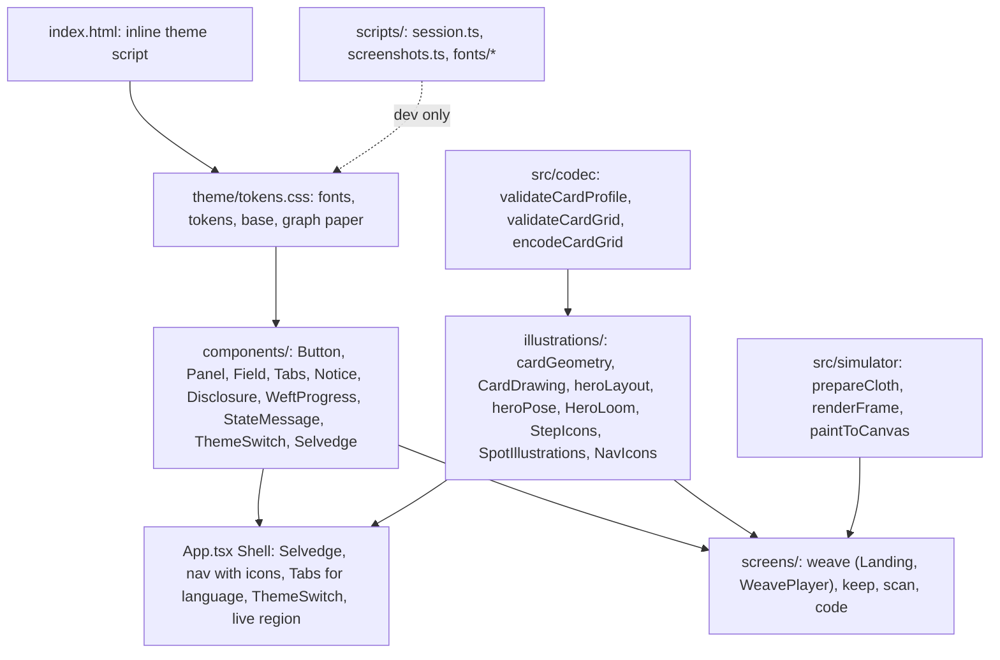
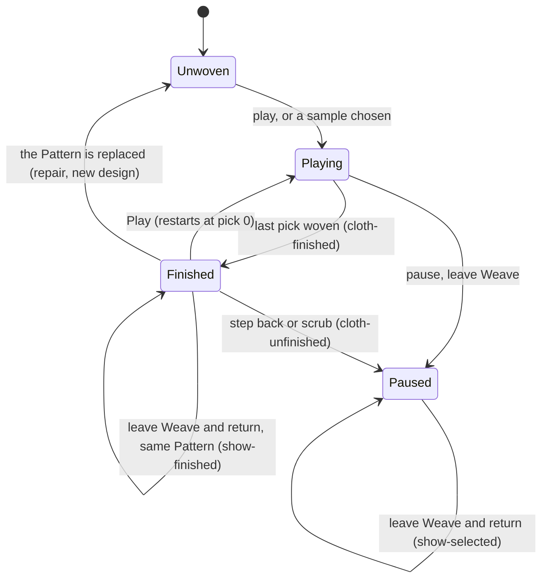

# Design Document

## Overview

This pass changes how the App looks and reads. It adds no weaving logic, no codec change and no new dependency. Everything new lives in `src/ui` (React, CSS Modules, inline SVG), in `public/fonts`, in `scripts`, and in a few documents. The four stages of the requirements map to work as follows.

| Stage | What lands | Main files |
|---|---|---|
| 0 (before Stage A) | The screenshot tooling and the 24 "before" PNG files (Requirement 24.1). The Check_Browser plumbing moves unchanged into a shared file. Bundle sizes and benchmark times are measured and written down. | `scripts/checks/session.ts`, `scripts/checks/screenshots.ts`, `scripts/screenshots.ts`, `media/design/before/` |
| A, Foundation | Fonts, complete tokens, the pre-paint theme script, the Night_Loom switch, the shared components, the Graph_Paper_Ground and the Selvedge. | `src/ui/theme/*`, `src/ui/components/*`, `public/fonts/*`, `index.html`, `scripts/fonts/*` |
| B, Understanding | The Landing, navigation icons, Disclosures, the purpose and next-step lines, the state messages with retry. | `src/ui/screens/weave/Landing.tsx`, `src/ui/components/Disclosure.tsx`, `src/ui/components/StateMessage.tsx` |
| C, Illustrations | The Card_Drawing, the Hero_Loom, the Step_Icons, the Spot_Illustrations, the "after" screenshots. | `src/ui/illustrations/*`, `media/design/after/` |
| D, Small fixes | Version_Labels, singular pick counts, the finished cloth on return to Weave, the steadier benchmark, the loom-mcp design correction, the loom-mcp screenshots. | `src/ui/state/versionLabels.ts`, `src/ui/i18n/messages.ts`, `src/ui/state/appState.ts`, `tests/codec-view/benchmark.test.ts`, `.kiro/specs/loom-mcp/design.md` |

### Decisions and the reasons for them

1. **One global sheet only.** `tests/ui/structure.test.ts` (R15.3) requires that `src/ui/theme/tokens.css` is the only non-module style sheet. The fonts, tokens, base element rules, focus ring, reduced-motion rule and the Graph_Paper_Ground therefore all go into `tokens.css`. No `base.css` is added.
2. **The Graph_Paper_Ground is the one place a `linear-gradient(` appears.** Requirements 3.13 and 7.8 forbid gradients in `.module.css` files, and Requirement 7.1 asks for a CSS-only grid with no image. A grid of 1 px lines is two hard-stop gradient layers on `body`, in `tokens.css`. It is not a colour blend. If you read Requirement 7.1 as "no gradient anywhere", the only alternative is an inline SVG `<pattern>` behind the Shell, which is not "CSS only". I chose `tokens.css`; say so if you want the other.
3. **No new package, one new colour token pair.** `--on-zari` (Day `#2A1F14`, Night `#07061A`) is the text on a primary Button, so `Button.module.css` needs no theme conditional (Requirement 5.7). `--on-hole` (`#F1E8D5` in both themes) is the text on the dark Code view panel, which the brief asks to be dark in both themes. Both go into `THEME_TOKENS` in the same commit (Requirement 3.11).
4. **The finished cloth is remembered by the Pattern, not by the pick.** See "Finished cloth on return to Weave" below. The cause is that the finished frame is stored as the last pick index, which looks the same as "paused on the last pick".
5. **Plural text is chosen inside `translator`.** Callers keep passing `keep.list.picks` with `{count}`. The translator picks `keep.list.picks.one` or `keep.list.picks.other`. This keeps Requirement 17.6 and leaves the existing tests that call `t('keep.list.picks', { count: 7 })` unchanged.
6. **The benchmark compares against a baseline measured in the same run.** A prototype run of 8 fresh processes gave an alignment time of 26 to 29 ms and a ratio to a plain integer LCS table of 2.48 to 2.81. A fixed millisecond ceiling cannot be steady when one run in three of the same test alone took 331 ms instead of 28 ms on this machine.
7. **Hero_Loom is a static import.** The Entry_Chunk is 100,853 bytes gzipped against a limit of 204,800 (measured today with `npm run check-bundle`). Requirement 13.6 applies only where the budget would be exceeded, so there is no `lazy` and no fallback box unless Stage C measures otherwise. The contingency is described under "Hero_Loom".
8. **The Weave screen is split in two.** `WeaveScreen` chooses between `Landing` and `WeavePlayer`. The player's cloth-measuring effect runs once on mount and needs its wrapper element to exist, so the player cannot live in the same component as the Landing branch.

### Points where the requirements pull against each other

These are the places where I had to choose. Each is repeated under "Open items" at the end.

| Point | Choice made |
|---|---|
| R24.1 asks for the "before" set to be committed before Stage A. R25.1 asks for four Stage commits. | One preparatory commit (Stage 0) before Stage A. The branch then holds five commits for this pass, four of them Stage commits. |
| R3.8 asks that every duration is `var()` of a motion token. The tokens are 120, 200 and 320 ms, and R13.3 allows a Lift_Cycle up to 3,000 ms. | The Lift_Cycle duration is `calc(var(--motion-long) * 6)` (1,920 ms). A style test accepts `var(--motion-*)` or a `calc()` whose operands are only such `var()`s and bare numbers. |
| R1.6 asks every Font_File to hold every symbol that appears in the strings. Hind and Rozha One may lack glyphs such as `●` and `○` (used by `repair.legend`). | The subset script records each code point the source font lacks in `scripts/fonts/missing-glyphs.json`. The font test allows exactly those. The fallback family draws them. |
| R12.1 asks for punched holes only. The repair panel legend (`repair.legend`) promises a ring for a hook position that is not punched. | `CardDrawing` takes `marks="rings"`, used only by the repair panel. The default draws no mark for an unpunched hook position. |
| R10.5 puts every Scan control except choose-a-photo inside a Disclosure. Accept and Discard are the next step after a read. | The Scan Disclosure is controlled. It starts collapsed and is opened by the Scan screen when a read completes. |
| R17.3 stores plural forms as `.one` and `.other`. R11.6 keeps every existing key. | The three base keys `keep.list.picks`, `codeview.pickCount` and `codeview.diff.option` are replaced by their `.one` and `.other` forms, as `keep.save.guessesNote` already is. The code still passes the base name. Two direct dictionary reads change (listed under "Existing tests and checks that change"). |

## Architecture



Dependencies keep their direction (`ui` imports `codec`, `simulator`, `archive`, `exporter`, `reader`, `codec-view`, `repair` through their `index.ts`; nothing imports `ui`). No file under `src/` imports from `scripts/`.

### New and changed files

| Path | New or changed | Stage |
|---|---|---|
| `scripts/checks/session.ts` | New. `Page`, `freePort`, `startPreview`, `startChrome`, `openPage`, `Cleanup`, `sleep` moved out of `check_browser.ts` with no change of behaviour. | 0 |
| `scripts/checks/screenshots.ts` | New. Pure: file names, view and theme lists, PNG checks. | 0 |
| `scripts/screenshots.ts` | New. The command `npm run screenshots -- before` or `-- after`. | 0 |
| `public/fonts/*.woff2`, `public/fonts/*-OFL.txt` | New. Four font files and three licence texts. | A |
| `scripts/fonts/` | New. `subset.sh`, `codepoints.ts`, `woff2Cmap.ts`, `report.ts`, `missing-glyphs.json`, `README.md`. Dev only. | A |
| `index.html` | Changed. Inline theme script before the module script. | A |
| `src/ui/theme/tokens.css` | Changed. | A |
| `src/ui/theme/contrast.ts` | Changed. New tokens, new pairs, `truncateRatio`. | A |
| `src/ui/theme/theme.ts` | New. `THEME_STORAGE_KEY`, `chooseTheme`, `applyTheme`. | A |
| `src/ui/platform/browser.ts` | Changed. `readStoredTheme`, `storeTheme`, `browserPrefersDark`. | A |
| `src/ui/components/*` | New. One `.tsx` and one `.module.css` per component. | A, B |
| `src/ui/App.tsx`, `src/ui/Shell.module.css` | Changed. | A, B |
| `src/ui/screens/weave/WeaveScreen.tsx` | Changed. Chooses `Landing` or `WeavePlayer`. | B |
| `src/ui/screens/weave/WeavePlayer.tsx` | New. The existing body of `WeaveScreen`, plus the finished-on-return fix. | B, D |
| `src/ui/screens/weave/Landing.tsx`, `ClothPreview.tsx` | New. | B |
| `src/ui/illustrations/*` | New. | C |
| `src/ui/screens/scan/BatchList.tsx`, `weave/RepairPanel.tsx` | Changed. They draw cards through `CardDrawing`. | C |
| `src/ui/i18n/en.json`, `hi.json`, `messages.ts` | Changed. | A to D |
| `src/ui/state/versionLabels.ts` | New. | D |
| `src/ui/state/appState.ts`, `src/ui/types.ts`, `src/ui/state/playback.ts` | Changed. | D |
| `scripts/check_browser.ts`, `scripts/check_bundle.ts`, `scripts/checks/precache.ts` | Changed. Additive checks and the Disclosure helper. | A to D |
| `tests/codec-view/benchmark.test.ts` | Changed. | D |
| `.kiro/specs/loom-mcp/design.md` | Changed. One entry. | D |
| `docs/BUILD_LOG.md`, `docs/KIRO_USAGE.md`, `README.md`, `docs/HINDI_REVIEW.md`, `.kiro/steering/structure.md` | Changed. `HINDI_REVIEW.md` is regenerated with `npm run review-list`. `structure.md` gains one line naming `components/` and `illustrations/`. | D |

### Naming rules this pass has to follow

`tests/structure/glossaryTerms.test.ts` scans every identifier and comment in `src` and `scripts` for the words row, column, col, thread, hole (alone), cell, overlap, horizontal and vertical. String literals and `.css` files are not scanned. `tests/structure/cardDimensions.test.ts` reports the demo profile's numbers (12, 15, 16, 36, 43, 45, 57, 60, 192, 720, 540 and the fractional ones) on a line that names card geometry. New code follows these rules:

| Requirement term | Name in code |
|---|---|
| Thread_Progress | `WeftProgress` (file `WeftProgress.tsx`). A weft being drawn across a track. |
| punched hole circle | class `punchedHole`, never `hole`. |
| a strip of items | `strip` or `group`, never `row`. |
| layout words in comments | "side by side" and "stacked", never horizontal or vertical. For the cloth, "warp direction" and "weft direction". |
| lift offsets in the Hero_Loom | `LIFT_UNITS`, `PRESS_UNITS`, `END_PITCH_UNITS`. They are drawing units of the illustration, not card dimensions. |

The tsconfig has `erasableSyntaxOnly`: no enums, no namespaces, no parameter properties.

## Components and Interfaces

### Tokens (`src/ui/theme/tokens.css`)

The file keeps its existing tokens and adds the ones below. It is organised in this order: `@font-face` rules, `:root` tokens, `[data-theme='night']`, base element rules, focus ring, Graph_Paper_Ground, reduced-motion rule. The existing contrast test reads the first `:root {...}` block and the `[data-theme='night'] {...}` block with `[^}]*`, so those two blocks contain no `}` inside comments or values.

| Group | Tokens (exactly this many) | Values |
|---|---|---|
| Type scale (6) | `--text-small`, `--text-meta`, `--text-body`, `--text-lead`, `--text-title`, `--text-display` | 14px, 16px, 18px, 22px, 28px, 36px |
| Spacing (7) | `--space-1` to `--space-7` | 4px, 8px, 12px, 16px, 24px, 32px, 48px |
| Radius (2) | `--radius-control`, `--radius-panel` | 4px, 8px |
| Shadow (1) | `--shadow-card` | `0 2px 6px rgb(0 0 0 / 0.25)`, the same in both themes |
| Motion (3) | `--motion-short`, `--motion-medium`, `--motion-long` | 120ms, 200ms, 320ms |
| Fonts (3) | `--font-display`, `--font-body`, `--font-data` | exactly the strings of Requirement 1.3 |
| Other | `--touch-target: 48px`, `--leading-body: 1.5`, `--leading-hindi: 1.7` | Prefixes `--text-`, `--space-`, `--radius-`, `--shadow-`, `--motion-` are used by no other token, so a test can count them. |
| Colour (13) | the 11 existing, plus `--on-zari` and `--on-hole` | Day and Night values in `THEME_TOKENS`. `--zari` stays `#B0800A` in Day. |

Base rules in the same file:

- `html { font-size: 18px }`. `body` uses `var(--font-body)`, `line-height: var(--leading-body)`, and `html[lang='hi'] body` uses `var(--leading-hindi)`. Running text elements (`p`, `li`) inherit it, so Hindi paragraphs, list items and Notice text compute 1.7 (Requirement 23.3).
- `td, th, [data-tabular] { font-variant-numeric: tabular-nums }`. The pick counter carries `data-tabular`.
- `:focus-visible { outline: 3px solid var(--zari); outline-offset: 2px }`. This pair already passes 3:1 on `--ground` and `--surface` in both themes (existing `TOKEN_PAIRS`).
- `[data-theme='night'] { color-scheme: dark }` so native form parts follow the theme.
- The Graph_Paper_Ground: `body { background-color: var(--ground); background-image: linear-gradient(var(--line) 1px, transparent 1px), linear-gradient(90deg, var(--line) 1px, transparent 1px); background-size: 8px 8px }`. It sits on `body`, so every Panel (fully opaque `--surface`, Requirement 7.2) covers it. `transparent` is the one colour keyword that appears, and only here.
- The existing `@media (prefers-reduced-motion: reduce)` rule that sets `transition: none` and `animation: none` stays.

### Fonts

| File in `public/fonts` | Family | Weight | Code points |
|---|---|---|---|
| `RozhaOne-Regular.woff2` | Rozha One | 400 | Basic Latin, Devanagari U+0900 to U+097F, symbols found in the strings |
| `Hind-Regular.woff2` | Hind | 400 | the same |
| `Hind-Bold.woff2` | Hind | 700 | the same |
| `IBMPlexMono-Regular.woff2` | IBM Plex Mono | 400 | Basic Latin and the symbols found in the strings. No Devanagari. |
| `RozhaOne-OFL.txt`, `Hind-OFL.txt`, `IBMPlexMono-OFL.txt` | licence text and copyright notice | | |

Each font has one `@font-face` rule with `font-family`, `font-weight`, `font-display: swap` and `src: url('/fonts/<file>') format('woff2')`. A throwaway Vite build confirmed that under `base: './'` this URL is rewritten to `../fonts/<file>` in the built CSS, so it has no scheme and no host, and the file is in `dist/fonts/`. There is no `<link rel="preload">` and no `unicode-range`, so a file is fetched only when a rule that uses it applies (Requirement 15.2). While a file loads, `font-display: swap` shows the first fallback of the `--font-*` stack (Georgia, system-ui or ui-monospace) at once, and a failed request leaves that fallback in place with no message (Requirements 1.9 and 1.11).

**How the files are made (dev only, no `package.json` change).** Nothing here runs in `npm run build`. The woff2 files are committed.

1. One-time setup, documented in `scripts/fonts/README.md`: `python3 -m venv /tmp/naqsha-fonts && . /tmp/naqsha-fonts/bin/activate && pip install fonttools brotli`. `pyftsubset` needs `brotli` to write woff2.
2. `scripts/fonts/subset.sh` does the rest:
   - `node scripts/fonts/codepoints.ts` writes `latin-symbols.txt` and `devanagari.txt` into a temp directory. It reads every string value of `en.json` and `hi.json` and the three Sample_Design names, takes U+0020 to U+007E, adds each other code point that is not Devanagari (such as `…`, `·`, `●`, `○`, `—`), and for Rozha One and Hind adds U+0900 to U+097F, U+200C, U+200D and U+25CC.
   - It downloads the four source `.ttf` files and the three `OFL.txt` files from `https://raw.githubusercontent.com/google/fonts/<ref>/ofl/{rozhaone,hind,ibmplexmono}/` into `scripts/fonts/source/` (git-ignored). `<ref>` is a commit SHA pinned in the script and copied into the Build_Log. All three directories exist and have `OFL.txt` (checked on 2026-11-21; designers: Indian Type Foundry for Rozha One and Hind, Mike Abbink and Bold Monday for IBM Plex Mono).
   - For each file: `pyftsubset <ttf> --unicodes-file=<list> --flavor=woff2 --layout-features='*' --no-hinting --output-file=public/fonts/<name>.woff2`. `--layout-features='*'` keeps the Devanagari shaping features.
   - `node scripts/fonts/report.ts` prints bytes before and after for each file, the sum, and the code points each source font lacks. It writes `missing-glyphs.json`. The Build_Log "Font_Weight_Report" is typed from this output.
3. `scripts/fonts/woff2Cmap.ts` reads the code points a woff2 file covers: it parses the woff2 table directory, decompresses the single Brotli stream with `node:zlib`, slices the `cmap` table (which woff2 does not transform), and reads its format 4 and format 12 subtables. The font test and `report.ts` both use it. This is how Requirement 1.5 is checked without a browser.

The licence check (Requirement 2) is made at the same step: the three `OFL.txt` files are the licence texts, and the licence name, source URL and the date (YYYY-MM-DD) go into the Build_Log. If a licence turns out not to be OFL 1.1 or equivalent, the font is not copied into `public/fonts` and the Build_Log names it. The total size is expected to be well under 300 KB (my estimate is about 110 to 130 KB, not measured here because `fonttools` is not installed on this machine). If the real sum is above 307,200 bytes, the Build_Log lists each file above 51,200 bytes and the ranges that could go, and the final report asks the user (Requirement 2.6).

The README gets a "Fonts" part in "Prior work and credits" with designer, licence and URL for each family. The sentence "No other credits are listed." is reworded so it stays true.

### Theme: applied before the first paint

`index.html` gets one classic inline script in `<head>`, before the module script. A throwaway build showed that Vite keeps such a script as written and in front of the stylesheet link.

```html
<script>
  (function () {
    var theme = null;
    try { var stored = localStorage.getItem('naqsha.theme'); if (stored === 'day' || stored === 'night') theme = stored; } catch (e) {}
    if (theme === null) { try { theme = window.matchMedia('(prefers-color-scheme: dark)').matches ? 'night' : 'day'; } catch (e) { theme = 'day'; } }
    document.documentElement.setAttribute('data-theme', theme);
  })();
</script>
```

`src/ui/theme/theme.ts` holds the same rule in typed form, and a test runs the script from `index.html` in `node:vm` with fake `localStorage` and `matchMedia` and compares it with `chooseTheme` for every case of Requirements 4.5 to 4.8.

```ts
export const THEME_STORAGE_KEY = 'naqsha.theme';
export function chooseTheme(stored: ThemeName | null, prefersDark: boolean): ThemeName; // stored wins; else dark -> night; else day
export function applyTheme(root: Pick<Element, 'setAttribute'> | null, theme: ThemeName): void; // no-op when root is null
```

`platform/browser.ts` gets `readStoredTheme(storage)` and `storeTheme(storage, theme)`, which follow `readStoredLanguage` and `storeLanguage` (never throw, return `null` or `false`), and `browserPrefersDark()` (never throws; `false` when `matchMedia` is missing or throws).

`App` keeps `theme` in `useState`, set from `chooseTheme(readStoredTheme(store), browserPrefersDark())`, the same inputs the inline script used. `useLayoutEffect(() => applyTheme(document.documentElement, theme), [theme])` runs before the next paint after a change. The theme is not in the `AppState` reducer, so changing it cannot touch the Current_Pattern, the language or the Screen (Requirement 4.9). `Shell` gets two props, `theme` and `onThemeChosen`. The handler calls `storeTheme` (inside `try/catch` already), then sets state. A refused store leaves the choice applied for the page session and shows nothing.

`ThemeSwitch` (`components/ThemeSwitch.tsx`) is one `<button role="switch" aria-checked={theme === 'night'}>`, at least 48 by 48 px. It shows a drawn sun or moon (different shapes, `aria-hidden`), the text `theme.label` ("Night loom") and the state text `theme.on` or `theme.off`. The accessible name is the label; the state is `aria-checked`. Text may wrap onto a second line at 320 px, and the control grows in height.

SVG Illustrations take their colours from `fill: var(--token)` in their CSS Module, so a theme change redraws them with no script (Requirement 4.11). The cloth canvas uses the weaver's thread colours, not tokens, and is not redrawn on a theme change.

### Shared components (`src/ui/components/`)

Each has a co-located `.module.css`. Every colour is a token; every duration is a motion token; no `box-shadow` except `var(--shadow-card)`.

| Component | Props | Notes |
|---|---|---|
| `Button` | `variant?: 'primary' \| 'secondary' \| 'quiet'` (default `secondary`), `type?: 'button' \| 'submit'` (default `button`), the other `<button>` attributes, `ref` | Renders one `<button>`. Primary: `--zari` fill, `--on-zari` text in every state. Secondary: 2 px `--ink-soft` outline. Quiet: no border, `--indigo` text, underline. Disabled: native `disabled` (not focusable, no action), dashed border, no fill and `--ink-soft` text, so the look differs by more than colour. Minimum 48 by 48 px. |
| `ButtonLink` | `href`, `onActivate`, `variant` | An `<a>` with the look of a Button. The Landing "scan your own card" control uses it with `href="#scan"`; the click handler calls `preventDefault` and navigates. |
| `Panel` | `as?: 'div' \| 'section'`, `aria-labelledby?`, `children` | `--surface` fill (alpha 1), 1 px `--line` border, `--radius-panel`. |
| `Field` | `label: string`, `children` (the control) | Renders `<label><span>{label}</span>{children}</label>`, the markup the existing tests and `Page.fillField` rely on. Styles `input`, `select`, `textarea` and `::file-selector-button` inside it. Control borders are `--ink-soft` (5.70 on Day `--ground`, 8.21 on Night), not `--line` (1.40). |
| `Tabs` | `label`, `items: {key, label, lang?}[]`, `current: string`, `onChoose(key)` | A group of toggle buttons with `aria-pressed`, the same semantics as today's language switch. The current choice has bold text and a drawn check mark besides its fill. Used by the language switch. |
| `Notice` | `variant: 'information' \| 'success' \| 'warning' \| 'error'`, `word: string`, `role?: 'alert' \| 'status'`, `children`, `action?` | A word and a drawn icon that differ per variant, then the text. The word colour is `--indigo`, `--leaf`, `--ink`, `--madder` (all on `--surface` at 4.5:1 or more already). The border is 2 px in the variant colour. `error` defaults to `role="alert"`; the others have no role. |
| `Disclosure` | `label`, `children`, `expanded?`, `onToggle?`, `id?` | See next section. |
| `WeftProgress` | `text: string` | Visible text and a drawn thread on a track (`<svg>` with a `--line` track and a `--zari` thread). The thread draws across with a CSS animation of `calc(var(--motion-long) * 4)`. Reduced motion shows it fully drawn. It has no role; the text is the statement of progress (Requirement 7.4, the "visible text" alternative). |
| `EmptyState` | `illustration?: ReactNode`, `message: string`, `next: string` | A Panel with the (decorative) illustration, the message and the next-step sentence. |
| `StateMessage` | `variant`, `message`, `next?`, `retry?: {label, onRetry}`, `t` | A Notice or an EmptyState. The retry is a 48 px secondary Button. |
| `LoadingState` | `text` | `<div role="status">` with `text` and a `WeftProgress`. Mounted only while loading. The Shell's own persistent `role="status"` region is unchanged and is the only one that stays mounted. |
| `ThemeSwitch`, `Selvedge`, `ScreenIntro` | see below | |

`ScreenIntro({ purpose, next })` renders two `<p>` lines under the Screen heading. Each is one sentence of at most 100 characters from the Translation_Files (Requirement 10.1).

A small helper `startDelay(ms, onElapsed, timers)` in `components/delay.ts` runs a timer and returns its cancel function. The hook `useAfterDelay(active, 300)` uses it, so a `WeftProgress` appears only after an operation has run for 300 ms. The timers are injected, so a test passes a fake clock.

### Disclosure and the structure of each Screen

`Disclosure` renders `<button aria-expanded aria-controls={id}>` followed by `<div id={id} hidden={!expanded}>`. A `hidden` element is out of the Tab order and the accessibility tree, and its inputs keep their values because the elements stay mounted (Requirement 10.10). Server rendering still contains the controls, with `hidden`, which keeps the existing string-matching tests working. State is `useState(false)` unless `expanded` is given, so it is collapsed each time a Screen mounts. Enter and Space toggle it (native button). An Escape key inside the panel collapses it and focuses the button (Requirement 10.12).

| Screen | Intro lines (new keys) | Outside a Disclosure | Inside a Disclosure ("More" or "Settings") | The one primary Button |
|---|---|---|---|---|
| Landing | `weave.purpose`, `weave.empty` (existing key, kept as the next-step line) | headline, Hero_Loom, Step_Strip, three tiles, scan link | none | first Sample_Tile "Try it" |
| Weave player | `weave.purpose`, `weave.nextStep` | cloth, current card, pick counter, playback controls, scrubber, speed | repeat count, warp colour, weft colour, zari (labelled `disclosure.settings`) | Play (or Resume) |
| Keep | `keep.purpose`, `keep.nextStep` | name field, Save, the export panel with its primary export button, the saved list | export options (bit depth, lift colour, order of picks, order of ends) and the other metadata fields, one "More" | the export button; Save is secondary |
| Scan | `scan.purpose`, `scan.nextStep` | the choose-a-photo input | zoom, undo, accept, discard, the batch controls and the camera (one "More", opened by the screen when a read completes) | choose-a-photo while no card is read; Accept after a read, with choose-a-photo then styled secondary |
| Code view | `codeview.purpose`, `codeview.nextStep` | the compare panel (placed directly under the intro), then the pick controls and the listing | none | Compare |
| Shell | | the Card_Profile status notice | the Card_Profile details (`ProfileNotice` keeps the name and the UNVERIFIED notice outside, details inside) | |

Moving the Compare panel above the pick controls on the Code view is what keeps its primary Button inside the first 844 px at 390 by 844 (Requirement 23.7). If the screenshot inspection shows it is not, the panel's hint paragraph moves into the existing help text.

### Shell

`Shell` keeps its `<nav aria-label>`, its four buttons and its single `<div role="status" aria-live="polite">`. Changes:

- A `Selvedge` as the first child of `<header>`: an inline `<svg>`, `width: 100%`, 6 px high, `<pattern>` of alternating `<rect>`s whose classes set `fill: var(--zari)` and `fill: var(--madder)`. No gradient, no image, and `overflow: hidden` on the header so it adds no scroll width.
- Each navigation button renders the label text first, then an `aria-hidden` `<svg>` icon from `NavIcons.tsx`, then, for Code view only, a `<span>` with `nav.advanced` ("Advanced"). The label is first in the markup because existing tests match `aria-current="page"[^>]*>Weave<` and `>Code<`. The icon moves in front with CSS `order: -1` on a flex column. The current item has `aria-current="page"`, bold text, a 3 px underline and a filled `--zari` background with `--on-zari` text (ink on `--zari` is 4.55:1 in Day, `--hole` on `--zari` is 10.28:1 in Night).
- The language switch becomes `Tabs`; `ThemeSwitch` sits beside it. At 320 px the header wraps into stacked groups (title, then switches, then navigation); nothing is clipped because every item may wrap its own text and grow in height (Requirement 23.10).
- The banner `<div className={styles.banner}>` for a failed profile becomes `StateMessage` (error, with the retry). The loading `<p>` becomes `LoadingState`.

### Landing

`WeaveScreen` (outer) reads `state.current.pattern`. If it has no pick it renders `<Landing>`; otherwise `<WeavePlayer arrival={...}>`. It also captures the arrival values once, on mount (see the finished-cloth section).

`Landing` props: `{ state, dispatch, t }`. Its contents, in DOM order:

1. `<h2 id="screen-title">` with `nav.weave`. Kept because `check_browser` and the existing tests read `#screen-title`. It is styled as a small label (`--text-small`).
2. The headline `<h3>` from `landing.headline` in `--font-display`: `--text-lead` below 720 px, `--text-display` from 720 px.
3. `ScreenIntro` (`weave.purpose` and `weave.empty`).
4. `HeroLoom` (Stage C; until then, nothing). On narrow screens CSS `order` places it after the scan link. It holds no focusable element, so focus order still equals reading order.
5. `StepStrip`: an `<ol>` of three items, each a `StepIcon` and the label (`landing.step.scan`, `landing.step.weave`, `landing.step.keep`).
6. `SampleTiles`: while the profile is `loading`, a `LoadingState` (`status.loading`); while `failed`, an error `StateMessage` with retry (`error.profile.*`); when `ready`, three tiles.
7. `ButtonLink` to Scan, `landing.scanLink`, after the last tile.

One `SampleTile` is one `<button type="button" data-sample="diamond">`. Its children are the name (`tryit.diamond`), a `ClothPreview` (`aria-hidden`) and a `<span>` "Try it" (`landing.tile.try`). The first tile is styled like a primary Button, the other two like secondary Buttons, by applying the Button module's classes to the tile. Clicking it dispatches `{ type: 'request-sample', design, pattern: generateSample(profile, design) }`. The reducer replaces the Current_Pattern, `WeaveScreen` renders `WeavePlayer`, and `entryModeFor` returns `autoplay` because the new Pattern is not the one that was loaded on arrival. Playback therefore starts as it does today after Try it, well inside 500 ms. (Under Reduced_Motion it shows the finished cloth, as today.)

`ClothPreview({ profile, pattern })` is a small `<canvas>`. In an effect it runs `prepareCloth`, `parseRenderSettings` (with `DEFAULT_CLOTH_CHOICES`, a small `threadSizePx`, and the canvas size) and `renderFrame` for the frame after the last pick, then `paintToCanvas`. It makes no network request. If any step returns a failure value or throws, it sets a flag and renders nothing; the tile keeps its name and its "Try it" label and still works, and no Notice is shown (Requirement 8.14).

`TryIt` stays as it is, below the player, with the sample buttons, the lost-cards sample and the print controls. The Landing does not render it. Its sample buttons gain `data-sample`, so one selector, `[data-sample="diamond"]`, finds either control. The list of words the Landing may not contain (Requirement 8.9) is a test over the rendered Landing text and accessible names in both languages.

Estimated height budget at 390 by 844, English (to be confirmed by a new Check_Browser step that reads `getBoundingClientRect().bottom` of the headline, the Step_Strip and the first tile):

| Part | Height |
|---|---|
| Header: Selvedge 6, title and switches 48, navigation 48, gaps 24 | about 126 (about 174 when Hindi wraps the first strip) |
| Screen label | 28 |
| Headline, two lines at 22 px | about 53 |
| Two intro lines | about 48 |
| Step_Strip | about 100 |
| First tile (preview, name, "Try it") | about 200 |
| Total | about 555, with about 145 spare for Hindi wrapping |

### Illustrations (`src/ui/illustrations/`)

All are inline SVG React components. They carry no `fill` or `stroke` colour literal: a CSS Module class sets `fill: var(--token)` or `stroke: var(--token)`, or the element uses `currentColor`. None has a gradient, a `<filter>`, an emoji, a religious symbol or a figure. None adds an image file.

**Card geometry (`cardGeometry.ts`, pure).**

```ts
export type CardGeometry = {
  widthMm: number; heightMm: number;
  hookCentres: PointMm[][];            // [hookRow][hookColumn], from hookCentreMm(profile, r, c)
  holeDiameterMm: number;
  pegHoles: [Disc, Disc];              // each with its own diameter
  lacingHoles: Disc[];
};
export function cardGeometry(profile: unknown): { ok: true; geometry: CardGeometry } | { ok: false };
```

`cardGeometry` calls `validateCardProfile` from `src/codec`, and builds the centres with the existing exported `hookCentreMm` in `printable/layout.ts`, the one formula the printable card and the reader already share. It contains no card dimension. The punched positions come from `validateCardGrid(profile, grid)` returning no violation, then reading `grid[hookRow][hookColumn]`.

**`CardDrawing`** (`CardDrawing.tsx`, `CardDrawing.module.css`). It replaces `CardThumb` (the body; the name `CardThumb` is kept as a thin wrapper so the existing tests still import it) and the old `CardDrawing` in `RepairPanel.tsx`.

```ts
export type CardDrawingProps = {
  profile: CardProfile | null;
  grid: CardGrid | null;                   // null for a card that is missing
  state?: 'ok' | 'damaged' | 'missing';    // default 'ok'; 'ok' with a null grid is 'missing'
  pickNumber?: number;                     // the number the screen shows for this pick
  adjacentText?: boolean;                  // true when text beside it states pick number and punched count
  label?: string;                          // keeps today's aria-label where a test relies on it
  marks?: 'none' | 'rings';                // 'rings' only for the repair panel
  t: Translate;
};
```

The SVG has `viewBox="0 0 {widthMm} {heightMm}"` and `width: 100%`, so the box follows the card's aspect ratio from the profile (Requirement 12.8). It draws, in this order: the manila stock `<rect>` (no `rx`, so the corner radius is 0), the punched holes (`<circle class="punchedHole">`, one per punched hook position, centre and radius from the geometry), the two peg holes, the lacing holes, and, when `marks="rings"`, a thin `<circle class="unpunchedMark">` for each unpunched hook position. The stock has a 1 px `--ink-soft` outline with `vector-effect: non-scaling-stroke`. Day stock `--card` is only 1.68:1 against Day `--ground`, so the outline carries the shape. The soft shadow is `box-shadow: var(--shadow-card)` on the wrapping `<figure>`, which has square corners; it is not an SVG filter (Requirement 14.8).

| Case | What it draws |
|---|---|
| `profile` is null or fails `cardGeometry` | no card; the text `card.cannotDraw`; no exception (R12.12) |
| the grid does not match the profile | stock, peg holes, lacing holes, no punched hole, `<desc>` containing `card.mismatch` (R12.5) |
| `state` is `damaged` or `missing` | a gap `<rect>` filled `--surface` with a `--madder` hatch (an SVG `<pattern>` of `<line>`s), and a `<figcaption>` with `card.damaged` or `card.missing` as visible text (R12.10). Madder on `--surface` is 7.28:1 Day and 4.74:1 Night. |
| `adjacentText` is false | `role="img"`, `<title>` (the `label`, else `card.title` with the pick number) and `<desc>` (`card.desc`: punched holes out of the total) (R12.6). When `label` is given, the same text is the `aria-label`. |
| `adjacentText` is true | `aria-hidden="true"`, no `<title>`, no `<desc>` (R12.7) |

It is wrapped in `React.memo`. Where it is used:

- Weave: the current card of the shown pick, beside the cloth from 720 px and below the playback strip on narrow screens (so Play stays high). The pick shown while finished is the last card. The pick counter text states the pick number but not the punched count, so `adjacentText` is false.
- Scan: `CardThumb` in the batch list, with `label` set to the existing `scan.batch.thumb.alt` text. The text beside it does not repeat the count either. The photograph with its markers (`CardOverlay`) stays: it marks sampled hook positions over a photograph and does not draw a card from a profile. I read "the result" in Requirement 12.4 as the card in the batch.
- The repair panel: `marks="rings"`, `label` set to the existing `repair.draw` text. It keeps the legend true.
- Keep and the empty states: no card is drawn today and none is added. The Spot_Illustrations are abstract and show no punch card, so they need no Card_Drawing.

**`HeroLoom`.** Two files, so the layout can stay out of a lazy chunk if one is ever needed.

- `heroLayout.ts` (pure): `heroLayout(profile)` returns the viewBox size, the card's box and the x of each end. The x of end `i` is `MARGIN_UNITS + i * END_PITCH_UNITS`, so there are `endsPerPick` columns of hooks and warp ends, and the width is `endsPerPick * END_PITCH_UNITS` plus margins. The card height comes from the profile's aspect ratio.
- `heroPose.ts` (pure): `heroPose(profile, pattern)` finds the first pick with at least one punched hook position, checks it with `validateCardGrid`, encodes it with `encodeCardGrid`, and returns `{ kind: 'lifted', pickIndex, grid, liftedEnds: number[], endsPerPick }`. If no pick qualifies, or the grid does not match, or encoding fails, it returns `{ kind: 'plain' }`. Each lifted end index is the end its hook position maps to (`endOrder` through `encodeCardGrid`), and the number of raised hooks equals the number of lifted ends equals the number of punched hook positions of that pick.
- `HeroLoom.tsx`: draws, from top to bottom, the Jacquard head (a frame), the card (the inner part of `CardDrawing`, shared as `CardFace`, so the card uses the same stock, holes and square corners), a short needle for each end, a hook for each end, and a warp line for each end. A hook of a lifted end has the class `hookRaised` and its warp end has `endLifted`. A weft is a single bar.
- **Raised and resting differ by position.** `.hookRaised` and `.endLifted` are translated up by `--lift` (set by an inline style from `LIFT_UNITS`). They also differ by colour (`--zari` for a lifted end against `--indigo` at rest, both at least 3:1 on `--ground`), and the `<desc>` says it in words, so no colour is the only carrier (Requirement 13.7).
- **Lift_Cycle.** One CSS animation set, `animation-iteration-count: 1`, duration `calc(var(--motion-long) * 6)` (1,920 ms). Keyframes: the card translates down by `PRESS_UNITS` to press on the needles; the raised hooks and lifted ends translate up by `--lift`; the weft bar translates across the warp direction; everything returns to translate 0. Nothing repeats, because the animation is not re-triggered by a re-render or a language change (the element is not remounted). Switching the theme only changes variables.
- **Reduced motion.** The still pose is the lifted pose: `.hero[data-motion='still'] { --still-lift: var(--lift) }` and the same declaration inside `@media (prefers-reduced-motion: reduce)`. `.hookRaised` and `.endLifted` use `transform: translateY(calc(var(--still-lift, 0px) * -1))` as their base transform and animate from it. With animation off (the global reduced-motion rule), the base transform is the lifted pose. `HeroLoom` gets `reducedMotion` from `AppState.prefersReducedMotion` and sets `data-motion`.
- **Accessibility.** `role="img"` with `aria-labelledby` pointing at `<title>` (`hero.title`) and `<desc>` (`hero.desc`), in the current language. A language change re-renders the strings with no reload.
- **Density risk.** For the 192 ends of the demo profile, each end is about 1.9 CSS px wide on a 358 px screen. Hooks and warp ends are thin lines with a minimum lift of `LIFT_UNITS` so a raised hook is plainly above a resting one. The 24 "after" screenshots (Requirement 24.7) are where this is judged. The profile gives the count; I do not group ends, because Requirement 13.2 asks for one hook per punched hook position.
- **If the Entry_Chunk would exceed the budget after Stage C** (it is far from it today), only `HeroLoom.tsx` changes: it is imported with `lazy` and wrapped in a `Suspense` fallback `<div style={{ aspectRatio: layout.aspect }}>` built from `heroLayout`, so the box has the same size before and after. A failed chunk keeps that fallback and an error boundary around it swallows the rejection (Requirement 13.9). The Build_Log names each Illustration moved.

**`StepIcons.tsx`, `SpotIllustrations.tsx`, `NavIcons.tsx`.** Pure drawing components with a `viewBox`, `width: 100%` up to a `max-width` in CSS, and `currentColor` or token classes. The three Step_Icons are a camera frame with corner brackets (scan), a cloth with one weft passing (weave) and a folder tab with a tick (keep). The three Spot_Illustrations are an empty shelf (no saved designs), a camera frame with nothing in it (no cards scanned) and two sheets side by side with a gap (nothing to compare). The four navigation icons are different from the Step_Icons. Each Step_Icon sits beside a visible label, so it is `aria-hidden` with no `<title>`. Each Spot_Illustration sits in an EmptyState that states the situation in text, so it is `aria-hidden` too. If one is ever used without such text, it takes `role="img"` with a `<title>` and `<desc>` (Requirement 14.6); the props allow it with a `decorative?: boolean` default of `true`.

### Text, plurals and state messages

**New keys.** Every key is added to both `en.json` and `hi.json`; the `hi.json` entry has `"reviewed": false`; `docs/HINDI_REVIEW.md` is regenerated.

| Group | Keys |
|---|---|
| Landing | `landing.headline`, `landing.step.scan`, `landing.step.weave`, `landing.step.keep`, `landing.steps.name`, `landing.tile.try`, `landing.scanLink` |
| Intro lines | `weave.purpose`, `weave.nextStep`, `keep.purpose`, `keep.nextStep`, `scan.purpose`, `scan.nextStep`, `codeview.purpose`, `codeview.nextStep` |
| Navigation | `nav.advanced` |
| Theme | `theme.label`, `theme.on`, `theme.off` |
| Disclosure | `disclosure.more`, `disclosure.settings` |
| Notice words | `notice.information`, `notice.success`, `notice.warning`, `notice.error` |
| States | `state.retry`, `status.screen`, `keep.list.empty.next`, `scan.batch.empty.next` |
| Progress | `progress.reading`, `progress.exporting`, `progress.saving` |
| Cards | `card.title`, `card.desc`, `card.damaged`, `card.missing`, `card.mismatch`, `card.cannotDraw` |
| Hero | `hero.title`, `hero.desc` |
| Version label | `codeview.diff.separator`, `codeview.diff.duplicate`, `codeview.diff.ellipsis` |
| Plural pairs | `keep.list.picks.one` and `.other`, `codeview.pickCount.one` and `.other`, `codeview.diff.option.one` and `.other`, `repair.evidence.repeat.one` and `.other` |

`repair.evidence.repeat` puts `{period}` directly before "picks", so Requirement 17.3 covers it ("every 1 picks" is wrong). Its `.one` form reads "Cards repeat every pick ({agreeing} of {compared} pairs agree). Taken from pick {picks}." The `.one` form of each pair keeps the `{count}` (or `{period}`) placeholder, so `hi` and `en` keep the same placeholder set the existing test checks.

**Plural choice in `messages.ts`.**

```ts
/** `key.one` for a count of 1, `key.other` otherwise, only when the English dictionary has `key.one` and no `key`. */
export function pluralKey(en: Readonly<Record<string, string>>, key: string, params?: Params): string;
```

`translator(dictionaries, language)` calls `pluralKey` first, then `lookup` and `fillPlaceholders` as before. The count read is `params.count`, or `params.period` for the repeat evidence. A count that is not a number leaves the key alone. Count 0 and every count of 2 or more use `.other`. The choice depends on the count alone (Requirement 17.6). Existing keys with an explicit `.one` or `.other` are untouched, because they exist as written. The Hindi `.one` and `.other` texts of the picks keys use the same word ("पिक"), and the Build_Log names those keys (Requirement 17.5).

**State messages (Requirement 11).**

| Situation | Where it shows | Component | Retry |
|---|---|---|---|
| no saved designs | Keep list | `EmptyState` with the Spot_Illustration, `keep.list.empty` and `keep.list.empty.next` | none |
| no card in the Scan_Batch | Scan batch | `EmptyState`, `scan.batch.empty` and `scan.batch.empty.next` | none |
| nothing to compare | Code view | `EmptyState`, `codeview.empty` (it already names the next step) | none |
| Card_Profile loading | Landing and Shell | `LoadingState`, `status.loading` | none |
| Screen chunk loading | the `Suspense` fallback | `LoadingState`, `status.screen` | none |
| Card_Profile failed | Shell and Landing | error `StateMessage`, `error.profile.*` | reload the profile |
| Screen failed to load | `ScreenBoundary` | error `StateMessage`, `error.codeview.load` or `error.generic` | remount the Screen |
| card cannot be read | Scan | error `StateMessage`, `error.read.*`, for that card only | none; the choose-a-photo control stays usable |
| Archive failure | Keep and Code view | error `StateMessage`, `error.archive.*` | repeat the operation |

Each retry is a Button with a 48 px target. The Shell navigation, the Current_Pattern, the Scan_Batch and every saved design are untouched by a retry. How each retry works:

- **Profile.** `App` holds `profileAttempt` in `useState`. The effect that calls `loadProfile` lists it as a dependency, and the retry dispatches `{ type: 'profile-loaded', state: { status: 'loading' } }` and increments it.
- **Screen chunk.** `React.lazy` caches a rejected import. The two `lazy()` calls become `useLazyScreen(importer, attempt)` in `App.tsx`, which creates a new `lazy` component with `useMemo` per attempt. `ScreenBoundary` gets `onRetry`, which increments the attempt and remounts the Screen.
- **Archive.** Keep and Code view already hold the failure key in state. The retry calls the same handler again (list refresh, or Save with the form as it is). A failed Save wrote nothing, so a repeat cannot save twice.

The wording rule (Requirement 11.2, 11.3) is checked by a test over a named list `STATE_MESSAGE_KEYS` (the keys in the table above): each English text is at most 160 characters, has one to three sentences, and none contains "bitmap", "matrix", "decode", "decoded" or "decoding" outside the Code view. Any message over the limit is shortened with its meaning kept. Only an error variant uses `role="alert"`. Where the code already dispatches `announce` for the same failure (profile and read failures), the visible `StateMessage` is rendered with no role, so assistive technology hears it once, through the Shell's live region. Where there is no such `announce`, the message uses `role="alert"`. Focus never moves to a message.

### Version labels (Requirement 16)

`src/ui/state/versionLabels.ts`, pure, imports types only.

```ts
export const NOTE_EXCERPT_MAX = 40;
export function noteExcerpt(note: string | undefined, ellipsis: string): string; // '' when no usable note
export function versionLabels(
  summaries: ReadonlyArray<DesignSummary>,
  language: Language,
  t: Translate,
): ReadonlyMap<string, string>; // archive id -> label, all distinct
```

`noteExcerpt` trims, replaces each run of whitespace (line breaks included) by one space, and counts Unicode code points with `Array.from`. Up to 40 code points it returns the text. Over that, it takes the first 40 code points, cuts at the last space inside them (or keeps all 40 when there is none), trims the end and appends the ellipsis. The ellipsis is not counted.

`versionLabels` builds each label as `t('codeview.diff.option', { name, count })` (which picks `.one` or `.other`), then, in order, the separator and `formatSavedAt(createdAt, language)` when it is not empty (the same function the Keep list uses, so the date text is the same), then the separator and the excerpt when there is one. The name comes from `savedLabel(metadata, t('keep.untitled'))`. A missing or invalid `createdAt` makes `formatSavedAt` return `''`, so the date part and its separator are left out. To make labels distinct, it groups equal labels, sorts each group by `createdAt` ascending and then by archive id, and appends `t('codeview.diff.duplicate', { k })` (" #1", " #2", ...) to every member of a group of two or more. `ChoiceSelect` in `DiffPanel.tsx` calls `versionLabels` once per list and reads its option text from the map; the `<label>` and `<select>` accessible names are untouched.

### Finished cloth on return to Weave

**Root cause (read from `playback.ts`, `WeaveScreen.tsx`, `ClothCanvas.tsx`, `appState.ts`).**

1. The player's last frame when a cloth ends is `rest(pickCount)`. `createClothPlayer` reports `frame.pick === pickCount`.
2. `WeaveScreen`'s `onFrame` dispatches `select-pick` with that value. The reducer clamps it to `pickCount - 1` (Requirement 18.7 and the existing rule), so `AppState.selectedPick` ends at the last pick index. The "finished" fact lives only in the screen's local `playback` state, which is lost when the Screen unmounts.
3. On return, `entryModeFor(pattern, null, mounted, mountedPick)` sees the same Pattern and `mountedPick > 0`, so it returns `show-selected`, and `entryPlayback` gives `{ status: 'paused', pick: pickCount - 1 }`. The Play button reads "Resume" and the cloth is paused on the last pick instead of finished.
4. A one-pick Pattern happens to work, because `selectedPick` is 0 and the mode is `show-finished`.

**Fix.** Keep the fact in `AppState`, keyed by the Pattern.

```ts
// types.ts
AppState.finishedPattern: Pattern | null;   // the Pattern whose cloth was last seen finished; null otherwise
AppAction: { type: 'cloth-finished' } | { type: 'cloth-unfinished' }
```

- `initialAppState.finishedPattern` is `null`.
- `cloth-finished` sets `finishedPattern` to `state.current.pattern` when that has at least one pick and is not already so. `cloth-unfinished` sets it to `null` when it is not already. Both return the same state object when nothing changes, so React skips the render.
- `withNewPattern`, `accept-repairs` and `undo-repair` set `finishedPattern: null`, because each replaces the Pattern. The comparison below is by identity anyway, so a stale value cannot match.
- `WeavePlayer`'s `onFrame` dispatches `cloth-finished` when `report.atEnd` and `cloth-unfinished` otherwise (at most once per change, tracked in a ref). A step back, a scrub, a restart and a pause all report a frame that is not at the end, so each clears the fact (this keeps Requirement 18.3: a cloth paused before the weaver left still comes back paused).
- `WeaveScreen` (outer) reads once, on mount: `arrival = { pattern, pick: state.selectedPick, finished: state.finishedPattern === pattern }`, and passes it to `WeavePlayer`. `entryModeFor(pattern, entered, mounted, mountedPick = 0, mountedFinished = false)` gets a fifth parameter. For `entered === null` and `pattern === mounted`, it returns `show-finished` when `mountedFinished`, before the existing `mountedPick > 0` test. Every other branch is unchanged, so the existing calls with four arguments behave as before.



On the arrival render, `displayedPlayback` returns `entryPlayback('show-finished', ...)`, which is `{ status: 'finished', pick: pickCount }`. `shownPick` is then `pickCount`, so the counter reads "Pick N of N" and the scrubber is at `max`. The Play button reads "Play", not "Resume" (the only status text the Weave screen shows). The `select-pick` the entry dispatches is clamped to the last index and equals the stored value, so it changes nothing and `finishedPattern` survives. Pressing Play when `pick >= pickCount` already restarts at pick 0, which is Requirement 18.5.

### Benchmark (Requirement 19)

The test keeps `DIFF_PICK_LIMIT` against `DIFF_PICK_LIMIT`, the smaller warm-up sizes, the seed `20_931` and one timed run per size. It changes only how it decides.

- **Approach: ratio to a baseline measured in the same run.** The baseline is a plain integer LCS length table (two `Int32Array` lines, an `===` test and a `Math.max`) over the same two interned key arrays. It calls neither `diffPatterns` nor `alignLines`. It is run once before and once after the timed alignment, and the larger of the two is the baseline. The first run is slower than the second (10.7 ms against 7.0 ms in the prototype) because of the JIT, so taking the larger one keeps the ratio from being flattered.
- **Measured here (prototype, 8 fresh processes):** alignment 25.9 to 29.2 ms, baseline 7.0 to 10.9 ms, ratio 2.48 to 2.81. At the repeat of the existing test alone, one of three runs took 331.57 ms for the alignment against 27 to 28 ms in the other two, which is why a millisecond ceiling is not steady.
- **Bound.** After three consecutive full-suite runs on the same machine, the bound is set to 1.5 times the highest ratio of those runs, rounded up to one decimal. With today's numbers that is about 4.2 to 4.5. It must stay under 2.0 times the ratio of today, about 5.4, which a slowdown of 2.0 times would reach. The test prints the alignment time, the baseline time, the ratio and the bound, and fails with `expect(ratio, message).toBeLessThan(bound)`; the message carries all four.
- **Slowdown check.** Once, `alignLines` is temporarily made to do its dynamic program twice; the test must fail; `alignLines` is restored; the Build_Log records both facts. The same run records the before and after numbers of the three runs, and why the ratio was chosen.
- **If a spike hits the alignment alone.** A single run can still fail on a spike in the one timed alignment. The three-run measurement will show if that happens. The only remedy that keeps Requirement 19.6 is a retry of the failing comparison, which adds one timed repetition, so I would ask before adding it.

### Screenshots (Requirement 24)

`scripts/screenshots.ts`, run as `npm run screenshots -- before` or `-- after` (one new `scripts` entry, no dependency). `scripts/checks/screenshots.ts` holds the pure parts and has example tests.

```ts
export const SCREENSHOT_VIEWS = ['weave-landing', 'weave-sample', 'weave-lost', 'keep-versions', 'scan', 'code-diff'] as const;
export const SCREENSHOT_THEMES = ['day', 'night'] as const;
export const SCREENSHOT_WIDTHS = [320, 1280] as const;
export function screenshotNames(): string[];                    // the 24 names, `<view>-<theme>-<width>.png`
export function setProblems(files: ReadonlyMap<string, Uint8Array>): string[];  // missing, extra, not a PNG, wrong width
```

- **Plumbing.** `Page`, the preview server and the Chrome launcher move from `check_browser.ts` to `scripts/checks/session.ts` as they are, and both scripts import them. `check_browser.ts` is changed only by that move, and the 13 steps run unchanged before and after it.
- **Capture.** For each width, `Emulation.setDeviceMetricsOverride({ width, height: 800, deviceScaleFactor: 1, mobile: false })`. A full-page capture is `Page.captureScreenshot({ format: 'png', captureBeyondViewport: true, clip: { x: 0, y: 0, width, height: contentHeight, scale: 1 } })`, with `contentHeight` from `Page.getLayoutMetrics`. The PNG is `width` pixels wide. The language is English. Reduced motion is emulated (`Emulation.setEmulatedMedia` with `prefers-reduced-motion: reduce`) before the first navigation, so the cloth shows finished at once and the Hero_Loom shows its lifted pose, and every capture is the same each time. This is stated in the Build_Log.
- **Theme.** For "before", the script sets `document.documentElement.setAttribute('data-theme', 'night')` for the Night files and leaves it unset for Day (no switch exists yet). For "after", it clicks the Theme_Switch by its accessible name and checks `data-theme`. It never sets the attribute itself (Requirement 24.6).
- **Views.** Landing: a fresh load. Weave with a sample: click `[data-sample="diamond"]`. Weave with lost cards: from the player, press the `tryit.lost` button, then `weave.repair.suggest`, and wait for the `repair.heading` text. Keep with versions: choose a sample, open Keep, fill the name, press Save, choose `keep.save.mode.version`, type a note, press Save again, so one design has two versions (the controls inside Disclosures are opened first). Scan: the Scan screen with no card. Code view with a diff: save two versions as above, open Code view, choose the earlier and the later version in the two choosers, press Compare, and check that the diff has at least one changed pick (the `codeview.diff.counts.changedHoles` text is not 0). Each preparation ends with a wait for a named element, never a fixed sleep.
- **Output.** The script writes each file as soon as it is taken, so a failure keeps the files already saved. At the end it runs `setProblems` on the directory, names each missing or failed file, and exits non-zero if there is any. For "before", the exit code gates Stage A.
- **Inspection (after).** The 24 "after" files are looked at one by one for the five defects of Requirement 24.7, defects are fixed, changed views are retaken, up to three rounds, and the Build_Log lists each defect with the file and the fix. A cheap automatic aid is in the same script: for each view it records `scrollWidth <= clientWidth` and the bounding boxes of text elements that overlap, and prints them; they are hints, and the inspection is still done by looking.

### Bundle, precache and the browser checks

- `check_bundle.ts` keeps `ENTRY_CHUNK_LIMIT_BYTES = 200 * 1024` and the `>=` test, and its failure message already names the file, the gzipped size and the limit. It adds a printed line for every JavaScript chunk (file and gzipped bytes) so the Build_Log can record all of them before Stage A and after Stage C (Requirement 15.3).
- `scripts/checks/fonts.ts` exports `FONT_FILES` (the four `./fonts/*.woff2` entries) and `fontPrecacheProblems(entries)`, which names each missing file. `check_bundle.ts` calls it next to `precacheProblems`, which is unchanged. The existing tests of `precacheProblems` therefore need no new fixture. The font files and licence texts are in `dist/fonts`, and `build_precache.ts` lists every file of `dist`, so they are in the Precache without further change.
- `check_browser.ts` changes, all additive: a helper `openDisclosure(page, name)` that finds the button by its accessible name, clicks it when `aria-expanded` is `false`, and otherwise throws `the Disclosure "<name>" was not found` (Requirement 10.8); `chooseSample` clicks `[data-sample="<design>"]`; the Keep steps open "More" before they fill the place field or choose export options; the Weave steps that change the colours or the repeat open "Settings". New steps: one that reads the Landing's fold budget and starts a sample from a tile; one that switches the theme, reloads and checks `data-theme` and `localStorage`; one that records every request origin through `Network.requestWillBeSent` while the four Screens load in both languages and both themes and expects only the page's own origin (Requirement 1.4, 14.10). The offline step (13) gains a group that reads `document.fonts` and expects `loaded` for every family and weight the shown Screens use. The no-horizontal-scroll step (12) is extended to the Code view, to Hindi and to the Night_Loom. No existing assertion is removed or loosened.
- `check_bundle.ts` also reads `dist/index.html` and fails unless the inline theme script appears before the module script and the stylesheet link (Requirement 4.12).

### Documents and the loom-mcp correction

- **Requirement 20.** `.kiro/specs/loom-mcp/design.md` line 75 is the only line that says an error carries `structuredContent: {ok: false, ...}`. It becomes: "**Tool_Error:** `{isError: true, content: [text "reason: message. Hint: hint"], _meta: {reason, hint}}`, as `failure()` in `tools/loom-mcp/src/result.ts` builds it. `content` holds exactly one text block. `_meta` holds exactly the two keys `reason` and `hint`. There is no `structuredContent` and no `ok` key. An MCP client checks any `structuredContent` against the tool's `outputSchema`, and an error does not have the shape of a success, so an error has none. `message` is one sentence that states what went wrong; `hint` is one sentence that states what the caller should do next. The reason code is in `_meta.reason`, the hint is in `_meta.hint`, and the same reason, message and hint are in the text block. `message` is only in the text block." Line 74 (the success result) is not changed. A search of the file for `ok: false` returns nothing afterwards, and `git diff --name-only` for that step lists that one file.
- **Requirement 21.** `media/kiro/` does not exist today. `media/loom-mcp-connected.png` and `media/loom-mcp-validate-profile.png` exist and are untracked. Requirement 21.2 therefore applies: the Stage D commit leaves both untracked, and the final report says no screenshots were found in `media/kiro/` and names the two files. If `media/kiro/` has PNG files by then, the commit adds exactly those and nothing else from that directory.
- **Build_Log.** One new entry holds: the Font_Weight_Report and licence record, the chunk sizes before Stage A and after Stage C, the contrast table (every pair in both themes, ratio truncated to two decimals by `truncateRatio` in `contrast.ts`, a script `scripts/contrast_report.ts` prints it), any pair below its minimum with a proposed value, the benchmark decision, the "after" inspection, each changed selector (Requirement 22.2), each Hindi key that needed a wrapping fix (Requirement 23.10) and the keys whose Hindi `.one` and `.other` are the same.
- **Contrast table.** `THEME_TOKENS` gains `on-zari` and `on-hole`. `TOKEN_PAIRS` replaces its `ink`/`hole`-on-`zari` pair by `on-zari` on `zari` (same two colours, now by name), and adds: `hole` on `card` for the punched holes (3:1; 9.46 Day and 8.54 Night today), `on-hole` on `hole` for the Code view panel (4.5), and `ink-soft` on `ground` and on `surface` for the card outline and control borders (3:1; they already pass as text pairs at 5.70 and 8.21 on `ground`). The pairs that already exist cover the rest: `ink`, `madder`, `indigo` and `leaf` on `surface` for the Notice variants, `madder` on `surface` for the gap hatch, and `zari` and `indigo` on `ground` for the Hero_Loom graphics. No text is placed on the `--card` stock, so no text pair with `card` is needed. The existing test over the pairs and the test that compares `tokens.css` with `THEME_TOKENS` run unchanged.

## Data Models

```ts
// src/ui/types.ts (additions)
export type ThemeName = 'day' | 'night';                    // already in theme/contrast.ts; re-exported, not redefined

export type AppState = {
  /* existing fields */
  /** The Pattern whose cloth the weaver last saw finished, or null. Compared by identity with `current.pattern`. */
  finishedPattern: Pattern | null;
};
export type AppAction =
  | /* existing actions */
  | { type: 'cloth-finished' }
  | { type: 'cloth-unfinished' };

// src/ui/screens/weave/WeavePlayer.tsx
export type Arrival = { pattern: Pattern; pick: number; finished: boolean };  // read once when the Screen mounts
```

```ts
// src/ui/state/playback.ts
export function entryModeFor(
  pattern: Pattern, entered: Pattern | null, mounted: Pattern, mountedPick = 0, mountedFinished = false,
): EntryMode;
```

```ts
// src/ui/theme/contrast.ts
export type TokenName = /* existing */ | 'on-zari' | 'on-hole';
export function truncateRatio(ratio: number): string;   // 2 decimals, truncated, never rounded up
```

| Data | Shape | Where |
|---|---|---|
| Stored theme | the text `day` or `night` under `naqsha.theme` in `localStorage` | `platform/browser.ts` |
| Font list | `FONT_FILES: readonly string[]` of four paths | `scripts/checks/fonts.ts` |
| Missing glyphs | `{ "<file>": number[] }` of code points the source font lacks | `scripts/fonts/missing-glyphs.json` |
| Screenshot names | 24 strings `<view>-<theme>-<width>.png` | `scripts/checks/screenshots.ts` |
| Plural pair | two keys, `<base>.one` and `<base>.other`, in both Translation_Files | `en.json`, `hi.json` |

Nothing is stored in IndexedDB, and the archive schema does not change.

## Error Handling

| Failure | Behaviour |
|---|---|
| A Font_File request fails | The fallback family shows, no Notice, every control works. Nothing in the App reads the failure. |
| `localStorage` throws on read or write | Read: treated as "no stored choice". Write: ignored, the choice stays for the session, nothing is shown. |
| `matchMedia` is missing or throws | Day_Loom. The inline script and `browserPrefersDark` both have the `try/catch`. |
| The Card_Profile fails `validateCardProfile` in `CardDrawing` | The text `card.cannotDraw`, no exception, the CardGrid and the Current_Pattern untouched. |
| The CardGrid does not match the profile | Stock, peg holes and lacing holes only, with `card.mismatch` in `<desc>`. |
| The first Sample_Design has no usable pick | `heroPose` returns `plain`: head, card and warp, nothing raised, nothing lifted. |
| The simulator fails for one Cloth_Preview | That tile has no preview, keeps its name and "Try it", and shows no Notice. |
| The Hero_Loom chunk fails (only if a lazy chunk is ever used) | The same-size fallback stays, the rest of the Landing works, the rejection is caught. |
| The Card_Profile, a Screen or an Archive operation fails | An error `StateMessage` with a 48 px retry. Navigation, the Current_Pattern, the Scan_Batch and saved designs are unchanged. |
| A card cannot be read | The state message for that card only. The batch and the Current_Pattern are unchanged, and choose-a-photo stays usable. |
| The screenshot script cannot reach a view | It names the file, keeps the files already saved, and exits non-zero. Stage A does not start without a valid "before" set. |
| A font licence is not OFL 1.1 or equivalent | The font is not copied into `public/fonts`, the Build_Log names it, and the user is asked. |
| `npm run typecheck`, `test:run` or `check:browser` fails at the end of a Stage | The Stage is not committed. The cause is fixed and the commands run again. No check is edited to pass. |
| `git push` of `auto/build` fails | The local commits stay, there is no force push, and the final report says it failed and why. |

## Testing Strategy

**Property-based testing does not apply to this pass, and none is added.** You asked for example tests only, and the requirements say the same (the testing steering covers `src/codec`, `src/reader`, `src/simulator` and `src/exporter`, and this pass adds no function to them). The work is stylesheets, inline drawings, text, wiring and scripts. The pure helpers that are new (`chooseTheme`, `noteExcerpt`, `versionLabels`, `pluralKey`, `heroPose`, `cardGeometry`, `truncateRatio`, `screenshotNames`) are tested with examples, including their edge cases. For that reason this document has no "Correctness Properties" section, and the prework step was not run. The existing property tests stay as they are, at the same strength.

### New example tests

| Test file (under `tests/`) | What it checks | Requirements |
|---|---|---|
| `ui/theme/tokens.test.ts` | the four `@font-face` rules (family, weight, `font-display: swap`, relative woff2 `src` that exists in `public/fonts`), the three `--font-*` strings, the counts of `--text-`, `--space-`, `--radius-`, `--shadow-` and `--motion-` tokens and their values, `html` is 18px, the Hindi line height, `tabular-nums` | 1.1 to 1.3, 3.1 to 3.10 |
| `ui/theme/styles.test.ts` | over every `src/ui/**/*.module.css`: no `gradient(`, `backdrop-filter`, `blur(`; every `box-shadow`, `text-shadow`, `drop-shadow(` value is `var(--shadow-card)`; every `transition` and `animation` duration is `var(--motion-*)` or a `calc()` of those and bare numbers; no colour literal; no `button` selector or `.button` class declaring colour, background, border or radius in the four Screen modules; no emoji; no `linearGradient`, `radialGradient` or `filter` in the illustration sources | 3.6, 3.8, 3.13, 4.10, 6.6, 7.8, 14.4, 14.8 |
| `ui/theme/contrast.test.ts` (existing, unchanged) and `ui/theme/truncate.test.ts` | every pair passes in both themes; `truncateRatio(4.55)` is "4.55", `truncateRatio(4.499)` is "4.49", `truncateRatio(4.5)` is "4.50" | 5.1 to 5.7 |
| `ui/theme/theme.test.ts` | `chooseTheme` for stored and unstored cases; the inline script from `index.html` run in `node:vm` with fake storage and `matchMedia` agrees with `chooseTheme` for stored `day`, stored `night`, a bad stored value, dark, light, no preference, a throwing `matchMedia` and a throwing `localStorage`; the script sits before the module script | 4.3 to 4.8, 4.12 |
| `ui/components/components.test.tsx` | server-rendered markup of `Button` (three variants, disabled), `Notice` (four variants differ by word and icon; only `error` has `role="alert"`), `Tabs` (`aria-pressed`, mark), `Field` (markup `<label><span>`), `Disclosure` (collapsed by default, `aria-expanded`, `hidden` content that is still present), `ThemeSwitch` (`role="switch"`, `aria-checked`, visible state text); `startDelay` with a fake clock fires once at 300 ms and cancels | 4.1, 4.2, 6.1, 6.4, 6.9, 6.10, 7.4, 10.6 |
| `ui/screens/landing.test.tsx` | headline, three steps in order, three tiles with `data-sample`, "Try it", one primary and two secondary styles, the scan link last, no forbidden word in text or accessible names in both languages, loading and failed-profile states, the tile dispatches `request-sample` with the sample's own Pattern, a failing preview keeps the tile | 8.1 to 8.14 |
| `ui/screens/navigation.test.tsx` | four items, `aria-current` on one, icon `aria-hidden`, `nav.advanced` on Code only, label is the first text | 9.1 to 9.4 |
| `ui/illustrations/cardDrawing.test.tsx` | the circle count (`punchedHole` equals punched positions), centres and radius from the geometry for the demo profile and a second profile with other values, square corners, mismatch and invalid-profile cases, `aria-hidden` when `adjacentText`, `role="img"` with title and desc otherwise, the damaged and missing gap with visible text, Night tokens through classes (no colour literal) | 12.1 to 12.12 |
| `ui/illustrations/hero.test.tsx` | `heroPose` picks the first pick with a punched hook position; the raised-hook count and lifted-end count equal its punched count and sit at the encoded end indices; the plain pose for a Pattern with no usable pick; `data-motion="still"` under reduced motion; title and desc change with the language; one animation, one iteration | 13.1 to 13.10 |
| `ui/illustrations/illustrations.test.tsx` | three Step_Icons and three Spot_Illustrations differ from each other, have a `viewBox`, have no colour literal, no `<filter>`, no gradient, and the repository holds no new image or font file outside `public/fonts` | 14.1 to 14.9 |
| `ui/i18n/plural.test.ts` | exact English text for counts 0, 1 and 2 of `keep.list.picks`, `codeview.pickCount` and `codeview.diff.option` ("1 pick", "0 picks", "2 picks", "{name} (1 pick)"), each of which fails against the old "1 picks"; `repair.evidence.repeat` for 1 and 12; both files have the same keys | 17.1 to 17.7 |
| `ui/state/versionLabels.test.ts` | the excerpt rule (exactly 40, 41 with and without a space, line breaks, empty and blank notes, a code point above U+FFFF), no empty brackets or doubled separators, missing date, untitled name, duplicate labels get `#1` and `#2` in saved-time then id order, and no two labels are equal afterwards | 16.1 to 16.9 |
| `ui/state/finishedCloth.test.ts` | the reducer: `cloth-finished`, `cloth-unfinished`, replacement of the Pattern; `entryModeFor` with `mountedFinished`; the sequence of Requirement 18.6 through the reducer and `entryPlayback`: weave to the end, navigate to Code view, navigate back, expect `finished` status, the counter at "Pick N of N", `selectedPick` within range; the counter-example that a paused cloth still returns `show-selected`; a replaced Pattern returns `autoplay` | 18.1 to 18.7 |
| `ui/screens/weaveReturn.test.tsx` | the server render of `WeaveScreen` with `finishedPattern` equal to the Pattern shows "Play" (not "Resume"), `Pick N of N` and `max` equal to the pick count | 18.1, 18.2 |
| `ui/state/stateMessages.test.ts` | each key in `STATE_MESSAGE_KEYS` is at most 160 characters, one to three sentences, free of the forbidden words, present in both files | 11.1 to 11.8 |
| `scripts/fonts.test.ts` | `woff2Cmap` on the four committed files: every Devanagari code point in `hi.json` is covered by the two Hind files and Rozha One; the other required code points are covered unless listed in `missing-glyphs.json`; each licence file is non-empty; `fontPrecacheProblems` names a missing file | 1.5 to 1.7, 1.12, 2.3 |
| `scripts/screenshots.test.ts` | `screenshotNames()` returns the 24 names in order; `setProblems` reports a missing file, an extra file, a non-PNG and a wrong width | 24.3, 24.10, 24.11 |
| `scripts/session.test.ts` | the moved helpers keep their exports (a source check) | 22 |

### Existing tests and checks that change

Each change keeps the assertion and re-aims it. The old and new selectors go into the Build_Log (Requirement 22.2). Nothing is skipped, loosened or deleted. Please confirm the first group, because those tests render the whole empty Weave screen, which is now the Landing.

| Test or check | Old | New | Reason |
|---|---|---|---|
| `tests/ui/screens/weave.test.tsx`, R2.8, R3.8 | render `initialAppState` and read the speed select, the scrubber and the five selects | render `arrivedWith('diamond')`, which the file already has | the empty state is the Landing, which has no player |
| the same file, R4.1 and R2.12 | the three sample buttons (enabled, then disabled with a failed profile) read from the whole empty screen | the same two assertions on `<TryIt>` rendered alone, as the R4.7 test there already does | the Landing shows tiles and, for a failed profile, an error message in their place (Requirement 8.11) |
| `tests/ui/screens/repair.test.tsx`, R3.2 | `fill="currentColor"` and `fill="none"` in the drawing | `punchedHole` circles equal the punched count and `unpunchedMark` circles equal the unpunched count; the `aria-label` and the legend are unchanged | the drawing uses classes, not paint attributes |
| `tests/ui/i18n/messages.test.ts`, `DESIGN_TABLE_KEYS` | `codeview.pickCount` | `codeview.pickCount.one` and `.other` | the base key is replaced by its two forms |
| `scripts/check_browser.ts`, the Keep step | `EN['keep.list.picks']` | `EN['keep.list.picks.other']` | same reason |
| `scripts/check_browser.ts`, `chooseSample` and the steps in Disclosures | find a button by its text | find `[data-sample="<design>"]`, and open the named Disclosure first | the first Sample_Design tile has the name and "Try it" inside one control |

`tests/ui/screens/shell.test.tsx` keeps passing: the Landing still contains `weave.empty`, the heading is still `<h2 id="screen-title">`, and the navigation labels still come first inside their buttons. `tests/ui/screens/cardDrawing.test.tsx` keeps passing through `CardThumb`, whose circle count is the punched holes plus the peg holes plus the lacing holes. After each Stage, `npm run test:run` is the way to find any other test that needs the same re-aiming; each one found is listed in the Build_Log, and a re-aim that would cover less is not made without your agreement (Requirement 22.5).

### Per-Stage gate

At the end of each Stage, in this order: `npm run typecheck`, `npm run test:run`, `npm run build`, `npm run check-bundle`, `npm run check:browser`. All must exit with 0 before the commit. `npm run review-list` runs whenever a Hindi key was added. After Stage C, `npm run screenshots -- after` runs and the inspection of Requirement 24.7 starts. After Stage D, `npm run check:browser` and `npm run check:all` run once each for the final report, the branch is pushed with a plain `git push`, and the run stops.

### What is not tested automatically

The look of the Landing, the legibility of the Hero_Loom at 320 px, the Hindi wrapping and the contrast of every drawn graphic are judged by looking at the 24 "after" screenshots and, for numbers, by `scripts/contrast_report.ts`. The font sizes in bytes cannot be known until `scripts/fonts/subset.sh` runs on a machine with `fonttools` installed.

## Open items

1. **R24.1 against R25.1.** One Stage 0 commit before Stage A, so five commits in all. Say if the "before" set should go into the Stage A commit instead.
2. **Graph_Paper_Ground in `tokens.css` with `linear-gradient`.** The only gradient in the App, hard-stop lines, outside every `.module.css`.
3. **Lift_Cycle duration as `calc(var(--motion-long) * 6)`.** Needed because the three motion tokens are at most 320 ms.
4. **Glyphs the source fonts lack.** `●` and `○` in `repair.legend` are likely missing from Hind. They are listed, not shipped, and drawn by the fallback family.
5. **Re-aimed tests.** The four existing tests in the table above, and the two `check_browser` changes. Nothing covers less than before.
6. **Screenshots with reduced motion emulated.** This makes every capture repeatable, and it means the Hero_Loom is photographed in its lifted pose.
7. **Scan Disclosure opens when a read completes.** The controls after a read are the next step, so hiding them would stop the flow.
8. **The Code view's Compare panel moves above the pick controls.** To keep its primary Button in the first 844 px.
