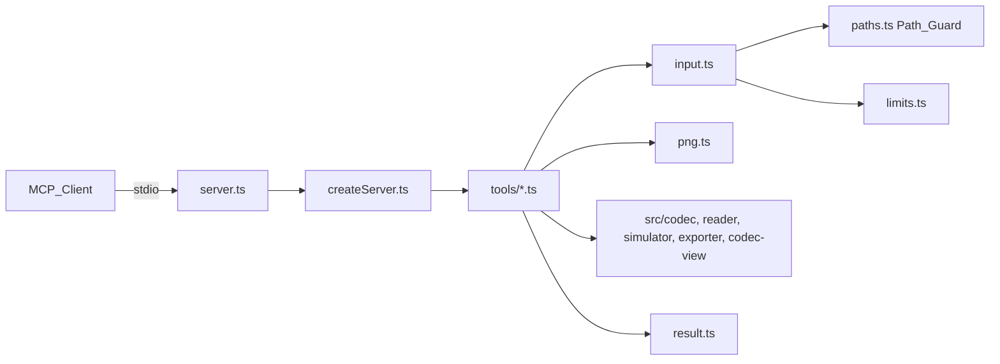

# Design Document

## Overview

loom-mcp is a stdio MCP server in `tools/loom-mcp/` with five tools. Each tool is a thin adapter over the existing pure modules in `src/`; it adds no weaving logic. The package has its own `package.json`, lockfile and `tsconfig.json`, so the SDK never reaches the app. Node 22.18+ runs the `.ts` files directly (type stripping).

Pinned dependencies (exact, no range operator):

- `@modelcontextprotocol/sdk` 1.32.2, published 2026-10-23, the latest release and about four weeks old.
- `zod` 4.6.7, published 2026-10-12. It is the first release past advisory GHSA-mrhx-c7xc-m3w5, which affects zod below 4.6.6, so `npm audit` is clean.

Scripts: `start`, `test` (`node --test tests/`), `typecheck` (`tsc --noEmit -p .`). `tsconfig.json` is strict, sets `allowImportingTsExtensions`, `erasableSyntaxOnly` and `types: node`, includes only `src` and `tests`, and extends nothing that includes the app.

## Architecture

- Dependencies point one way: the server imports `src/` and `scripts/png_rgba.ts`; no file under `src/` imports from `tools/`.
- The root tsconfig include list (`src`, `tests`, `scripts`, `vite.config.ts`) already leaves `tools/` out of the root typecheck, and the root vitest include (`tests/**`) leaves it out of `test:run`. Neither file changes.
- The root `package.json` gains only two scripts, `typecheck:loom-mcp` and `test:loom-mcp`, both calling `npm --prefix tools/loom-mcp`. Root dependencies and lockfile stay unchanged. `tools/loom-mcp/out/` is added to the root `.gitignore`.
- `tests/structure/glossaryTerms.test.ts` scans only `src` and `scripts`. `tools/` stays out of it on purpose: the scan has no allowance for the simulator's own setting name `threadSizePx`, which the server must pass. The server code still uses glossary terms, and a one-off scan with `tools/loom-mcp/src` added is run and recorded.
- The repo root is found from `import.meta.url`, never from the current directory or the environment.

## Components and Interfaces

| File (`tools/loom-mcp/src/`) | Role |
|---|---|
| `hooks.ts` | `node:module` `registerHooks`: a relative import with no extension is retried with `.ts`, because `src/reader` imports its own files without one. Same hook as `scripts/time_read_card.ts`. |
| `server.ts` | Imports `./hooks.ts`, then dynamic-imports `./createServer.ts`, connects a `StdioServerTransport`. Logs only to stderr, since stdout carries the protocol. |
| `createServer.ts` | `McpServer` from the SDK; registers the five tools, each with a zod input and output schema. |
| `limits.ts` | Constants (below). |
| `paths.ts` | Path_Guard. |
| `png.ts` | PNG decoder using `node:zlib` only. |
| `input.ts` | Loads inline or path JSON; parses profiles and patterns. |
| `result.ts` | `ok` and `fail` helpers. |
| `tools/*.ts` | `validateProfile`, `readCardPhoto`, `renderCloth`, `diffDesigns`, `exportBmp`. |

**Limits** (all stated in the README). Size checks run before parsing, decoding, rendering or writing.

| Input | Limit |
|---|---|
| Inline JSON arguments | 1 MiB serialised |
| JSON files | 2 MiB |
| PNG files | 8 MiB |
| PNG pixels | 16,777,216 (4096 x 4096) |
| Picks | 5,000 |
| Rendered image | 4096 pixels per side; refused with `too_large`, not cropped; the hint says to lower repeat or thread size |
| Export file name | 1 to 64 characters of letters, digits, dot, dash, underscore; ends in `.bmp` |

**Path_Guard.** A path is a string with no NUL byte and no `..` segment. It is resolved against the repo root. Its `realpath` must equal or lie inside the `realpath` of the repo root, which rejects symlinks that lead out. Reads must be regular files. Writes take a bare file name only; the target is `out/<name>`. The out directory is created if missing, and its `realpath` must be inside the repo root. An existing target must be a regular file, not a symlink. Any violation gives `path_not_allowed`.

**PNG decoder.** 8-bit, non-interlaced, colour types 0, 2, 3 (palette), 4 and 6, all five scanline filters, chunk lengths and CRCs checked. The result is the reader's `PixelData` (RGBA). 16-bit, interlaced and other forms give `unsupported_png`; a non-PNG gives `not_png`; size limits are checked first. `render_cloth` encodes its PNG with `scripts/png_rgba.ts`.

**Tools.**

- `validate_profile {profile?, path?}`, exactly one. Runs `parseCardProfile`. Returns `{valid, name, hookRows, hookColumns, endsPerPick, violations: [{kind, location, sentence}]}`. An invalid profile is a normal result, not an error.
- `read_card_photo {path, profile?, profilePath?}`, default profile `public/profiles/demo-12x16.json`. Decodes the PNG, calls `readCard`. Returns `{bitLine, hookRows, tiltDegrees, orientation}`, where `bitLine` comes from `cardToBits` and `hookRows` are strings of 1 and 0, one per hook row. A reader failure becomes a Tool_Error whose code is the failure reason, with a one-sentence hint of at most 200 characters per reason.
- `render_cloth {pattern?, patternPath?, profile?, profilePath?, repeat 1..64 = 1, threadSizePx 3..16 = 6, warpColour, weftColour as #rrggbb}`. A pattern file is a JSON array of cards or an object with a `pattern` field. Runs `prepareCloth`, `parseRenderSettings`, `renderFrame` at the end of the chain (phase rest), `computeFloats`. Returns an image block plus `{picks, gapCount, gaps: [{pick, kind}], floatCount, longestFloat, width, height, pngBytes}`.
- `diff_designs {first, second, profile?, profilePath?}`, each side `{pattern?, path?}`. Runs `patternToLines`, `diffPatterns`, `diffToText`. Returns `{text, counts, identical}`. A refusal becomes a Tool_Error with the refusal reason.
- `export_bmp {pattern?, patternPath?, profile?, profilePath?, fileName? = design.bmp, liftColour?, pickOrder?, endOrder?}`. Runs `exportPatternBmp` with `bitDepth` 1 and writes `out/<fileName>`. Returns `{path (repo-relative), bytes, width, height}`; `bytes` equals the file's size on disk.

**Registration.** `.kiro/settings/mcp.json` gets `"loom-mcp": {command: "node", args: ["tools/loom-mcp/src/server.ts"], disabled: false}` next to the unchanged `context7` entry. The server finds its files from `import.meta.url`, so it does not depend on the working directory; the relative `args` path assumes the workspace root, which Kiro uses. `.kiro/steering/loom-mcp.md` has front matter `inclusion: manual`.

## Data Models

- **Success result:** `{content: [text summary, plus an image block for render_cloth], structuredContent}`, validated by a per-tool zod `outputSchema`.
- **Tool_Error:** `{isError: true, content: [text "reason: message. Hint: hint"], structuredContent: {ok: false, reason, message, hint}}`.
- **Reason codes:** `path_not_allowed`, `too_large`, `not_found`, `not_json`, `not_png`, `invalid_profile`, `invalid_pattern`, `invalid_option`, `unsupported_png`, `internal_error`, plus the reader's and the codec-view refusal reasons verbatim.

## Correctness Properties

None required; the proof is the stdio tests. The spec has no universal property over a large input space, since every tool is an adapter over `src/` modules that carry their own properties. The safety invariants below are checked by the Path_Guard unit tests and the stdio tests:

- The Path_Guard never lets a path outside the Repo_Root through for reading, and never lets a write target outside the Out_Directory through.
- No tool writes outside the Out_Directory. Only `export_bmp` writes, and only to `out/<fileName>`.
- A refused call (size, path or option) leaves all files unchanged.
- The server makes no network request, starts no child process and reads no environment variable.

## Error Handling

- Every handler is wrapped in try/catch. Schema failures, domain failures and unexpected exceptions all return a Tool_Error, and the process keeps serving.
- Any exception maps to `internal_error`. Messages never include file contents: a JSON parse error says only "not valid JSON".
- Limit and path checks run first, so a refused call has no side effect. An invalid option names the first invalid option and writes no file.

## Testing Strategy

PBT does not apply to the adapter layer; the pure modules it calls already have fast-check properties under `tests/`. Tests use `node:test` in `tools/loom-mcp/tests/`, with no new dependency. No browser checks.

- **Unit tests:**
  - Path_Guard: `..` segment, NUL byte, absolute path outside the root, symlink leading out, non-regular file, bad write name, symlinked out target.
  - PNG decoder: each colour type, each filter, bad CRC, truncated chunk, 16-bit, interlaced, not a PNG, size limits.
- **Stdio tests:** start the server with `StdioClientTransport`, call every tool through the SDK client against `tests/fixtures/*.png` and `public/profiles/demo-12x16.json`, each with one failing case asserting an error result:
  - `validate_profile` with a path outside the root.
  - `read_card_photo` with a blank image, which gives `peg-holes-not-found`.
  - `render_cloth` with `repeat` 65.
  - `diff_designs` with two patterns the codec-view refuses to compare.
  - `export_bmp` with a file name containing a separator.

  Also check the five-tool list, a failing call followed by a successful one on the same process, and that the `export_bmp` size equals the size on disk (the test removes its output file).
- **Source scan:** a test reads every file in `tools/loom-mcp/src` and fails on `child_process`, `net`, `http`, `https`, `fetch` or `process.env`.
- **Isolation checks:** the root `package.json` and lockfile dependencies are unchanged, and no file under `src/` imports from `tools/`.
