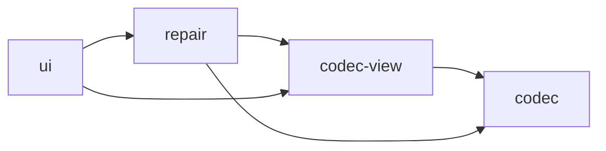

# Design Document

## Overview

Repair suggestions guess the card at each Gap from the readable picks and show the evidence. A new pure module `src/repair` computes the guesses (R1, R2). A lazily loaded Repair_Panel shows them and the weaver accepts or skips each one (R3, R4). App state records which picks were repaired so Weave, Code view and Keep can label them (R4, R5). Nothing changes the Current_Pattern except Accept, "Accept all high-confidence" and Undo (R4.3).

Pick indices in all plain data are 0-based. The UI shows them 1-based, like the existing `weave.gaps` text. Card equality is equality of the Bit_Line string from `cardToBits` in `src/codec-view`; there is no second comparison.

## Architecture



`src/repair` has `types.ts`, `index.ts`, `slots.ts` (Gap classification and keys), `repeat.ts`, `mirror.ts`, `neighbours.ts` and `suggest.ts`. It imports only `src/codec` and `src/codec-view`. `.kiro/steering/structure.md` gets a `src/repair` section and the dependency lines `ui → repair` and `repair → codec, codec-view`.

The notice, state, strings and sample live in the entry chunk. `src/repair` and `RepairPanel.tsx` form a separate chunk, loaded by `import()` in the click handler of "Suggest repairs" (R8.1).

## Components and Interfaces

### Repair_Module

`suggestRepairs(pattern: unknown, profile: unknown): RepairResult` never throws, does not modify its inputs, and returns `structuredClone` copies of proposed cards (R1.2).

```ts
RepairResult =
  | { ok: true; gaps: GapRepair[]; pickCount: number; readableCount: number }
  | { ok: false; failure:
      | { reason: 'invalid-profile'; violations: Violation[] }
      | { reason: 'not-a-pattern' } }
GapRepair = { pick; gapKind: 'missing' | 'damaged'; suggestions: Suggestion[];
  conflict: boolean; notApplied: { kind: SuggestionKind; reason: NotAppliedReason }[];
  none: NoSuggestionReason | null }
Suggestion = { kind: 'repeat' | 'mirror' | 'neighbours'; confidence: 'high' | 'medium' | 'low';
  card: CardGrid; evidence: Evidence }
Evidence =
  | { kind: 'repeat'; period; supportingPicks: number[]; comparedPairs; agreeingPairs }
  | { kind: 'mirror'; centreSum; partnerPick; comparedPairs; agreeingPairs }
  | { kind: 'neighbours'; beforePick; afterPick }
```

- `NoSuggestionReason` (`none`, set when `suggestions` is empty): `no-readable-cards` (every pick is a Gap, which includes cards that do not match the profile), `too-short` (fewer than 3 picks), `no-evidence`.
- `NotAppliedReason`: `no-period`, `no-supporter`, `supporters-tie`, `no-mirror`, `centre-pick`, `partner-out-of-chain`, `partner-unreadable`, `at-chain-edge`, `neighbour-unreadable`, `neighbours-differ`, `too-few-readable-cards`.
- Each Gap lists each of the three kinds exactly once, either as a Suggestion or in `notApplied` (R2.1). A Pattern with no Gap gives `gaps: []`.
- Exported constants: `MIN_COMPARISONS = 3`, `AGREEMENT_FLOOR = 0.8`, `HIGH_MIN_COMPARISONS = 4`.

**Slots.** Pick i is a Gap when its slot is null or undefined (`missing`) or `cardToBits(profile, slot)` fails (`damaged`). Otherwise it is readable and its key is the Bit_Line string.

**repeat.** For each period p from 1 to floor(pickCount/2), compare pairs (i, i+p) with both picks readable. The period qualifies when comparedPairs ≥ MIN_COMPARISONS and agreeing/compared ≥ AGREEMENT_FLOOR. Best period: exact (all pairs agree), then most agreeing pairs, then shortest p (R2.1). For Gap g the supporters are the readable picks j ≠ g with j mod p = g mod p. The card is the most common key among them. A tie gives `supporters-tie`; no supporters gives `no-supporter`. Confidence: high = exact, comparedPairs ≥ HIGH_MIN_COMPARISONS and at least 2 supporters, all equal; medium = supporters all equal otherwise; low = majority only.

**mirror.** For each centre sum s (i+j of a mirrored pair), compare pairs i<j with i+j=s and both readable, using the same qualifying rule. Best s: exact, then most agreeing pairs, then s closest to pickCount−1. The partner of Gap g is s−g. It must lie in 0..pickCount−1, differ from g (else `centre-pick`) and be readable. Confidence: high = exact and comparedPairs ≥ HIGH_MIN_COMPARISONS, otherwise medium.

**neighbours.** Picks g−1 and g+1 both readable with equal keys give a Suggestion with confidence always low. Otherwise the reasons are `at-chain-edge`, `neighbour-unreadable`, `neighbours-differ`.

**Order and conflict.** Suggestions sort by confidence (high, medium, low), ties by kind (repeat, mirror, neighbours). `conflict` is true when the proposed card keys are not all equal; both Suggestions stay unchanged (R2.2). Cost is O(n²) in picks, fine for chains of a few thousand.

### State and reducer (`ui/types.ts`, `ui/state/`)

`AppState.repairs = { picks: ReadonlyArray<number>; history: ReadonlyArray<ReadonlyArray<{ pick: number; before: unknown }>> }`, initially `{ picks: [], history: [] }`, with `picks` ascending and unique. The existing `withNewPattern` resets it, so open, restore, sample and scan commit all clear the marks (R5.3).

- `accept-repairs { items: { pick; card }[] }`: one item for a single Accept, many for "Accept all high-confidence". It ignores picks outside the Current_Pattern, pushes one history group with the previous slots, replaces the slots and adds the picks (R4.1, R4.3).
- `undo-repair`: pops the last group, restores the slots, removes those picks; a no-op when the history is empty (R4.2).

The reducer does not import `src/repair`.

### Screens

- **Weave.** `RepairNotice` reads the cloth's gaps (count only, no repair module): "{count} cards could not be read" with singular and plural keys, plus the "Suggest repairs" button. When `repairs.picks` is non-empty it also shows "Repaired (a guess): picks {picks}" and an Undo button (R3.1, R4.2). The button calls an injectable loader that runs `import()`, with a loading state and a failure message.
- **RepairPanel.tsx.** Computes `suggestRepairs` for the Current_Pattern. It lists each Gap (1-based pick, missing or damaged in words) and each Suggestion: kind and Confidence in words, an evidence sentence built from the plain data, and a drawing. The drawing is an SVG of hookRows × hookColumns with a filled circle for a punched hole and a ring for an unpunched position, `role="img"` with an accessible name. Each Suggestion has Accept and Skip (Skip is local state, with "Show again"). A conflict sentence appears for conflicting Gaps, and the reason text for `none` and `notApplied`. The sentence "These are guesses based on the pattern. Check them against the real card if you can." appears once. A separate secondary "Accept all high-confidence" button takes only the first high Suggestion of each non-conflicting Gap. The panel recomputes after each accept (R3.2, R4.3).
- **Code view.** `CodeViewScreen` passes `state.repairs.picks` to `Listing` and `LineRow`. A repaired Line shows the text "repaired (a guess)", and the same words are in its accessible name (R4.1). No new diff or comparison code.
- **Keep.** `KeepView` takes an optional `repairedCount` and shows "Some picks are suggested guesses, not read from a card." next to the export button. Save and export are unchanged, so a save is a normal new Version and the BMP is identical (R5.1, R5.2).
- **Sample.** `sampleWithLostCards(profile)` in `ui/samples/sampleDesigns.ts` is the diamond sample with picks 4, 15 and the last pick replaced by `[]` (a damaged card). TryIt gets "Try a design with lost cards", dispatching `request-sample` with design `diamond` and that Pattern. For the demo profile (12 hook rows) the diamond has 36 picks, period 12, and is symmetric, so every Gap gets agreeing repeat and mirror Suggestions (R7.1).
- **i18n and style.** Keys under `repair.*` and `tryit.lost` in `en.json` and `hi.json`, Hindi `reviewed: false`; regenerate `docs/HINDI_REVIEW.md` with `npm run review-list`. Meaning is carried by text and shape, not colour only. CSS Modules, 48 px targets, wrapped text, no horizontal scroll at 320 px (R6.1). New files use "pick", "card", "hook" and "punched hole", and never "row" or "column" for picks or hooks. "hook row" and `hookRows` appear only in the glossary sense. No new glossary term.

## Data Models

The types above are the data models. `Pattern`, `CardGrid` and `CardProfile` come from `src/codec`; `Bit_Line` comes from `src/codec-view`. Nothing is stored in the archive beyond the cards themselves; the repaired marks live only in `AppState.repairs` (R5.1, R5.3).

## Correctness Properties

*A property is a characteristic or behavior that should hold true across all valid executions of a system-essentially, a formal statement about what the system should do. Properties serve as the bridge between human-readable specifications and machine-verifiable correctness guarantees.*

Only two new fast-check properties are allowed. All other criteria are covered by example tests (see Testing Strategy).

### Property 1: A repeating chain recovers a lost card

For any Card_Profile, any block of 1 to 6 cards, repeated enough times that the chain has at least 8 picks and at least 3 repeats, and any one pick replaced by a Gap, the first Suggestion of kind `repeat` for that Gap proposes the true card.

**Validates: Requirements 1.1, 2.1**

### Property 2: A palindromic chain recovers a lost card from its mirror partner

For any Card_Profile, any random half of 5 to 8 cards, mirrored with or without a centre card, and any one pick that is not the centre card replaced by a Gap, the first Suggestion of kind `mirror` for that Gap proposes the true card.

**Validates: Requirements 1.1, 2.1**

The centre card of an odd-length palindrome has no mirror partner. It is outside Property 2 and is covered by an example test that expects no `mirror` Suggestion and the reason `centre-pick` (R2.1).

## Error Handling

`suggestRepairs` returns `{ ok: false }` for an invalid Card_Profile (with its violations) or a non-array Pattern. For a valid input it returns `ok: true` with a plain-data reason for each Gap that has no Suggestion: no repeat, every pick a Gap, one or two picks, or a Gap at the first or last pick (R1.2). The panel shows these reasons as text. If the chunk fails to load, the Weave_Screen shows a failure message and the button can be pressed again (R8.1).

## Testing Strategy

Property-based testing applies to the pure `src/repair` functions. UI rendering and reducers use examples. Tests live in `tests/repair/` and mirror `src/`.

- **Properties.** Exactly the two above, with fast-check through `fc.assert`, at least 100 runs each, no `fc.pre` filters. The profile is generated or passed in, never hard-coded. Each carries the tag `Feature: repair-suggestions, Property N: <title>`. A failure is reported with its shrunk counterexample, seed and path.
- **Example tests per kind.** `repeat`: period choice (exact, then most agreeing pairs, then shortest), evidence fields, confidence levels, `supporters-tie`, `no-supporter`, `no-period`. `mirror`: centre sum choice, `partner-out-of-chain`, `partner-unreadable`, `centre-pick`, `no-mirror`. `neighbours`: low confidence, `at-chain-edge`, `neighbour-unreadable`, `neighbours-differ`.
- **Example tests per edge case.** Invalid profile, non-array Pattern, cards that do not match the profile, every pick a Gap, one or two picks, first and last pick, no Gap, ordering, the conflict flag with both Suggestions kept (R1.2, R2.2), and that inputs are unmodified.
- **UI examples.** Server rendering of `RepairNotice` (count, singular and plural, absent at zero), `RepairPanel` (evidence, Confidence in words, drawing names, guess sentence once, one Accept and one Skip each), Code view labels, the Keep notice, and the TryIt button. Reducer tests cover accept, accept-all, undo, undo with empty history, reset by open and restore, and out-of-range picks (R3 to R5). Translation key parity between `en.json` and `hi.json` covers R6.1(a). The sample test checks exactly three Gaps, each with a Suggestion (R7.1). The loader is tested with an injected fake.
- **Not tested by checks.** Keyboard, 320 px layout, the 1 second limits and the entry-chunk size (R6.1(b),(e), R3.2, R8.1) are reported from the build size check, with the entry chunk gzipped size before (99,932 bytes) and after. No browser checks are added.
