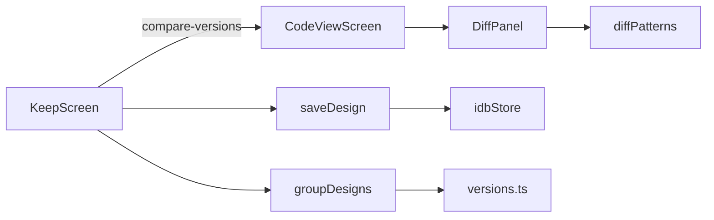

# Design Document

## Overview

A Version is an ordinary Archive record plus summary, with two optional fields: `designId` and `note`. Versions of one Design share a Design_Id. Grouping is a pure function over the flat summary list, so `listDesigns` and `deleteDesign` stay unchanged. Comparison goes through the existing `diffPatterns`. Restore loads a Pattern into the Current_Pattern and writes nothing.

## Architecture



Dependency direction is unchanged: `ui` imports `archive` and `codec-view`; `archive` imports only types from `codec`.

## Components and Interfaces

**src/archive/types.ts.** `SavedDesign` and `DesignSummary` gain `designId?: string` and `note?: string`. Export `NOTE_MAX = 200`. `ArchiveFailure` is unchanged.

**src/archive/versions.ts** (pure, no I/O, exported through `index.ts`):
- `designIdOf(x) = x.designId ?? x.id`.
- `groupDesigns(summaries): DesignGroup[]`, where `DesignGroup = { designId; versions: DesignSummary[]; newest; versionCount }`. `versions` is newest first, ties by id ascending (the `listDesigns` rule). Groups are ordered by their newest version, newest first, ties by `designId`.
- `previousVersion(group, id): DesignSummary | null` returns the next older version.

**src/archive/designs.ts.** `saveDesign` input gains `continues?: string` and `note?: string`.
- Without `continues`, the first Version stores no `designId` (R2.2).
- With `continues`, it calls `get(continues)`. A missing record returns `{reason:'not-found', id}` and writes nothing. Otherwise the new record stores `designId = designIdOf(record)` (R2.1, R7.1).
- A note longer than `NOTE_MAX` (JS string length) writes nothing and returns `{reason:'write-failed', detail:'note is longer than 200 characters'}`. An empty or whitespace-only note is stored as absent (R2.1).
- The record and its summary are written in one transaction, as today. Existing callers behave as before.
- `deleteDesign` removes one record and its summary. Deleting the newest Version leaves the older ones grouped under the same Design_Id, and deleting the last removes the Design (R4.3, R5.1, R5.2).

**src/archive/idbStore.ts.** `DATABASE_VERSION` goes from 1 to 2, and `onupgradeneeded` reads `event.oldVersion`.
- `oldVersion 0`: create both stores and the `createdAt` index as today, plus the `designId` index on summaries.
- `oldVersion 1`: use `request.transaction.objectStore('summaries')` to add the `designId` index. No record is rewritten, because a missing `designId` means the record's own id (R6.1).
- No code reads the `designId` index yet. The bump was requested, and adding the index is the cheapest non-destructive change that justifies it.

**src/ui/types.ts.** `AppState` gains `compare: CompareRequest | null`, with `CompareRequest = { first: CompareChoice; second: CompareChoice }` and `CompareChoice = { kind:'current' } | { kind:'saved'; id }`, the same shape as `SideChoice` in `DiffPanel.tsx`. New actions:
- `compare-versions {first, second}` sets `compare` and navigates to `code` (R4.1).
- `restore-saved {id, pattern}` uses `withNewPattern` with origin `{kind:'archive', id}`. It stays on the current screen, sets `selectedPick` to 0 and clears breakpoints (R4.2).
- `set-archive-origin {id}` changes the origin id only when the origin is already `archive`. After a save, the next save continues the newest Version.
- `mark-saved` is unchanged. `navigate` and `withNewPattern` clear `compare`.

**src/ui/state/keep.ts.** `KeepForm` gains `note` and `saveMode: 'version'|'design'` (initially `''` and `'version'`). `KeepFormAction` gains `set-note`, `set-save-mode` and `set-metadata` (restore fills the form with that Version's Metadata and clears the note). Pure helpers:
- `effectiveSaveMode(form, origin)` returns `'design'` unless the origin is `archive` (R1.1, R1.2).
- `versionRow(summary, language, untitled)` returns the date, note and pick count. The date uses `Intl` with `hi-IN` or `en-IN`, date and time.
- `compareTargets(group, id, openDesignId)` says whether Compare with previous and Compare with open design are offered. The open design is offered only when the origin is `archive`.

**KeepScreen.tsx.** `runSave` takes an optional `continues`. `runRestore(id)` calls `getDesign`, then dispatches `restore-saved` and `set-metadata`, and announces that the next save becomes a new Version. The list renders `groupDesigns(designs)` (R3.1).
- A single-Version Design shows "1 version" and its actions inline (Open, Compare with the open design, Restore, Delete).
- A Design with several Versions shows the newest name, place, date, pick count, "N versions" and a "Show versions"/"Hide versions" button (`aria-expanded`, `aria-controls`). The expanded Version_List is an ordered list, newest first. Each item shows date, note, pick count and the same four actions, plus "Compare with previous version" when an older Version exists (R3.2).
- Delete reuses `DeleteConfirm` and its keys, per Version id.
- New `KeepView` props are optional, so existing tests compile.
- The save choice is a `fieldset` with a `legend` and two radios, shown only for an `archive` origin, with a note field. Nothing is written until the weaver confirms.

**DiffPanel** takes an optional `request: CompareRequest | null`. When it arrives and the profile is ready, the panel sets both choices and runs the existing `runComparison`/`compareDesigns` once. `CodeViewScreen` passes `state.compare`. The Code view choosers keep the flat list, so every Version appears there.

**i18n.** New `keep.version.*` keys in `en.json` and `hi.json`, with separate singular and plural count keys (no "1 versions"). Hindi entries carry `reviewed:false`, and `npm run review-list` regenerates `docs/HINDI_REVIEW.md`. Add a `version` row to `.kiro/steering/weaving-glossary.md` and update the archive and ui entries in `.kiro/steering/structure.md`.

**Accessibility (R8.1).** Native buttons, text labels in addition to colour, the existing 48 px touch-target token, and wrapping of long names so nothing scrolls sideways at 320 px.

## Data Models

```ts
SavedDesign  = { id, profileName, metadata, createdAt, pattern, designId?, note? }
DesignSummary = { id, profileName, metadata, createdAt, pickCount, designId?, note? }
DesignGroup  = { designId, versions: DesignSummary[], newest, versionCount }
```

## Correctness Properties

*A property is a characteristic or behavior that should hold true across all valid executions of a system. Properties serve as the bridge between human-readable specifications and machine-verifiable correctness guarantees.*

### Property 1: Lineage listing and restore

For any sequence of `saveDesign` calls that continue one Design with strictly increasing clock times, listing and then `groupDesigns` returns one group whose `versions` are those Versions newest first, with `versionCount` equal to the number of saves. `getDesign` on each returns a Pattern equal to the one saved (so restore loads exactly what was stored).

**Validates: Requirements 2.1, 3.1, 3.2, 4.2**

## Error Handling

`saveDesign` returns values and never throws. Storage cannot open gives `storage-unavailable`. A failed write, or a Note over 200 characters, gives `write-failed`. A missing source Version gives `not-found`. Each failure writes nothing and leaves earlier Versions unchanged (R2.1, R7.1). A failed `getDesign` during restore shows the existing Keep error message and leaves the Current_Pattern unchanged.

## Testing Strategy

- **Property test (the only new one):** Property 1, with fast-check, at least 100 runs, using `FakeArchiveStore` and an injected increasing clock and id source. Tag: `Feature: version-history, Property 1: Lineage listing and restore`.
- **Example tests, one per behaviour:**
  - Save choice shown only for an `archive` origin (R1.1, R1.2).
  - First Version has no `designId`. A continuing Version stores `designIdOf(source)`. A 200-character note is stored and a 201-character note is rejected. A whitespace note is stored as absent (R2).
  - Grouping count and newest name (R3.1). Compare and restore reducer actions (R4.1, R4.2). Delete one Version, delete the newest, delete the last (R4.3, R5).
  - Upgrade of a legacy version-1 database through `tests/support/fakeIndexedDb.ts`, with a new option that starts from given rows and passes `oldVersion` and `request.transaction.objectStore(name).createIndex`. Every row must still be listed, opened and deleted (R6.1).
  - The three failure reasons (R7.1) and the English and Hindi keys present (R8.1).
- **Tests updated on purpose:** the `idbStore` test that pins version 1 and the index list now pins version 2 and the extra index. The R6.1 test that pins `SavedDesign` to five fields now pins the seven-field shape. The build log records both.
- **Budget (R8.2):** the entry chunk was 97,686 bytes gzipped before. The new size is measured with `check_bundle` and reported.
- No browser checks are added.
