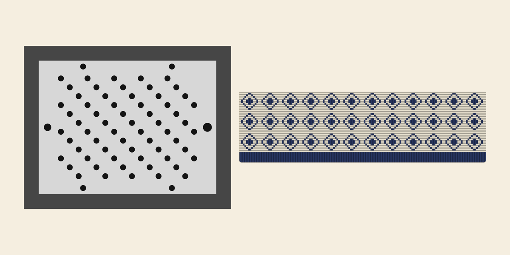
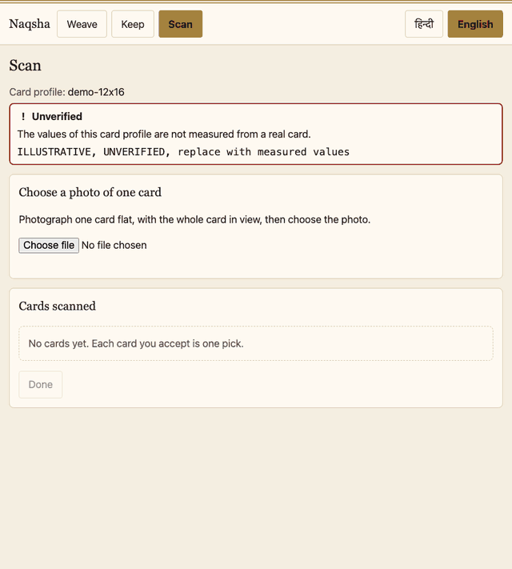

# Naqsha

A browser app that reads a Jacquard loom punch card through a camera, rebuilds the weave pattern, shows how the cloth will weave, and exports a bitmap for electronic Jacquard looms. It runs at https://naqsha-ashen.vercel.app/ and keeps saved designs in the browser (IndexedDB). It has no server.

The GIFs below were captured from the built site (`npm run preview`) with the demo card profile, whose values are illustrative and unverified. The Scan GIF reads a generated card image, not a camera photo.





Public URL: https://naqsha-ashen.vercel.app/ (opens with no login; deployed by hand on Vercel, see "Deploy to Vercel").

**Status:** the app is built and deployed at https://naqsha-ashen.vercel.app/ , with three screens (Weave, Scan, Keep). Weave has a Try it button and printable sample cards. Keep exports a bitmap and saves designs in the IndexedDB archive. Scan reads a card from an uploaded photo, lets you tap to correct a hole, reads cards in a batch, and uses the live camera on HTTPS. Not verified: the Hindi text has not been reviewed (see `docs/HINDI_REVIEW.md`), the live camera has not been tested on real devices, and the card profile values are illustrative and unverified.

## Try it in 60 seconds

Open https://naqsha-ashen.vercel.app/ . It needs no login.

1. On Weave, choose **Try it** to weave a sample design pick by pick.
2. Print a sample card from Weave, or use a photo of a card, and open Scan to read it. Tap a hole to correct it.
3. On Keep, export the bitmap or save the design to the archive.

To run it yourself, see "Run it locally". Developer-only photo trial tools are listed there too.

## What it does

| Step | Status |
|---|---|
| Read one card from an image into a grid of punched and unpunched hook positions | Built (`src/reader`), synthetic images only |
| Convert a card grid to a list of ends and back, through the profile's end order | Built (`src/codec`) |
| Scan a card from an uploaded photo or the live camera, correct a hole by tap, read cards in a batch | Built (`src/ui/screens/scan`). The live camera needs HTTPS and has not been tested on real devices |
| Simulate the cloth pick by pick | Built (`src/simulator`), shown on the Weave screen with play, pause, step, scrub, speed and cloth colours |
| Export a bitmap for an electronic Jacquard loom | Built (`src/exporter`), offered on the Keep screen: uncompressed BMP, 1-bit and 8-bit, one pixel per end and one row per pick; reads its own files back. No loom controller has been tested with it |
| Archive designs in the browser | Built (`src/archive`), on the Keep screen: save, list, reopen and delete in IndexedDB. Tested with a fake store in Node; not yet checked in a real browser |
| Hindi and English text | Built. The Hindi text has not been reviewed by a Hindi speaker |

The card layout is a profile loaded at runtime. The only profile, `public/profiles/demo-12x16.json`, holds ILLUSTRATIVE, UNVERIFIED values for a small demo card (12 hook rows x 16 hook columns). No real card has been measured yet, so the profile is unverified.

### Reader failure reasons

`readCard(profile, pixels)` returns a card grid with the pose it found, or one of these failures. It never throws.

| Reason | Meaning |
|---|---|
| `invalid-profile` | The card profile failed validation. |
| `invalid-image` | The pixel data has a wrong size, length or type. |
| `peg-holes-not-found` | No pair of dark regions matched the peg holes and the card layout. |
| `ambiguous-orientation` | The card could not be told upright from upside down, or the peg diameters and the layout disagree. |
| `card-outside-image` | A hook position falls outside the image. |
| `resolution-too-low` | A punched hole is under 11 px across, so it cannot be sampled reliably. |

### Limits

- Accuracy is measured on synthetic fixtures only. No real card photograph has been tested. See `.kiro/specs/card-codec-and-reader/measurements.md`.
- The card must be upright or upside down within 10 degrees, with no perspective distortion. Mirrored images are not supported. Holes must be darker than the card surface.
- Each peg hole diameter must differ from the punched hole diameter. Profile validation does not enforce this.
- A 2 mm hole needs at least 5.5 px/mm, because the reader refuses punched holes under 11 px.
- The 300 ms reading budget has not been checked on a phone.

### Simulator limits

- One weft per pick (no extra zari wefts on the ground weft).
- One end per hook (no harness tie-up). A horizontal repeat count is supported.
- No face-down weaving.
- Threads are at least 3 px wide.
- `renderFrame` rejects copies of a prepared cloth (`structuredClone`, Web Worker messages).
- The 16 ms per frame budget is unmeasured on a phone. Node figures are in `.kiro/specs/simulator/measurements.md`.

### Exporter options and limits

- `bitDepth`: `1` (default) or `8`.
- `liftColour`: `black` (default) or `white`.
- `pickOrder`: `first-at-top` (default) or `first-at-bottom`.
- `endOrder`: `first-at-left` (default) or `first-at-right`.

Limits:

- Each loom controller may need a specific variant of these options.
- No loom controller has been tested with these files.
- The right lift colour for each controller is unverified. Black is only the default.
- Designs with a missing or damaged card cannot be exported.
- One pixel per end. There is no repeat across the loom width.
- The reader reads only files this exporter writes.

### Known issue (task 5.18, not fixed)

On sparse or small cards, the peg-pair check against the layout can reject a good read. This fails safely with `peg-holes-not-found`. At low resolution it could also pick a wrong peg pair; the 11 px floor hides the measured cases, but the cause is still there.

## Why it matters

Many weave designs exist only as physical punch cards, and those cards wear out. Naqsha reads a card with a camera or a photo so that its design can be checked, kept and sent to an electronic loom. No weaver or card maker has tested it yet.

## How it was built with Kiro

Planning was done with Claude before any Kiro session. The code, specs and tests were produced in Kiro.

| Kiro feature | Used for | Status |
|---|---|---|
| Specs | `card-codec-and-reader`: requirements, design with numbered correctness properties, tasks | Done |
| Steering | Product, tech, structure, weaving glossary, card geometry (loaded only for codec and reader files), testing rules | Done |
| Property-based tests | fast-check properties named after the requirement they check | Done |
| Hooks | Related tests and typecheck on save; fixture regeneration with a PNG drift check | Created, not yet seen firing in the IDE |
| MCP | Context7 documentation server | Configured |
| Custom MCP server, custom agent | Not used | Not built |

The day-by-day record, including what failed, is in `docs/BUILD_LOG.md`.

## Architecture

The modules are `codec`, `reader`, `simulator`, `exporter`, `archive` and `ui` under `src/`. `ui` may import the others; `reader`, `simulator` and `exporter` import only `codec`; `codec` imports nothing. The full rules are in `.kiro/steering/structure.md`.

## Run it locally

Requires Node 22.18 or newer.

```
npm install
npm run dev          # start the dev server
npm run test:run     # run the tests once (npm test watches)
npm run typecheck    # type-check with tsc
npm run build        # type-check, then build to dist/
npm run fixtures     # regenerate the synthetic card images in tests/fixtures/
npm run sample-bmp   # write media/sample-design-1bit.bmp and media/sample-design-8bit.bmp
```

Check the built site locally before you deploy:

```
npm run build        # type-check, then build to dist/
npm run check-bundle # entry chunk under 200 KB gzipped, no absolute URL in dist/index.html
npm run preview      # serve dist/ locally and open the address it prints
```

The built site uses relative paths (`base: './'`), so it works from the root of a host and from a sub-path.

Developer-only photo trial: start the dev server with `npx vite --host`, print `/scripts/photo-trial/print.html` at 100% scale, photograph the printed card from directly above, then open `/scripts/read-photo.html` and choose the photo.

Developer-only simulator preview: start the dev server with `npx vite --host` and open `/scripts/sim-preview.html`.

## Verify it yourself
Five commands check the project. Run them from the repository root. Run times are one measurement on a MacBook with a good connection; yours will differ.
| Command | What it does | What it needs | Run time (measured) | Where the output goes |
|---|---|---|---|---|
| `npm run check:all` | Type-check, the full test suite, build, bundle check, repo hygiene (LICENSE, `.kiro` not ignored, no secrets in tracked files, a README without placeholder wording), then the state of the git working tree. Every step prints PASS, FAIL, SKIPPED or INFO. The spec format validators are SKIPPED because the repo has no command for them. | Node 22.18 or newer, and `npm install` | about 40 seconds | the terminal |
| `npm run check:browser` | It serves the built `dist/` (it runs `npm run build` first if `dist/` is missing) and drives a real headless Chrome through twelve steps: load, Hindi/English switch, the three Try it samples, Keep (save, reload, open, delete), BMP and PNG downloads parsed byte by byte, a PNG read back on Scan, a blank image, and no horizontal scroll at 320, 390 and 1280 px. | Google Chrome or Chromium (set `CHROME_PATH` to its executable if it is not found) | about 1 minute | the terminal, and one screenshot per step in `media/check/` (git-ignored) |
| `npm run check:deployed` | Fetches the published site and checks: HTTP 200 and not a login page, the page title, the JS and CSS assets, and that `profiles/demo-12x16.json` passes `parseCardProfile`. It also prints the response headers. Pass another address with `npm run check:deployed -- <url>`. | Network access | under 5 seconds | the terminal |
| `npm run check:manual` | An interactive walkthrough of the checks no script can do: the live camera on a phone, printing at 100% and measuring with a ruler, a real card photo, the rise-from-darkness look, reduced motion, and the five manual items R8.8, R14.12, R16.5, R23.1 and R23.11. You answer pass, fail or skip for each step. | A person at a terminal (it refuses to run without one), and a phone for most steps | depends on you | your answers are written to `docs/MANUAL_TEST_RESULTS.md` |
| `npm run check:everything` | Runs `check:all`, then `check:browser`, then `check:deployed`, even if an earlier one failed, and prints a summary with PASS, FAIL or SKIPPED and the exit code of each. If Chrome is missing, `check:browser` shows as FAIL with its message. It exits non-zero if any stage failed. Add `--manual` to run `check:manual` last, `--bail` to stop after the first failure, and `--url <url>` to choose the address `check:deployed` checks. Use `npm run check:everything -- --manual --bail`. | everything the stages above need | about 1.5 minutes without `--manual` | the terminal, plus the places named above |
What these commands cannot prove:
- They do not use a real phone camera, so the live camera on a real device is untested.
- They do not measure print scale. Only you can print the card at 100% and measure it with a ruler.
- They do not read a photograph of a real card. The card images used are synthetic or printed by this app.
- They do not judge the Hindi text. A native speaker has to review it.
- They do not test a loom or a loom controller. The exported bitmaps are checked against the BMP format, not against a machine.
- `check:browser` uses Chrome only. Firefox, Safari and iOS are not tested.
## Deploy to Vercel

The site is deployed at https://naqsha-ashen.vercel.app/ . The steps below are how to deploy your own copy by hand.

1. Create a Vercel account (the free Hobby plan is enough) and sign in. Connect it to the Git host that holds this repository.
2. In Vercel choose **Add New... > Project** and import this repository.
3. Framework preset: **Vite**. `vercel.json` already states it.
4. Build command: `npm run build`. `vercel.json` already states it.
5. Output directory: `dist`. `vercel.json` already states it.
6. Environment variables: none. Add none. The app has no backend and no API key.
7. Select **Deploy**. Vercel prints the public URL when the build ends. If you deploy your own copy, put its URL in the "Public URL" line near the top of this file.

Visitors need no login, no account and no API key to open the published site. The site makes no request to a third party and has no analytics.

What is not verified:

- Card_Profile values are ILLUSTRATIVE and UNVERIFIED. `public/profiles/demo-12x16.json` is a demo card, not a measured one.
- No loom controller has been tested with the exported bitmaps.

## Prior work and credits

Naqsha is not the first project to read Jacquard punch cards with a camera. It builds on this research:

- *Visual system for punched card reading in textile industry*, 2018. A camera-based system for reading the punched cards of mechanical Jacquard looms. [doi:10.1080/00051144.2018.1456097](https://www.tandfonline.com/doi/full/10.1080/00051144.2018.1456097)
- *Digitization and recognition of Jacquard cards for textile design preservation*, Multimedia Tools and Applications, 2025. A multi-step computer vision method that extracts design information from photos of Jacquard cards. [doi:10.1007/s11042-025-20917-9](https://link.springer.com/article/10.1007/s11042-025-20917-9). Its dataset is published at [ELiRF/telers](https://github.com/ELiRF/telers).

No other credits are listed.

## License

MIT. See `LICENSE`.
