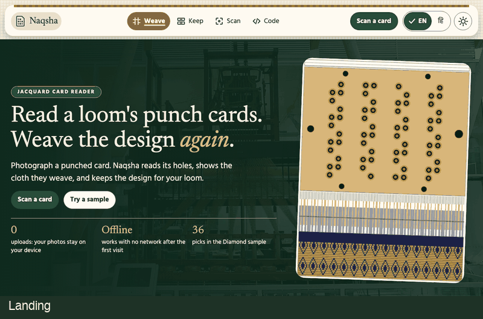
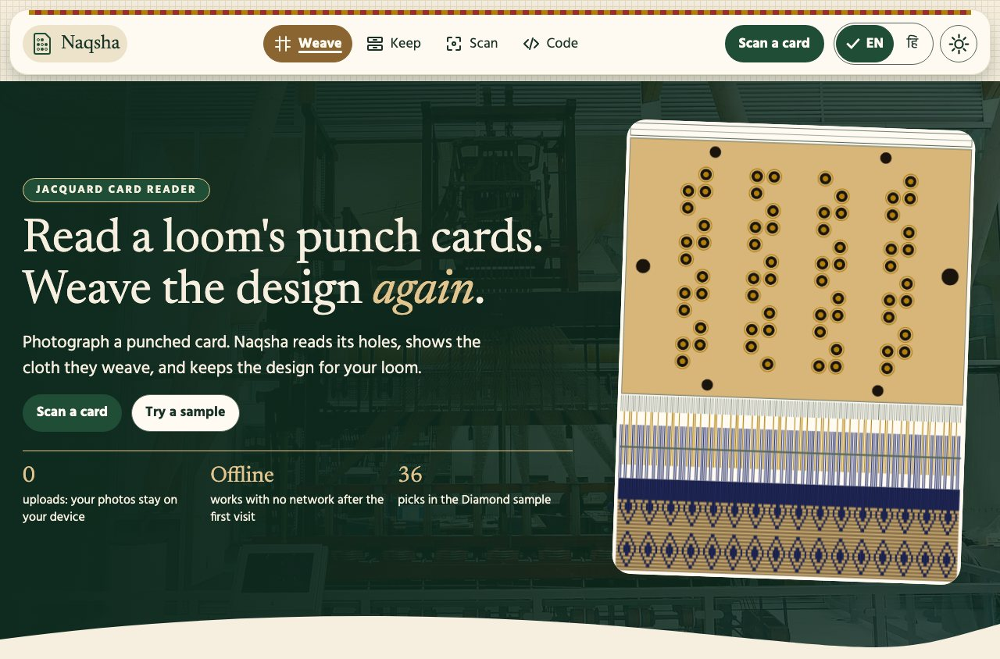
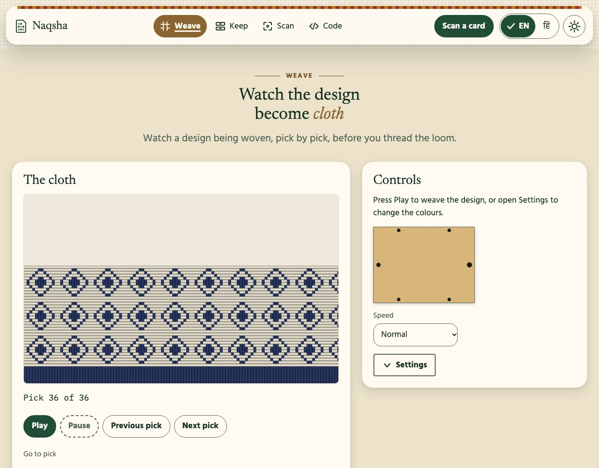
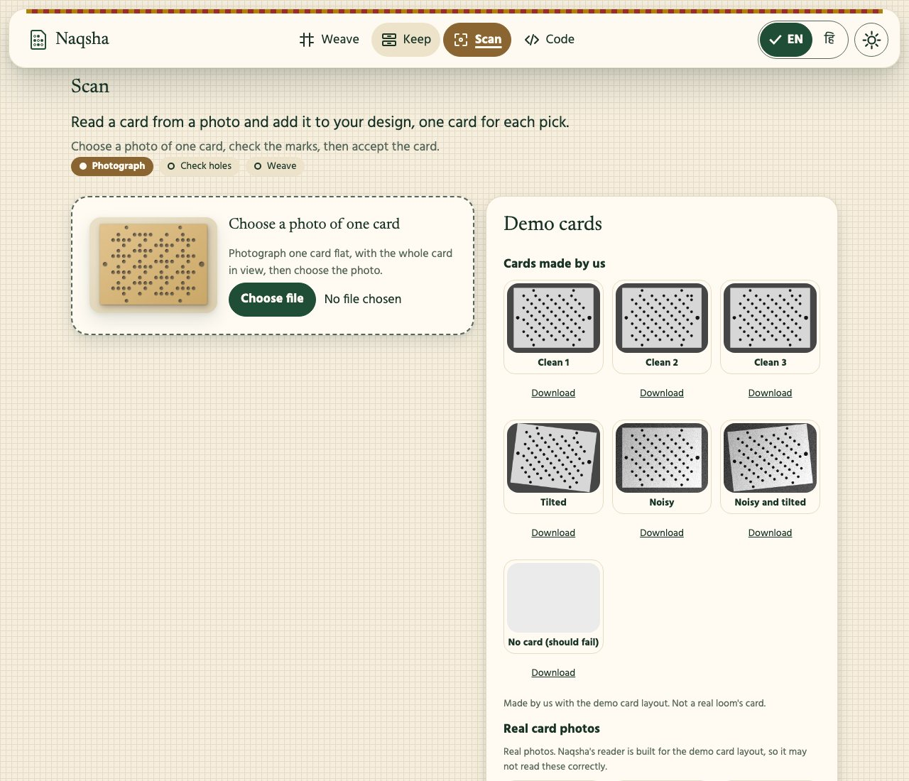
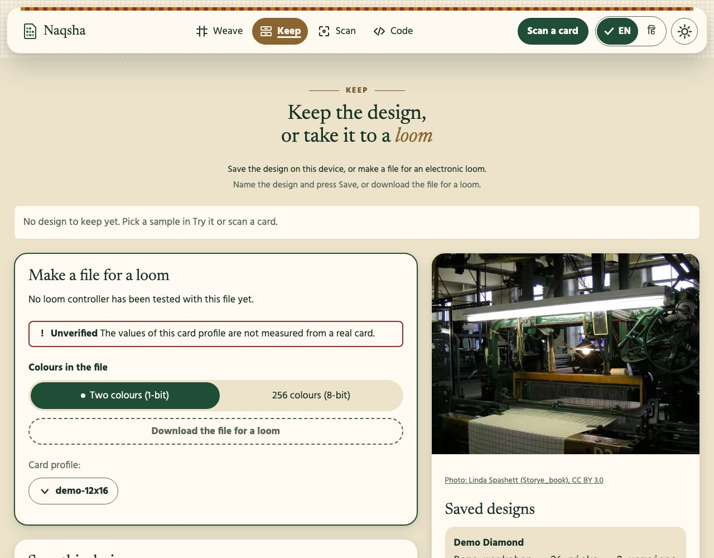
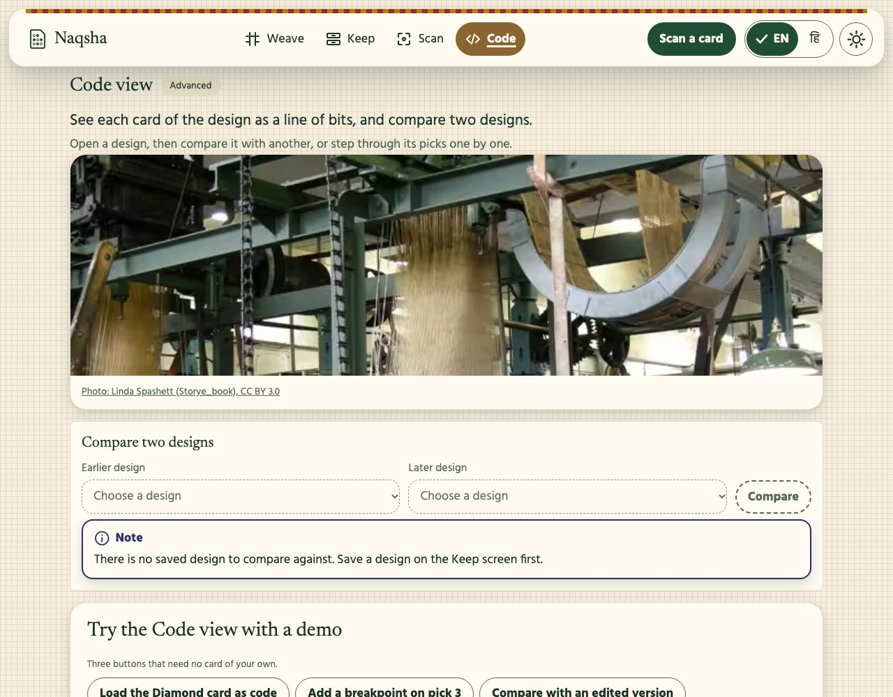
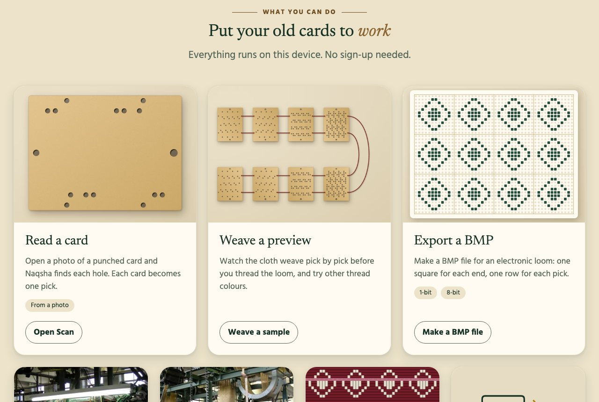
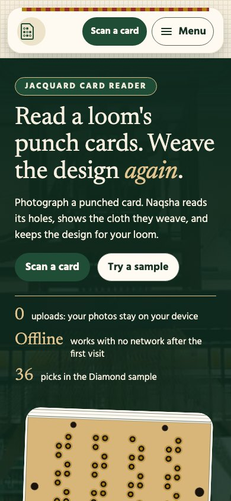
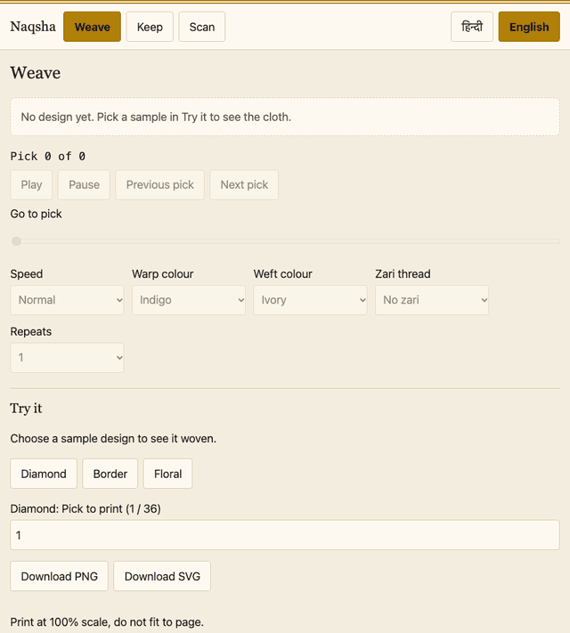
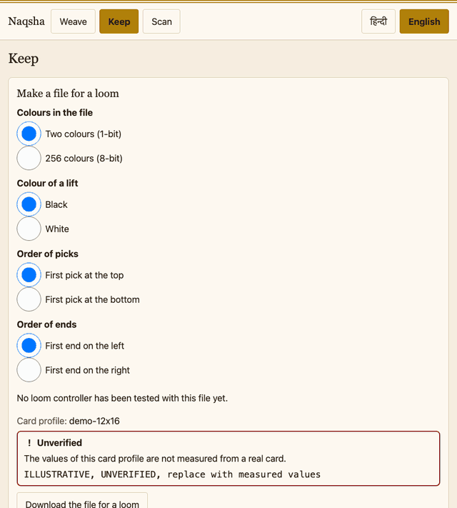

# Naqsha

**Read a loom's punch cards. Weave the design again.**

Naqsha is a browser app that reads a Jacquard loom punch card from a camera or a photo, rebuilds the weave pattern, shows how the cloth will weave, and exports a bitmap for electronic Jacquard looms. Designs are kept on the device (IndexedDB). There is no server, no login and no analytics.

Many weave designs exist only as physical punch cards, and those cards wear out. Naqsha is a way to read one, check it, keep it and send it to a loom. It is built for the Kiroween 2026 hackathon (Resurrection category), and Kiro wrote the code.

Public URL: https://naqsha-ashen.vercel.app/ (opens with no login, no account and no API key)
**No punched card?** [`docs/JUDGES.md`](docs/JUDGES.md) is a 10-step path that tests every function with demo cards and a loom file download.



The tour above is a slideshow of screenshots of the built site, not a screen recording. The older GIFs below are recordings from before the new look, with the demo card profile (illustrative and unverified).

## The screens



**Landing.** The app opens on a scrolling page: a loom photo behind the headline, a live picture of a card turning into cloth, how it works, what you can do, three samples to try, a Night section and a footer with the photo and font credits. The "Naqsha" mark at the top left always brings you back here.

| | |
|---|---|
|  |  |
| **Weave.** Watch a design weave pick by pick. Play, pause, step, scrub, change speed and thread colours. Lost and torn cards are flagged, and repair suggestions are shown as labelled guesses. | **Scan.** Read a card from a photo or the live camera, tap a hole to correct it, read cards in a batch. The Demo cards panel loads a card with one press, so you can test without a punched card. |
|  |  |
| **Keep.** Save designs on your device with a name, a place and the weaver's name. Export a BMP for an electronic loom (1-bit or 8-bit), print sample cards, and compare saved versions. | **Code view.** See each card of a design as a line of bits, step through the picks with breakpoints, and compare two designs. |



On a phone the header folds into the mark, a Scan button and a Menu:



## What you can do

- **Read** a punched card from a photo or camera into a grid of holes.
- **Fix** a wrong hole with one tap, or read many cards in a batch.
- **Weave** the design on screen, pick by pick, and change the thread colours.
- **Keep** designs on your device, with version history and a compare view.
- **Export** a BMP (1-bit or 8-bit) for an electronic Jacquard loom.
- **Print** a sample card at full size to try the reader.
- **Read as code**: every card is one line of bits.
- **Work offline**: after the first visit the app runs with no network.
- **Switch** between English and Hindi, and between day and night.
- **Ask from an AI assistant**: `tools/loom-mcp` is a small MCP server (five tools) built on the app's own modules.

## Try it in 60 seconds

1. Open https://naqsha-ashen.vercel.app/ and press **Try a sample** to weave a design.
2. On **Scan**, press a card in **Demo cards**, for example "Noisy and tilted". Naqsha finds the holes and the grid appears. Tap a hole to correct it.
3. On **Keep**, save the design, make a demo edit, and download the loom file.
4. Press **Naqsha** at the top left to go back to the Landing.

The full path with what to expect at each step is in [`docs/JUDGES.md`](docs/JUDGES.md). To run it yourself, see "Run it locally".

## Honest limits

- **No real card has been read yet.** The reader is tested on synthetic card images. Eight photos of real Jacquard cards from Wikimedia Commons are offered on Scan, and **all eight fail** with "peg holes not found", because real cards do not match the demo card layout. The app shows exactly that.
- **The card layout is a guess.** `public/profiles/demo-12x16.json` is an illustrative, unverified demo card (12 hook rows by 16 columns). A real loom's card needs its own measured profile.
- **No loom has been tested with the BMP files.** The files follow the BMP format and are read back by the app. No loom's own file format was available to us.
- **The Hindi text has not been reviewed** by a Hindi speaker (see `docs/HINDI_REVIEW.md`).
- **The live camera and the animations have not been tried on real devices** by the author. Only Chrome (headless) is tested; Firefox, Safari and iOS are not.
- **Photos load as AVIF with no JPEG fallback.**

## Older GIFs

Recorded from the built site before the new look. The Scan GIF reads a generated card image, not a camera photo.






## What it does

| Step | Status |
|---|---|
| Read one card from an image into a grid of punched and unpunched hook positions | Built (`src/reader`), synthetic images only |
| Convert a card grid to a list of ends and back, through the profile's end order | Built (`src/codec`) |
| Scan a card from an uploaded photo or the live camera, correct a hole by tap, read cards in a batch | Built (`src/ui/screens/scan`). The live camera needs HTTPS and has not been tested on real devices |
| Read a naksha as one line of bits per pick (Code view), step through it with breakpoints, and diff it against a saved design with a plain-text export | Built (`src/codec-view`, `src/ui/screens/code`), the fourth screen, loaded only when opened. Tested in Node and in headless Chrome; not tried on a phone. The Hindi text has not been reviewed |
| Simulate the cloth pick by pick | Built (`src/simulator`), shown on the Weave screen with play, pause, step, scrub, speed and cloth colours |
| Export a bitmap for an electronic Jacquard loom | Built (`src/exporter`), offered on the Keep screen: uncompressed BMP, 1-bit and 8-bit, one pixel per end and one row per pick; reads its own files back. No loom controller has been tested with it |
| Archive designs in the browser | Built (`src/archive`), on the Keep screen: save, list, reopen and delete in IndexedDB. Tested with a fake store in Node; not yet checked in a real browser |
| Hindi and English text | Built. The Hindi text has not been reviewed by a Hindi speaker |

The card layout is a profile loaded at runtime. The only profile, `public/profiles/demo-12x16.json`, holds ILLUSTRATIVE, UNVERIFIED values for a small demo card (12 hook rows x 16 hook columns). No real card has been measured yet, so the profile is unverified.

### Reader failure reasons

`readCard(profile, pixels)` returns a card grid with the pose it found, or one of these failures. It never throws.

| Reason | Meaning |
|---|---|
| `invalid-profile` | The card profile failed validation. |
| `invalid-image` | The pixel data has a wrong size, length or type. |
| `peg-holes-not-found` | No pair of dark regions matched the peg holes and the card layout. |
| `ambiguous-orientation` | The card could not be told upright from upside down, or the peg diameters and the layout disagree. |
| `card-outside-image` | A hook position falls outside the image. |
| `resolution-too-low` | A punched hole is under 11 px across, so it cannot be sampled reliably. |

### Limits

- Accuracy is measured on synthetic fixtures only. No real card photograph has been tested. See `.kiro/specs/card-codec-and-reader/measurements.md`.
- The card must be upright or upside down within 10 degrees, with no perspective distortion. Mirrored images are not supported. Holes must be darker than the card surface.
- Each peg hole diameter must differ from the punched hole diameter. Profile validation does not enforce this.
- A 2 mm hole needs at least 5.5 px/mm, because the reader refuses punched holes under 11 px.
- The 300 ms reading budget has not been checked on a phone.

### Simulator limits

- One weft per pick (no extra zari wefts on the ground weft).
- One end per hook (no harness tie-up). A horizontal repeat count is supported.
- No face-down weaving.
- Threads are at least 3 px wide.
- `renderFrame` rejects copies of a prepared cloth (`structuredClone`, Web Worker messages).
- The 16 ms per frame budget is unmeasured on a phone. Node figures are in `.kiro/specs/simulator/measurements.md`.

### Exporter options and limits

- `bitDepth`: `1` (default) or `8`.
- `liftColour`: `black` (default) or `white`.
- `pickOrder`: `first-at-top` (default) or `first-at-bottom`.
- `endOrder`: `first-at-left` (default) or `first-at-right`.

Limits:

- Each loom controller may need a specific variant of these options.
- No loom controller has been tested with these files.
- The right lift colour for each controller is unverified. Black is only the default.
- Designs with a missing or damaged card cannot be exported.
- One pixel per end. There is no repeat across the loom width.
- The reader reads only files this exporter writes.

### Known issue (task 5.18, not fixed)

On sparse or small cards, the peg-pair check against the layout can reject a good read. This fails safely with `peg-holes-not-found`. At low resolution it could also pick a wrong peg pair; the 11 px floor hides the measured cases, but the cause is still there.

## Why it matters

Many weave designs exist only as physical punch cards, and those cards wear out. Naqsha reads a card with a camera or a photo so that its design can be checked, kept and sent to an electronic loom. No weaver or card maker has tested it yet.

## How it was built with Kiro

Planning and prompt drafting were done with Claude. **Kiro wrote the code, the specs and the tests.** The author reviewed Kiro's reports, ran checks and made decisions. The full record, with what failed, is in [`docs/KIRO_USAGE.md`](docs/KIRO_USAGE.md) and `docs/BUILD_LOG.md`.

| Kiro feature | Used for |
|---|---|
| **Specs** | Thirteen specs in `.kiro/specs/`, each with requirements, a design with numbered correctness properties, and tasks: `card-codec-and-reader`, `simulator`, `exporter`, `app`, `cards-as-code`, `version-history`, `repair-suggestions`, `loom-mcp`, `design-and-ux-pass`, `second-pass-run1`, `second-pass-run2`, `home-button` and `judges-kit` |
| **Steering** | Product, tech, structure, weaving glossary, card geometry (loaded only for codec and reader files), testing rules, loom-mcp, a pre-release check |
| **Property-based tests** | fast-check properties named after the requirement they check. They found real bugs, listed in `docs/KIRO_USAGE.md` |
| **Hooks** | Related tests and typecheck on save; fixture regeneration with a PNG drift check. `npm run check:hooks` shows the log |
| **MCP** | Context7 for documentation, and a custom server, `tools/loom-mcp` (stdio, five tools: `validate_profile`, `read_card_photo`, `render_cloth`, `diff_designs`, `export_bmp`) |
| **Custom agent** | `.kiro/agents/weave-reviewer.md` |

## Architecture

The modules are `codec`, `reader`, `simulator`, `exporter`, `archive` and `ui` under `src/`. `ui` may import the others; `reader`, `simulator` and `exporter` import only `codec`; `codec` imports nothing. The full rules are in `.kiro/steering/structure.md`.

## Run it locally

Requires Node 22.18 or newer.

```
npm install
npm run dev          # start the dev server
npm run test:run     # run the tests once (npm test watches)
npm run typecheck    # type-check with tsc
npm run build        # type-check, then build to dist/
npm run fixtures     # regenerate the synthetic card images in tests/fixtures/
npm run sample-bmp   # write media/sample-design-1bit.bmp and media/sample-design-8bit.bmp
```

Check the built site locally before you deploy:

```
npm run build        # type-check, then build to dist/
npm run check-bundle # entry chunk under 200 KB gzipped, no absolute URL in dist/index.html
npm run preview      # serve dist/ locally and open the address it prints
```

The built site uses relative paths (`base: './'`), so it works from the root of a host and from a sub-path.

Developer-only photo trial: start the dev server with `npx vite --host`, print `/scripts/photo-trial/print.html` at 100% scale, photograph the printed card from directly above, then open `/scripts/read-photo.html` and choose the photo.

Developer-only simulator preview: start the dev server with `npx vite --host` and open `/scripts/sim-preview.html`.

## Verify it yourself
Five commands check the project. Run them from the repository root. Run times are one measurement on a MacBook with a good connection; yours will differ.
| Command | What it does | What it needs | Run time (measured) | Where the output goes |
|---|---|---|---|---|
| `npm run check:all` | Type-check, the full test suite, build, bundle check, repo hygiene (LICENSE, `.kiro` not ignored, no secrets in tracked files, a README without placeholder wording), then the state of the git working tree. Every step prints PASS, FAIL, SKIPPED or INFO. The spec format validators are SKIPPED because the repo has no command for them. | Node 22.18 or newer, and `npm install` | about 40 seconds | the terminal |
| `npm run check:browser` | It serves the built `dist/` (it runs `npm run build` first if `dist/` is missing) and drives a real headless Chrome through twelve steps: load, Hindi/English switch, the three Try it samples, Keep (save, reload, open, delete), BMP and PNG downloads parsed byte by byte, a PNG read back on Scan, a blank image, and no horizontal scroll at 320, 390 and 1280 px. | Google Chrome or Chromium (set `CHROME_PATH` to its executable if it is not found) | about 1 minute | the terminal, and one screenshot per step in `media/check/` (git-ignored) |
| `npm run check:deployed` | Fetches the published site and checks: HTTP 200 and not a login page, the page title, the JS and CSS assets, and that `profiles/demo-12x16.json` passes `parseCardProfile`. It also prints the response headers. Pass another address with `npm run check:deployed -- <url>`. | Network access | under 5 seconds | the terminal |
| `npm run check:manual` | An interactive walkthrough of the checks no script can do: the live camera on a phone, printing at 100% and measuring with a ruler, a real card photo, the rise-from-darkness look, reduced motion, and the five manual items R8.8, R14.12, R16.5, R23.1 and R23.11. You answer pass, fail or skip for each step. | A person at a terminal (it refuses to run without one), and a phone for most steps | depends on you | your answers are written to `docs/MANUAL_TEST_RESULTS.md` |
| `npm run check:everything` | Runs `check:all`, then `check:browser`, then `check:deployed`, even if an earlier one failed, and prints a summary with PASS, FAIL or SKIPPED and the exit code of each. If Chrome is missing, `check:browser` shows as FAIL with its message. It exits non-zero if any stage failed. Add `--manual` to run `check:manual` last, `--bail` to stop after the first failure, and `--url <url>` to choose the address `check:deployed` checks. Use `npm run check:everything -- --manual --bail`. | everything the stages above need | about 1.5 minutes without `--manual` | the terminal, plus the places named above |
What these commands cannot prove:
- They do not use a real phone camera, so the live camera on a real device is untested.
- They do not measure print scale. Only you can print the card at 100% and measure it with a ruler.
- They do not read a photograph of a real card. The card images used are synthetic or printed by this app.
- They do not judge the Hindi text. A native speaker has to review it.
- They do not test a loom or a loom controller. The exported bitmaps are checked against the BMP format, not against a machine.
- `check:browser` uses Chrome only. Firefox, Safari and iOS are not tested.
## Deploy to Vercel

The site is deployed at https://naqsha-ashen.vercel.app/ . The steps below are how to deploy your own copy by hand.

1. Create a Vercel account (the free Hobby plan is enough) and sign in. Connect it to the Git host that holds this repository.
2. In Vercel choose **Add New... > Project** and import this repository.
3. Framework preset: **Vite**. `vercel.json` already states it.
4. Build command: `npm run build`. `vercel.json` already states it.
5. Output directory: `dist`. `vercel.json` already states it.
6. Environment variables: none. Add none. The app has no backend and no API key.
7. Select **Deploy**. Vercel prints the public URL when the build ends. If you deploy your own copy, put its URL in the "Public URL" line near the top of this file.

Visitors need no login, no account and no API key to open the published site. The site makes no request to a third party and has no analytics.

What is not verified:

- Card_Profile values are ILLUSTRATIVE and UNVERIFIED. `public/profiles/demo-12x16.json` is a demo card, not a measured one.
- No loom controller has been tested with the exported bitmaps.

## Prior work and credits

Naqsha is not the first project to read Jacquard punch cards with a camera. It builds on this research:

- *Visual system for punched card reading in textile industry*, 2018. A camera-based system for reading the punched cards of mechanical Jacquard looms. [doi:10.1080/00051144.2018.1456097](https://www.tandfonline.com/doi/full/10.1080/00051144.2018.1456097)
- *Digitization and recognition of Jacquard cards for textile design preservation*, Multimedia Tools and Applications, 2025. A multi-step computer vision method that extracts design information from photos of Jacquard cards. [doi:10.1007/s11042-025-20917-9](https://link.springer.com/article/10.1007/s11042-025-20917-9). Its dataset is published at [ELiRF/telers](https://github.com/ELiRF/telers).

### Fonts

Naqsha ships four font families, and all four are listed here. Each is licensed under the SIL Open Font License 1.1 (SIL OFL 1.1). The fonts are self-hosted: the app loads them from its own site and makes no request to a font service. They are subset to the characters the app uses (Basic Latin, the symbols in the app text, and for Rozha One and Hind the Devanagari block; Newsreader is Latin only, in roman and italic, with its weight and optical size axes fixed at 400 and 36) and saved as woff2 files in `public/fonts/`. The full licence text and copyright notice of each font is in `public/fonts/` next to its woff2 files (`RozhaOne-OFL.txt`, `Hind-OFL.txt`, `IBMPlexMono-OFL.txt` and `Newsreader-OFL.txt`). The source files were taken from the [google/fonts](https://github.com/google/fonts) repository at commit `06bfe0d62a98375cb09c942fa18e68bd32cff057`.

| Font | Designer or foundry | Licence | Obtained from |
|---|---|---|---|
| Rozha One (display text for Devanagari headings, weight 400) | Indian Type Foundry | SIL OFL 1.1 | [google/fonts, `ofl/rozhaone`](https://github.com/google/fonts/tree/06bfe0d62a98375cb09c942fa18e68bd32cff057/ofl/rozhaone) |
| Hind (body text, weights 400 and 700) | Indian Type Foundry | SIL OFL 1.1 | [google/fonts, `ofl/hind`](https://github.com/google/fonts/tree/06bfe0d62a98375cb09c942fa18e68bd32cff057/ofl/hind) |
| IBM Plex Mono (data text, weight 400) | IBM Corp. | SIL OFL 1.1 | [google/fonts, `ofl/ibmplexmono`](https://github.com/google/fonts/tree/06bfe0d62a98375cb09c942fa18e68bd32cff057/ofl/ibmplexmono) |
| Newsreader (headings in Latin text, roman and italic, weight 400) | Production Type | SIL OFL 1.1 | [google/fonts, `ofl/newsreader`](https://github.com/google/fonts/tree/06bfe0d62a98375cb09c942fa18e68bd32cff057/ofl/newsreader) |

### Photos

The Landing shows five photographs from Wikimedia Commons (six AVIF files in `public/photos/`), each under a Creative Commons Attribution licence (CC BY 2.0 or CC BY 3.0) and resized and converted to AVIF by us. The author, title, licence and source link of each one are in [`docs/IMAGE_CREDITS.md`](docs/IMAGE_CREDITS.md), and the footer of the Landing lists the same credits, generated from that file. The authors did not endorse Naqsha. The other pictures (`public/art/`) are drawn by `scripts/make_art.ts` with the app's own card renderer and cloth code.

No other credits are listed beyond the research, the fonts and the photos above.

## License

MIT. See `LICENSE`.
